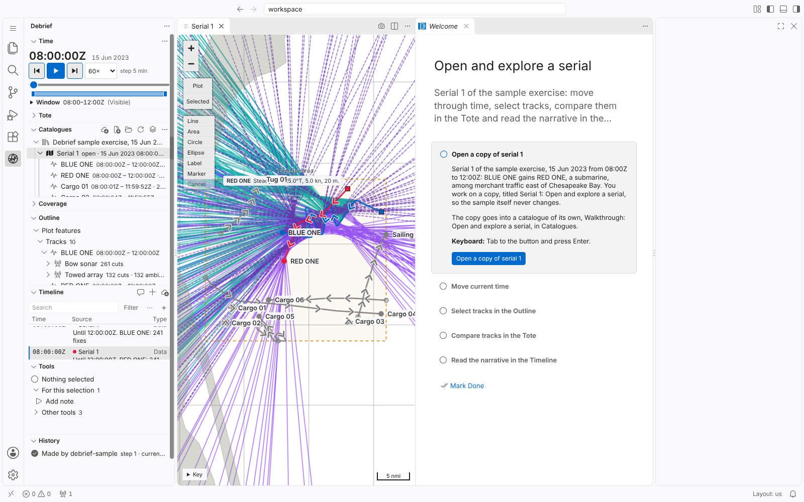

# Decision record: a hosted VS Code for analyst review

30 Oct 2026 · @Ian Mayo · **Decided**, built in [deploy/review](../../deploy/review/README.md)

Tags as in the decision logs: **DEC** decided · **OPEN** unresolved · **CAUTION** accepted risk.

## Context

- Analyst PCs block WebAssembly in the browser. The playground (DEP-06) runs the Python tools in Pyodide (CON-09), so it cannot start there, and analysts cannot review through it.
- Test on an analyst PC, 30 Oct: vscode.dev loads, opens files and edits them. Syntax colouring and the built-in *anycode* extension fail, both for want of WebAssembly. Nothing Debrief uses depends on either.
- VS Code is the primary host (DEP-01). Reviewing in VS Code itself shows analysts the real views, menus and QuickPicks, and removes the playground checklist's "cannot show" list ([playground-review.md](playground-review.md)).

## Decision

- **DEC** Run [code-server](https://github.com/coder/code-server) (VS Code served to a browser) on Heroku as a review instance. The extension is installed from its VSIX (DEP-02) and the Python tool service runs beside it in the container, as on a desktop. The browser needs no WebAssembly.
- **DEC** A container deploy (`heroku.yml` and a Dockerfile). The image holds the sample catalogue (DEP-08), and each start copies it into a fresh workspace, so code-server is listening well within Heroku's 60-second boot limit. Nothing persists: a restart, at least daily on Heroku, resets it.
- **DEC** One shared password, held as a Heroku config variable. code-server includes a terminal; open to all, it would be a free shell on our Heroku account, and such instances are found by scanners within days.
- **DEC** A Standard-2X dyno (1 GB), enough for two reviewers at once. Measured: code-server about 380 MB, and each browser window about 300 MB more (its extension host and tool service). Two at once is enough (Ian Mayo, 30 Oct); a `performance-m` dyno (2.5 GB) would serve about seven.
- **DEC** The playground stays as the public demonstration (DEP-06) and the blog's examples (DEV-06). The review instance is in addition to it.

## Tested

Locally, 30 Oct, in the image Heroku builds, run as a user with no account entry, in Chromium with WebAssembly removed (`--jitless`): sign-in, the Debrief views, opening serial 1 (map, Outline, Timeline, Time, Tools from the tool service) and a walkthrough's copy of serial 1 all work. The only error is VS Code's own syntax colouring wanting WebAssembly.

- The extension failed to start for a user with no account entry: Node's `userInfo()` throws, and the extension used it for the analyst's name in a plot's history. It now falls back to `USER`, which the review copy sets to `reviewer`.

## Alternatives considered

- **Desktop VS Code with the VSIX on analyst PCs.** The eventual route, and VS Code is already present (decision, 11 Oct). Rejected for review because each build would need IT to install it and a matching Python (DEP-03), too slow for a review cycle. *Proxy: not confirmed with IT.*
- **GitHub Codespaces.** The same browser UI with no hosting to run, but every analyst needs a GitHub account.
- **A sign-in proxy (GitHub or Google) instead of a password.** Per-person and revocable, but needs an account per analyst. Revisit if the password leaks or reviewers multiply.
- **openvscode-server.** Much the same; code-server has a password built in.

## Cautions

- **CAUTION** Any file a reviewer opens is uploaded to Heroku (hosted by Salesforce, US or EU region). Reviewers are stakeholders who know this is a review copy and will not open sensitive data; risk accepted, Ian Mayo, 30 Oct. The sign-in page says so in one line. This is not the public instance: it is behind a password and runs the desktop build, so DEP-07's in-browser promise and CON-09 do not apply to it. DEP-06 may gain a note that a private review instance exists.
- **CAUTION** One shared instance: every reviewer sees the same workspace, files and undo history. Acceptable on sample data; one app per reviewer if it gets in the way.
- **CAUTION** The password is the only control. Heroku's Common Runtime has no IP allow-list.
- **CAUTION** A restart drops whatever a reviewer has open. Feedback must be recorded somewhere other than the instance.

## Open

- **OPEN** WebSockets through the analysts' proxy. vscode.dev on local files does not need them; code-server does, continuously. The first deploy settles it. If they are blocked, no hosted VS Code will work, and the desktop route is the fallback.
- **OPEN** Heroku closes a WebSocket idle for 55 seconds. code-server's keep-alive is expected to cover it; confirm on the first deploy.
- **OPEN** Where reviewers' feedback goes (GitHub issues, the review checklist, or a shared doc).
