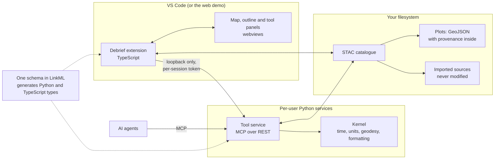

# How Debrief v4 fits together

Debrief v4 starts with foundations rather than features. Here is the shape everything else will hang from.

<!-- more -->

A few choices shape everything:

- **Plots are plain files.** A plot is a GeoJSON FeatureCollection, catalogued with STAC and carrying its own provenance. Anyone can read it without Debrief, and access control is simply the folder's permissions.
- **Analysis lives in Python.** Every operation is a Python tool served over MCP, so the same tool serves the Debrief interface, an analyst's script and an AI agent. A scientist adds a tool by writing a Python file, without rebuilding Debrief.
- **One vocabulary.** Every type that crosses between Python and TypeScript is generated from a single LinkML schema, so the two sides cannot drift apart.
- **Everything is recorded.** Each change to a plot is recorded so it can be replayed, which is also how undo works.
- **The web demo runs the same tools.** In the browser, the Python tools run under Pyodide; nothing is sent to a server.

The first foundations are in place: the schema and its generated types, and a kernel for time, units, geodesic measurement and display formatting. Three early checks came back positive. The schema approach works end to end; the Python code runs unchanged in the browser; and asking the Python service for each Tote update takes a few milliseconds, well inside the 100 ms an analyst needs to drag the time slider smoothly.
