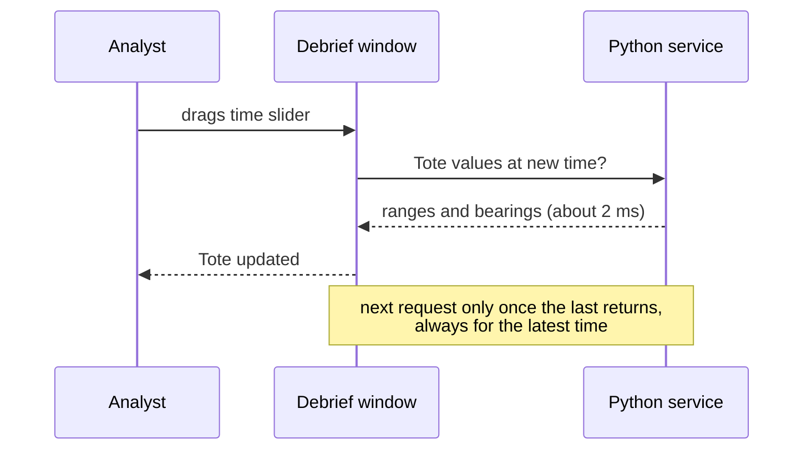

# Fast enough to drag

When you drag the time slider or a target solution, the numbers must keep up with your hand. We measured whether they will.

<!-- more -->

The Tote shows range and bearing to other platforms at the current time, and it must update within a tenth of a second of the slider moving. In Debrief v4 those numbers come from the Python service, one request per movement.

Each request took about 2 milliseconds, and never more than 7, even with twenty platforms: comfortably inside the tenth of a second.

Dragging a target motion analysis solution is harder, because every bearing in the period must be recomputed. With thousands of bearings, the straightforward code took a fifth of a second, too slow. Computing them all at once instead brought six hours of bearings at one a second down to under 40 milliseconds.

We measured on a development machine, so we will check again on an analyst's laptop before the target motion analysis work begins.
