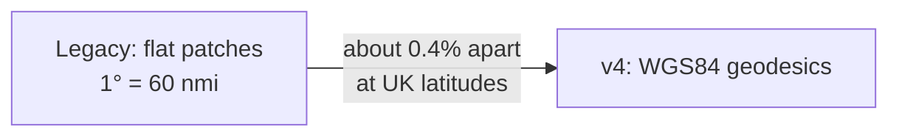

# Measuring on the real Earth

Debrief v4 measures ranges and bearings along the true shape of the Earth. Legacy Debrief did not, so some figures will change slightly.

<!-- more -->

Legacy Debrief treated each small patch of sea as flat, with one degree of arc equal to 60 nautical miles. Debrief v4 measures along geodesics on the WGS84 ellipsoid, the same model as GPS, whatever projection the map uses.

The difference is small but not zero. Worst cases, across every bearing:

| Latitude | Range | Range differs by | Bearing differs by |
| --- | --- | --- | --- |
| 50° | 1 nmi | 7 m | 0.09° |
| 50° | 10 nmi | 70 m | 0.16° |
| 50° | 50 nmi | 350 m | 0.5° |
| 70° | 50 nmi | 430 m | 1.1° |

Try it: drag A and B and watch the two answers part company. Move them further north, or further apart, and the difference grows.

If you compare a v4 figure with one from an old report, expect differences of this size. Bearing residuals in target motion analysis are the most sensitive: a solution built in legacy Debrief will not show exactly the same residuals in v4.

Every value shown on screen also goes through one formatting service, so knots, nautical miles, three-figure bearings such as `045.0°T`, and Zulu times look the same everywhere.
