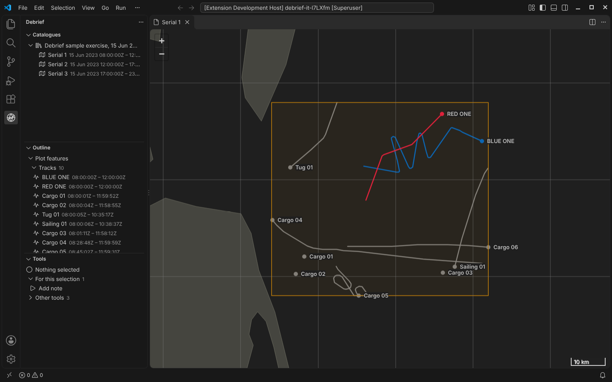
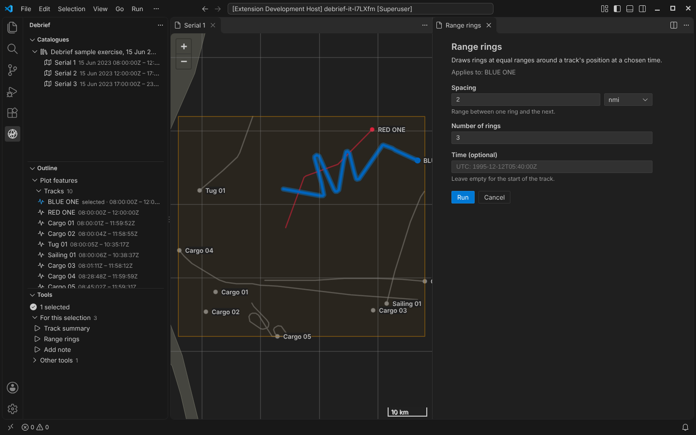
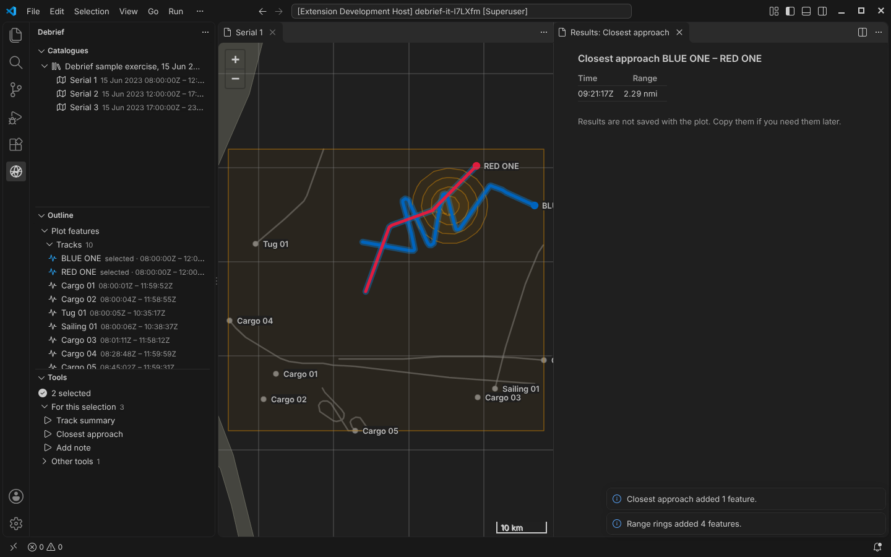
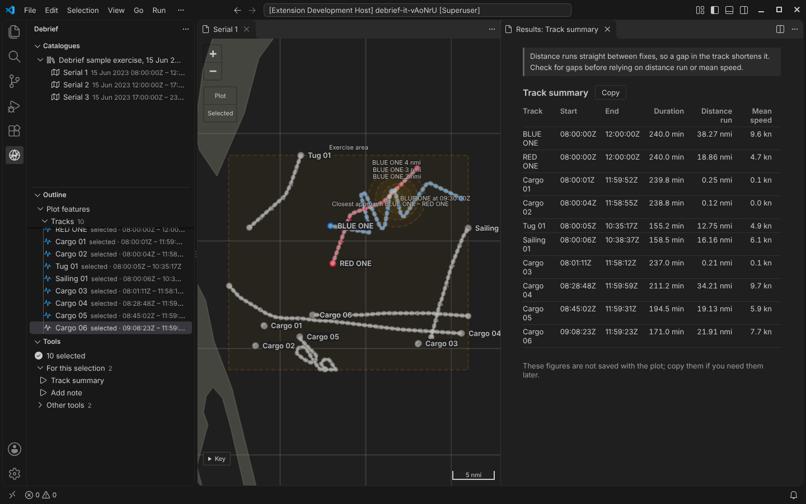
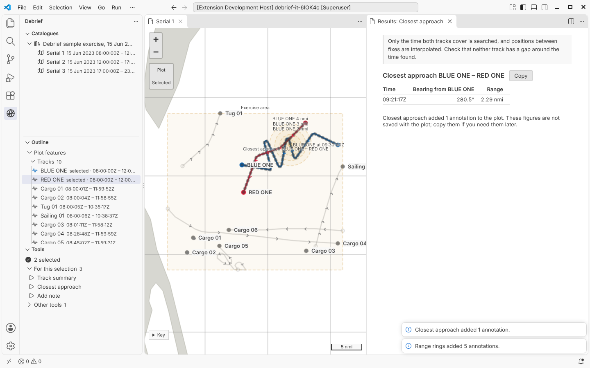

# Load and look: the whole path, end to end

Phase 1's job is to prove the architecture by walking one path all the way through. You open a catalogue, see a plot on a map, select tracks, run a Python tool, and see its result on the map. That now works in VS Code.

<!-- more -->

!!! note "Update, 11 October 2026"
    The demo below is today's Debrief, so it includes features added since this post was written, such as the time control along the bottom of the map and undo.

*Every picture here comes from CI. A test drives the real VS Code, with the real extension and the real Python tool service, on Debrief's sample exercise. It takes these screenshots as it goes, so they can't drift from what the software does.*

## Catalogues, plots and the map

The **Catalogues** view lists the folders Debrief knows about and the plots in each. Here that's the sample exercise: three serials on 15 June 2023, built by the sample data workstream.

Opening a serial shows it on the map:

- **BLUE ONE and RED ONE.** These are synthesised exercise tracks. Each was imported from a REP file that is kept, unchanged, as a source.
- **The background picture.** The grey tracks are real, anonymised open AIS data.
- **The exercise area.** An annotation drawn in amber.

The map is Web Mercator, but every line follows the geodesic: the path a vessel actually takes. A straight line on a Mercator chart is not that path ([why it matters](2026-10-11-geodesic.md)).

The **Outline** shows the plot's features, its supporting files and its reference data. The **Tools** view shows which tools apply to what is selected.

## Selecting, and the tools on offer

Select a track on the map or in the outline, and every view follows. The tools view asks the Python tool service which tools apply to everything selected.

- **On offer.** With one track selected you're offered *Track summary*, *Range rings* and *Add note*.
- **Not on offer.** *Closest approach*, which needs two tracks, waits under **Other tools** in VS Code, saying so; in the demo below it is greyed out, with the reason beside it. Nothing is hidden without a reason.

Try it here. Select BLUE ONE in the outline, Ctrl-click RED ONE, and see what's on offer:

## A form from a declaration

Nobody wrote this form. Debrief builds it from the tool's declaration in Python:

- the explanation;
- what the tool will act on;
- a distance with a unit picker;
- a whole number;
- an optional time.

The same declaration tells an AI agent what the tool needs, because the tool service speaks MCP.

## Running tools

**Range rings** draws geodesic circles around BLUE ONE at 09:30Z. **Closest approach** finds when BLUE ONE and RED ONE were nearest: 2.29 nmi at 09:21:17Z, bearing 280.5° from BLUE ONE. It draws the line between them, and puts the figures in a results panel beside the map. The panel repeats the tool's caveat, and says what was saved to the plot and what was not.

Every run that changes the plot is saved with its history: the tool, its version, who ran it, what was selected, and every value on the form. That's the start of being able to replay an analysis from its sources.

**Track summary** gives the start, end, duration, distance run and mean speed of each selected track. Its explanation warns that a gap in the track shortens the distance.

## Your theme, our colours

Debrief takes its interface colours from your VS Code theme, light, dark or high contrast. The data keeps its own colours whatever the theme: red is red and blue is blue, as in legacy Debrief. A check in CI fails if anyone hard-codes an interface colour.

## What's underneath

- **Configuration.** One per-user file lists the catalogues you know. The Python services and the extension read it by the same rules.
- **The tool service.** Each user runs their own, listening only on their own machine and requiring a token issued at start-up. Tools run in a separate worker process, so a tool that hangs or crashes fails its own run and nothing else.
- **Four tools.** The first four are ordinary Python. CI runs them in the browser under Pyodide too, ready for the web demo.
- **Reviewed before merging.** Each piece was reviewed before merging by a panel of specialists:
  - security and protocol;
  - Windows deployment;
  - a scientist writing their first tool;
  - an exercise analyst on the sample data;
  - a VS Code engineer and a human-factors specialist on the interface.

## Not yet

- **No time controller.** There is no current time to follow yet (Phase 3).
- **Bearings aren't drawn.** They are imported but not shown on the map (Phase 4).
- **No undo.** That arrives with replay in Phase 2.
- **Coarse coastline.** Proper reference charts come with the reference tile service.
