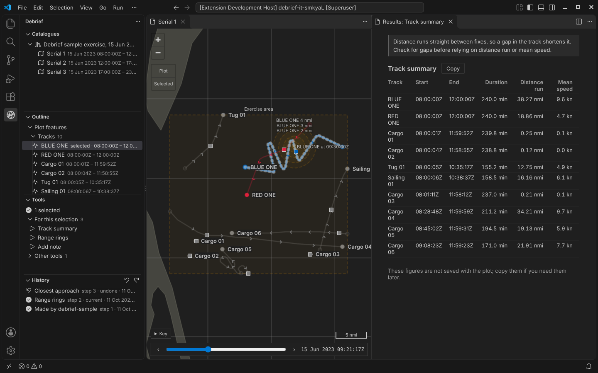
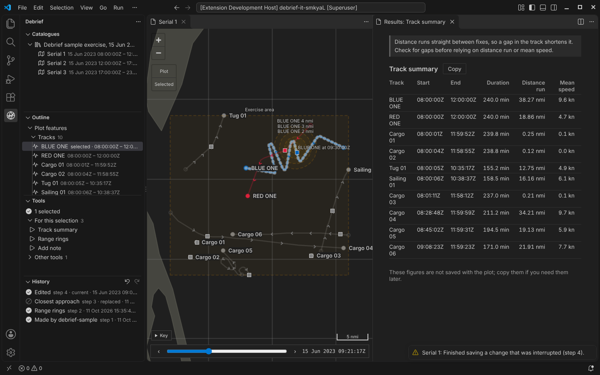
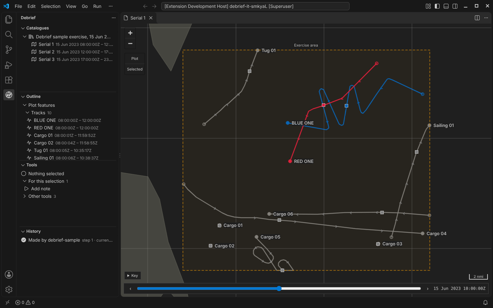
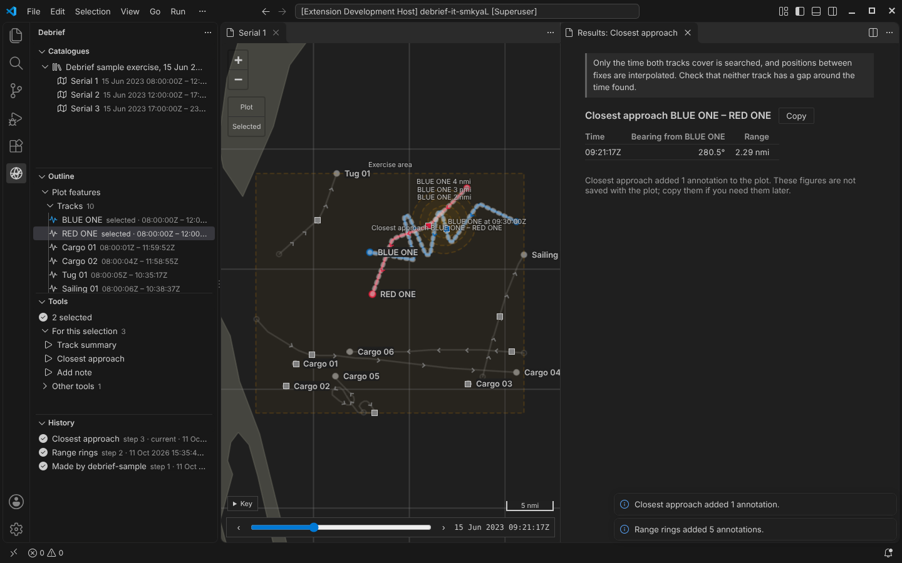
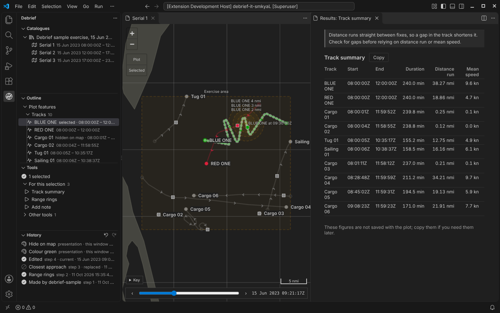

# Nothing lost: undo, crashes, and a plot shared with others

Phase 2 is about trust. An analyst should be able to try something, take it back, have Debrief die mid-save, or share a plot with a colleague who changes it at the same time, and never lose work or have it overwritten without being told.

<!-- more -->

*As before, every picture comes from the integration test, which drives the real VS Code with the real Python tool service on the sample exercise.*

## Every change is a step

Each change to a plot is now recorded as a step: an import, a tool run, an edit. A step holds two things:

- **What made it:** the tool, its version, who ran it, what they selected and every value they gave.
- **What it did:** the features added, changed and deleted.

The plot file itself is just the result of applying the steps in order. Debrief can always rebuild it from them, and does so whenever the file and the steps disagree.

The **History** view lists the steps, newest first.

## Undo is replay

Undo (`Ctrl+Z` on the map, the outline or the History view) returns the plot to the step before. Debrief does this by replaying the steps up to that point, never by asking a tool to reverse itself. That's why every tool, including one written by a scientist last week, gets undo for free.

- **Nothing is deleted.** The undone step stays in the list, marked *undone*, and **Redo** brings it back.
- **Undo leaves view state alone.** Current time and the selection stay where they are.
- **A new change after undoing replaces the undone steps.** They stay on record, marked *replaced*, but can't be redone. This was the analysts' choice: a record that never loses anything beats a branching history that's hard to follow.

## Killed mid-save, and recovered

The test kills a Debrief process part-way through saving a change: after it has written the step, before it has recorded the step as current. When the analyst opens the plot again, Debrief finishes the change and says so: *Finished saving a change that was interrupted (step 4).*

This works because of the order things are written in:

1. the step, created so that two writers can never claim the same number;
2. then where the history stands;
3. then the plot file.

A crash at any point loses at most the change in progress, and here not even that.

### Try it

Run a tool, undo it, then **Crash part-way through a save** and **Reopen the plot**:

## Someone else changed it

Plots are never locked. Two analysts can open the same plot on a shared folder, and the tool service and an agent can work on it too. Instead of locking, every change says which version of the plot it was made against.

- **While a plot is open.** If someone else changes it, Debrief shows the latest and says so.
- **When a tool run meets a change made meanwhile.** Debrief asks what to do:
  - if the two changes touch different features, it offers to **combine the changes**;
  - otherwise it offers to **save mine as a new plot**, which gets the history the analyst was working from, then their change.

  Overlapping changes are never combined automatically.

To try this, use **A colleague changes it while your next tool runs** in the demo above, then run Closest approach.

## Current time, shared

Current time, the selection and the viewport are now shared state:

- **The map** has a time control along its bottom edge, and marks where each track was at that moment.
- **Other extensions** can read and set the state.
- **Tools** see it and can change it.

*Closest approach* now moves current time to the moment it found:

## Colour is not history

Changing a track's colour or hiding a feature on the map is *presentation*. It travels with the plot, but it isn't a change to the analysis, so it's never recorded in the plot's history or provenance. It's undoable all the same: presentation changes are listed at the top of the History view, and one `Ctrl+Z` takes back whatever the analyst did last.

## Also in Phase 2

- **Legacy plots.** Debrief v3 `.dpf` files import, with every element that has no v4 equivalent named at the end of the import and recorded in the plot's provenance. Across the 46 legacy sample files, 45 import; the 46th is broken on purpose.
  Try it with a legacy plot of your own. The file is read in your browser and never uploaded:

  

- **Logs you can share.** Logs record errors and tool runs, but never plot data. Feature names and file paths become short hashes, and tool parameters are logged by name and type, never by value.
- **A newer Debrief, an older catalogue.** If saving would write a newer data format into a catalogue colleagues share, Debrief asks first.

Every part of this went through review by an expert panel: data integrity, crash safety and concurrency, a VS Code engineer, and an analyst. Each panel found real problems, including a race that could lock a plot against all further changes and a quick double undo that was reported as a conflict. All of them are fixed, and each has a test that fails without the fix.
