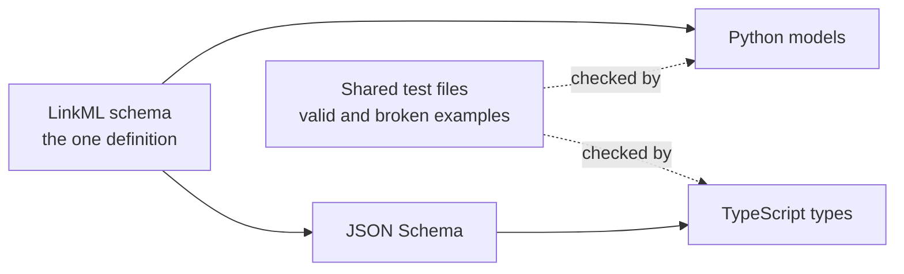

# One schema, two languages

Debrief's analysis runs in Python and its interface in TypeScript. Every piece of data that passes between them is defined once, so the two sides cannot quietly disagree.

<!-- more -->

The schema describes plots, catalogues, the history of every change, tools and their parameters, and the analyst's display settings. From it we generate Python and TypeScript code; nobody writes those types by hand.

A few things we settled along the way:

- **Units travel with the numbers.** A speed is stored as `{"unit": "m/s", "values": [...]}`, so a file can never leave you guessing. A speed labelled in degrees is rejected in both languages.
- **A plot is still plain GeoJSON.** Positions stay as longitude and latitude in degrees, so any GIS tool can read a plot without Debrief.
- **The same examples test both sides.** Over seventy example files, some valid and some deliberately broken, are checked by Python and by TypeScript. A plot written by one and read by the other comes back unchanged.

LinkML needed some help: its TypeScript output was unusable, and a few of its Python and JSON Schema outputs disagreed with each other. Each workaround now has an example file that would catch it coming back.
