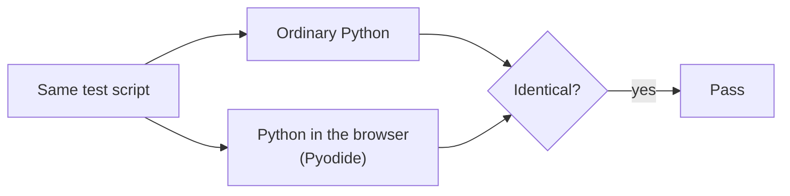

# Debrief's Python, in your browser

The public demonstration of Debrief will run its Python analysis tools inside your web browser. We checked that it works before building on it.

<!-- more -->

Pyodide is Python compiled to run in a browser. We ran the same test under ordinary Python and under Pyodide and compared every answer: geodesic measurements, closest approach, formatted values and over eighty example files.

The answers were identical. Calculations run about half as fast in the browser, which is still far quicker than an analyst can notice, and the demonstration needs a few seconds to start.

This check now runs on every change. It also sets a rule for the future: any library a Debrief tool relies on must be able to run in the browser too, or the tool must say plainly that it is only available on the desktop.

Nothing in the demonstration leaves your browser, and it only ever holds unclassified sample data.
