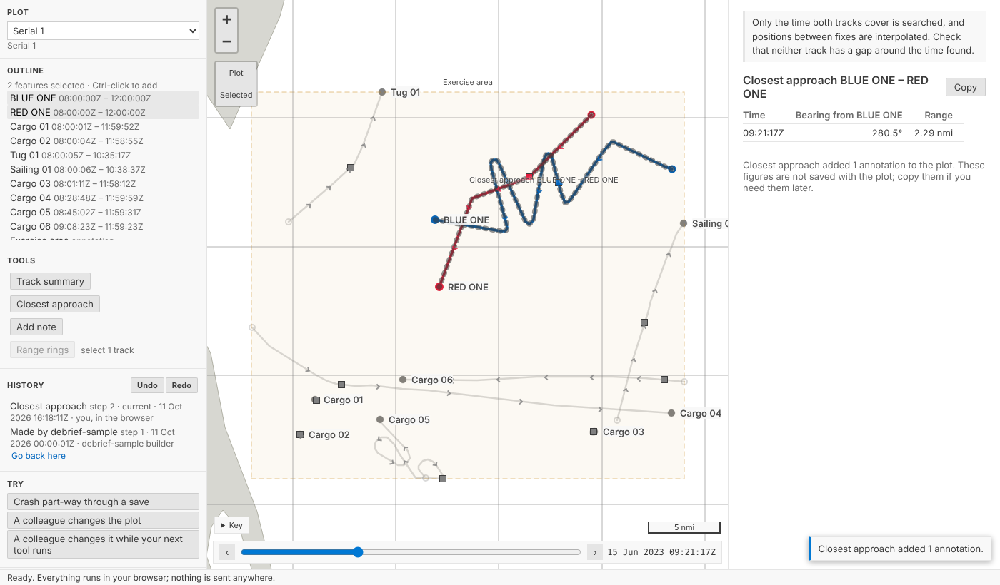
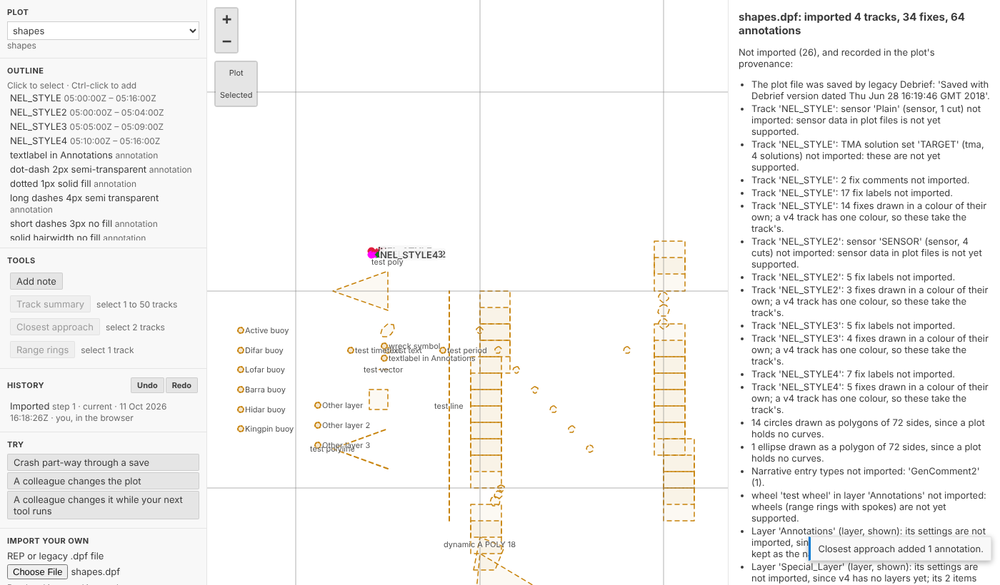

# Try it in your browser

You no longer need to install anything to try Debrief v4. The blog now has demos you can play with: the real map, tool forms and Python tools, running in your browser.

<!-- more -->

## It's the real thing

The demos are not mock-ups. They use exactly what the VS Code extension uses:

- **The map, tool form and results panel** are Debrief's own webviews, unchanged. The page around them plays the part of VS Code.
- **The Python** is Debrief's own: the catalogue, plot history, tools and importers. It runs under [Pyodide](https://pyodide.org), installed from the same packages the desktop uses.

The sample exercise is copied into your browser's memory. Every change, undo and crash happens there, and is gone when you close the page. Nothing is sent anywhere.

## Where to play

- **[Try Debrief](../../try.md)**: everything in one place.
- **[Load and look](2026-10-11-load-and-look.md)**: select tracks and see which tools are offered.
- **[Nothing lost](2026-10-11-nothing-lost.md)**: undo, a crash mid-save, and a colleague changing the plot while your tool runs. It also has a demo for importing your own legacy `.dpf` or REP file, which never leaves your browser.
- **[Measuring on the real Earth](2026-10-11-geodesic.md)**: drag two positions and compare Debrief v4's range and bearing with legacy Debrief's.

## It already found a bug

Building the demos showed that Pyodide's Python has no hard links, so saving a change failed in the browser. Saving now works there. The Pyodide check that CI runs on every change now saves, changes, undoes and redoes a plot, and requires the same answers as on the desktop.

Every demo is also played in CI, in Chromium, as a reader would play it. If a change breaks a demo, the build fails.
