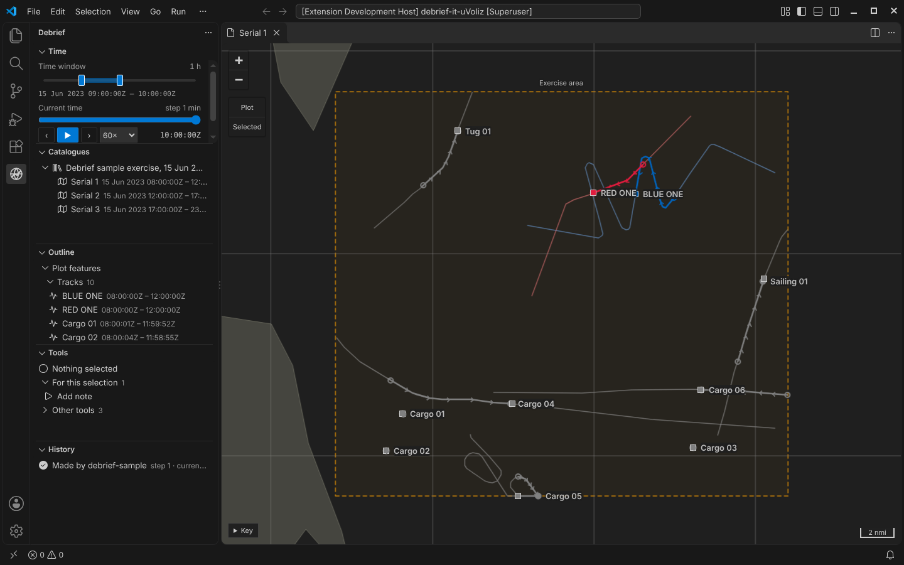
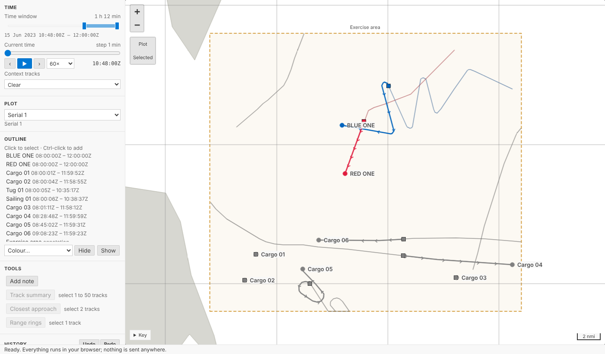
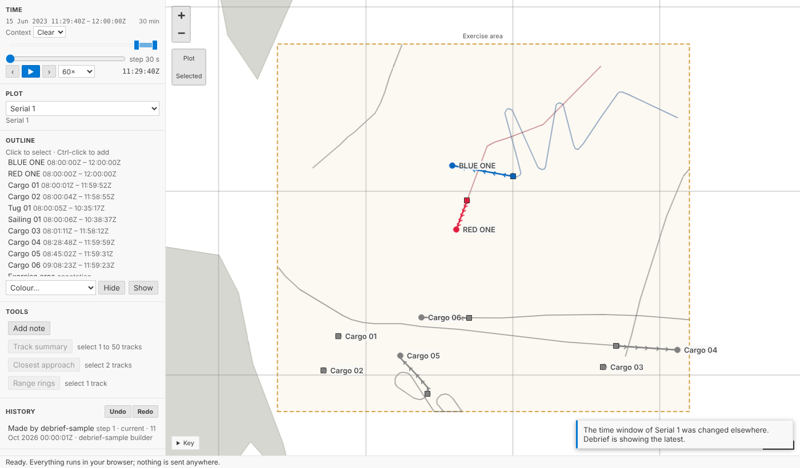
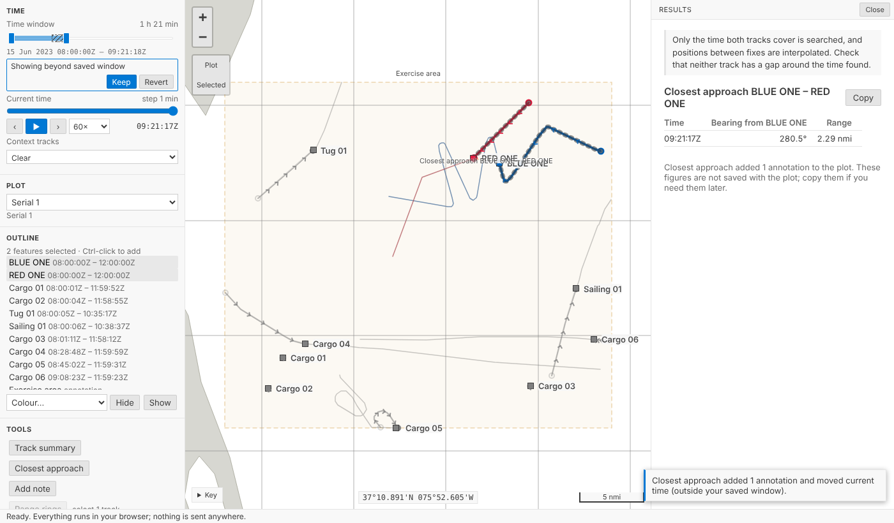

# One window, one file: the time controller

Debrief now has a time controller. The analyst sets one time window for the whole plot, plays through it at a chosen speed, and hands the plot file to a colleague, who opens it on the same window.

<!-- more -->

*The VS Code picture comes from the integration test, which drives the real VS Code with the real Python tool service on the sample exercise. The others come from the playground test, which plays the demo below in a browser.*

## The controller

In VS Code the controller is the **Time** view, at the top of the Debrief sidebar. The catalogues, outline, tools and history stay below it. The map no longer has a control along its bottom edge; it only draws. The playground has the same component at the top of its side column.

It has three parts:

- **Time window.** A slider with two handles over the plot's whole period. Drag a handle to move that end, or the band between them to move the whole window.
- **Current time.** A slider over the window, never outside it. **‹** and **›** step back and forward. The step is about a hundredth of the window, and the controller shows it.
- **Play.** **▶** (or Space on any slider) plays current time forward and stops at the end of the window.

The speeds are 1×, 10×, 60×, 600× and 3600× real time. Exercise serials last hours and deployments last weeks, so the speeds run from watching a close-quarters encounter as it happened (1×) to crossing a week in under three minutes (3600×). The default, 60×, plays a minute of the exercise each second, so a four-hour serial takes four minutes.

Everything works from the keyboard. The arrow keys move a handle or current time by a step, Page Up and Page Down by ten, and Home and End to the ends. Each slider says its time to screen readers. The [time controller](../../guides/interaction-models/time-controller.md) interaction model has the full table.

## What the map shows

Within the window, tracks are drawn in full: solid lines, direction ticks, a hollow dot at the first fix in the window and a labelled dot at the last. Outside the window, each whole track stays as a thin, solid line in a quieter version of its colour: a *context track*.

Hiding everything outside the window would be cleaner, but it would lose the shape of the exercise, and for deployments the requirement is to see a whole deployment's tracks at once, with sensor data limited to the window. So the context track stays, with no ticks, dots or labels to compete with the window. It is drawn at least 3:1 against the map on any theme, so it is quiet without being hard to see. A busy plot can draw it **faint** instead, or turn it **off**, from the **Context tracks** list under the controller.

Annotations with a time or a period are drawn only while it falls in the window. Annotations without one, such as the exercise area, always are.

Bearings aren't drawn yet. When they are, they'll be drawn only within the window. Weeks of bearings at once would be unreadable, and the window is also how Debrief will keep millions of observations off the screen.

## Moving shows; letting go saves

The map follows the window as you drag it, but the window is saved only when you let go: when you release the pointer, or the key. Holding an arrow key down saves once.

Saving on every movement would rewrite the plot file many times a second. On a shared folder, a colleague's Debrief would see a stream of changes to the file and have to check each one.

## One plot file

Analysts asked for one thing above all: a plot they can hand to a colleague as one file, with nothing beside it. That decided where everything lives.

| | Where it's kept | Undo | In the history |
| --- | --- | --- | --- |
| Tracks, annotations, tool results | The plot file, through its history | Yes | Yes |
| A track's colour, what's hidden | The plot file, through its history | Yes | Yes |
| Time window, how context tracks are drawn | The plot file, in its *island* | No | No |
| Current time, selection, viewport | Nowhere: they're shared while the plot is open | No | No |

Colour and hiding are part of the analysis: turning a friendly blue track red once it proves hostile is a judgement, and it belongs in the record. The window isn't. Moving it is how the analyst looks at the plot, not a change to it, and it would swamp the history with steps nobody wants to undo.

So the window lives in the plot's *island*: a small part of the plot file that the history ignores. The window travels with the file, but:

- **It's never a step.** The History view doesn't list it, and its provenance doesn't record it.
- **Undo leaves it alone.** `Ctrl+Z` takes back the last change to the plot, never a move of the window.
- **It never conflicts with a change to the plot.** A colleague can run a tool while you move the window, and neither of you is asked anything.

## A colleague's window

The window is still shared through the file, so two people can change it at once. Debrief watches the plot file as well as its history. When a colleague's window arrives, Debrief shows it without reading the plot's content again, and says so.

If you let go of a window after a colleague changed theirs, yours isn't saved over it. Debrief shows theirs and says: *Someone else changed the time window, so yours was not saved.* Set it again if you still want yours. That's the same rule as every other change: nothing is silently overwritten.

## Update, later on 12 Oct: three changes from an expert panel

We asked a panel (an analyst, an interaction designer, an accessibility specialist and a data-integrity reviewer) three questions the first version left open. They agreed unanimously, and the controller now does this:

- **Context tracks you can see.** The faint line was too faint on some themes. A context track is now clear by default: at least 3:1 against the map, worked out from the theme for every colour Debrief gives a track. A plot can still draw them faint, or not at all; that choice is saved with the plot, like the window. If you need the contrast everywhere, the setting **Debrief › Map: Minimum Context Contrast** draws faint as clear on every plot you open. High-contrast themes draw them in full colour.
- **A window of at least a second.** The handles stop a second apart and never cross. When the window is too short to play at the chosen speed, **Play** is off and says why: *Window too short to play at 60×: widen it or slow down*.
- **A tool's time outside your window is shown, never saved.** Closest approach moves current time to the moment it finds. If that's outside your window, the window on screen widens just enough to take it in (to at most twice its length; beyond that it moves instead). The part that differs is hatched, the tool's message adds *(outside your saved window)*, and a note stays until you choose: **Keep** saves the window shown; **Revert** goes back to yours. Dragging the window counts as Keep. Nothing a tool does is ever saved as your window behind your back, so a colleague opening the plot sees the window you chose.

### Try it

Narrow the window, play, then press **A colleague changes the time window**. Note that **History** doesn't change. Then narrow the window to before 09:00, select BLUE ONE and RED ONE, and run **Closest approach**:

## Not yet

- **Bearings**, drawn only within the window, arrive with sensor data.
- **The window following current time** while playing, so a fixed-length window slides along an exercise.
- **Choosing the step.** For now it's a hundredth of the window.
