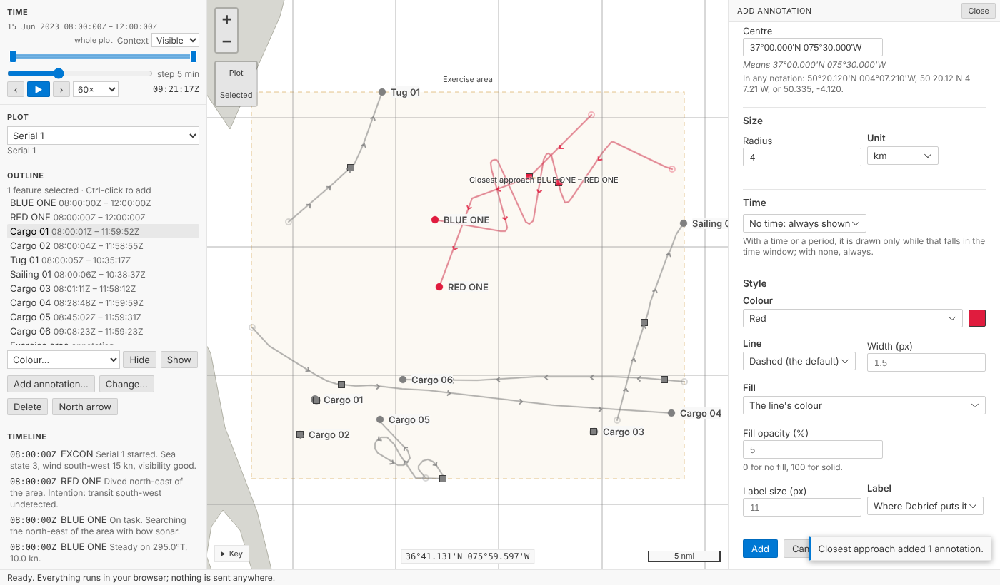
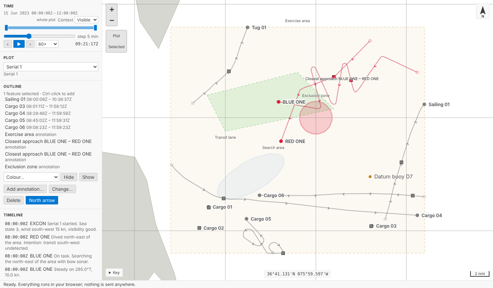
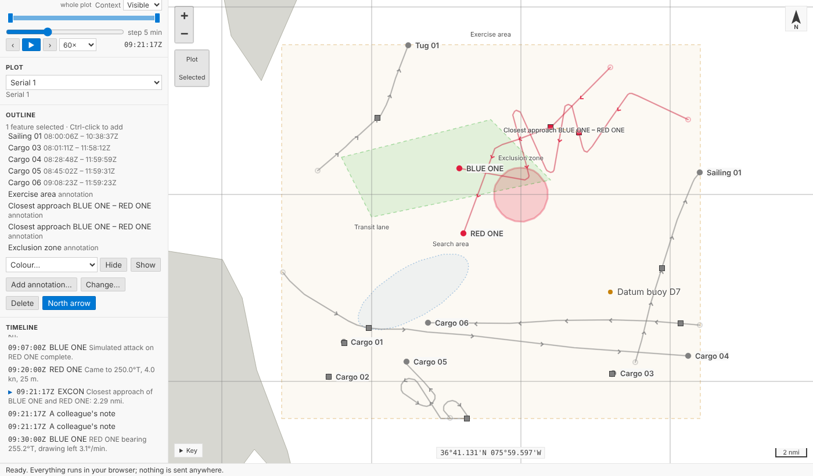
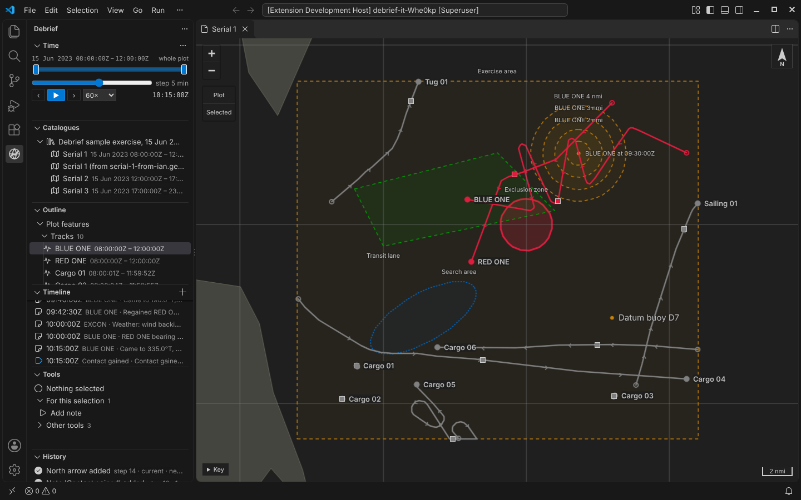
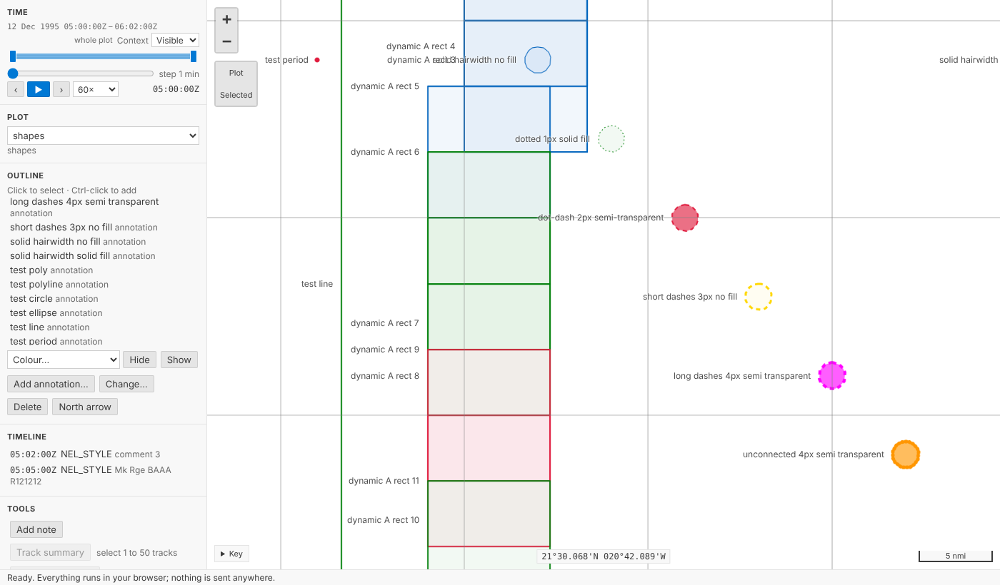

# Annotations

Analysts can now add lines, areas, circles, ellipses, labels, markers and notes to a plot through a form, style them, give them a time, change and delete them. Each is one step in the plot's history, so `Ctrl+Z` takes it back. Notes are listed in a new Timeline, and legacy plots bring their circles, ellipses and styling with them.

<!-- more -->

*The VS Code pictures come from the integration test, which drives the real VS Code with the real Python tool service on the sample exercise. The others come from the playground test, which plays the demo below in a browser.*

## Forms first

The product owner asked for annotations through forms first, and drawing on the map second. A form is exact: an exclusion zone is "4 km around 37°00.000'N 075°30.000'W", not wherever the pointer landed, and a form works the same from the keyboard, for a screen reader and for an agent.

**Add annotation…** opens the form beside the map. Choose a kind:

| Kind | Is |
| --- | --- |
| Line | a line through two or more positions |
| Area | a closed area with three or more corners |
| Circle | every position at one range from a centre |
| Ellipse | an ellipse about a centre, its longer axis along a true bearing |
| Label | text at a position |
| Marker | a marked position |
| Note | text at a time, with no position |

Positions are typed the way analysts write them: `50°20.120'N 004°07.210'W`, `50 20.12 N 4 7.21 W`, `N50 20.12 W4 7.21`, degrees, minutes and seconds, or two decimals. Under each, the form says what it understood, *Means 50°20.120'N 004°07.210'W*, so a slip shows before it is saved. Python and TypeScript read positions the same way, held to one shared set of test cases.

A radius, or an ellipse's semi-axes, is a number and a unit (nautical miles, yards, metres or kilometres), and the unit is kept with the value: a circle of 2 nmi stays 2 nmi for an analyst who reads ranges in yards. An ellipse's orientation is degrees true.

Anything wrong is said beside its field (*Give the radius, a number more than zero*), and nothing is saved until it is right.

## One step each

Adding an annotation is one step in the plot's history, named so the History view reads like a log: *Circle 'Exclusion zone' added*. So is every change through the form: *Style of Circle 'Exclusion zone' changed* when only its look changed, *Time of …* when only its time did, *… renamed …*, or *Circle 'Exclusion zone' changed* for anything else. Deleting is a step too, and named sets keep their other members.

Style is content, the same decision as a track's colour on 12 October: turning a zone red is an analyst's judgement, so it is recorded and undoable. An annotation can have its own colour, a solid, dashed or dotted line of any width, a fill and how opaque it is, and its label's size and place. Left alone, annotations are drawn as before: amber and dashed, so nothing a tool draws is mistaken for a track.

The form is the same path an agent takes. The tool service has `debrief/add_annotation`, `debrief/edit_annotation`, `debrief/delete_annotations` and `debrief/set_north_arrow`; the forms call them, the playground calls the same Python, and an agent can restyle a zone by sending only `{"appearance": {"line_style": "solid"}}`.

## Circles in a format without curves

GeoJSON, which plot files are, has no circles. We had two choices:

- **A point with a radius.** Small and exact, but any other GeoJSON tool would show a point, and a plot's extent (what "zoom to plot" fits) would leave the circle out.
- **A polygon approximating it, with the exact centre and size beside it.** Other tools see the area; Debrief reads the centre and size.

We chose the second. A circle or an ellipse is a polygon of 72 sides, each corner reached along the geodesic from the centre, so QGIS or geojson.io draws the zone. Its `shape`, `centre`, `radius` (or `semi_major`, `semi_minor` and `orientation`), each with its unit, are ordinary properties. Debrief draws it from those, smoothly and along geodesics at any zoom, and the form edits those. Change the radius and the polygon is made again; a rule checked on reading refuses a polygon that no longer matches its centre and size, so the two can't drift apart.

## Time, and the Timeline

An annotation can have a time, a period, or none. With a time or a period it is drawn only while that falls in the time window, as the time controller already does for annotations tools draw; with none, always.

Notes have a time and no position, so they don't appear on the map. They are in the new **Timeline**: a view under the outline listing the plot's notes and periods in time order. The sample exercise's narrative (*Bow sonar contact*, *Contact classified submarine*) is there already. Choose an entry and current time moves to it; the map and every other view follow. The entry current time is at is marked, and in VS Code the view keeps it in sight while playing, so the narrative can be read along with the replay.

If the entry's time is outside the window you're looking at, the window widens or moves to show it, without saving anything: the same rule as for a tool's time, with **Keep** and **Revert** on the time controller.

It is deliberately simple: a list, not a chart. It's a native view in VS Code, so it works from the keyboard and with screen readers like every other view.

## Chart furniture

The scale bar was already there, in the analyst's distance unit. A plot can now carry a north arrow: **North arrow** on the Outline view's menu adds it, and removes it again, as a step. The map is Web Mercator, so north is up everywhere and the arrow simply points up. Grids, legends and inset maps aren't done; they wait for a need.

## Legacy plots keep their look

The `.dpf` importer listed *colours, fonts, fills and line styles of annotations* as not imported, and turned circles and ellipses into anonymous polygons. Now a legacy circle is a circle, with its centre and radius, and an ellipse keeps its axes and orientation. Each annotation keeps its colour, its line style and width, its fill (semi-transparent or solid), its label's size and its label's place. Those leave the list of what wasn't imported.

Some of the legacy look has no v4 equivalent yet, so it is still listed, counted and named: label symbols (*Carrier*, *Wreck*), fonts other than plain Arial (the size is kept), label colours that differ from the line, arrowheads, and the dash patterns v4 doesn't have (long dashes, short dashes and dot-dash are drawn dashed; unconnected points dotted). The `.dpf` file stays in the catalogue as the plot's source, so re-importing it later recovers what a later version can hold.

## Try it

Press **Add annotation…** under the outline, name a circle, give it a radius and a colour, and press **Add**. Select it, press **Change…**, make it solid and filled, and save. Then `Ctrl+Z`: the style goes back. Choose an entry in the **Timeline** and watch current time move:

## Not yet

- **Drawing on the map.** Placing and dragging positions with the pointer is part B.
- **Arrowheads, label symbols and more chart furniture.** Listed when a legacy plot has them.
- **Changing an annotation's kind** once made: delete it and add another.
- **Circles across the antimeridian** are drawn whole in Debrief, but their polygon, for other tools, is not split there as GeoJSON advises.
