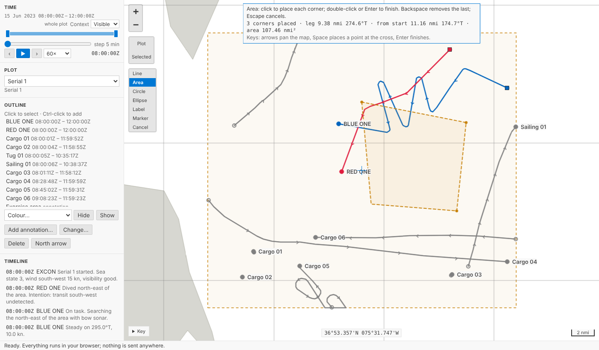
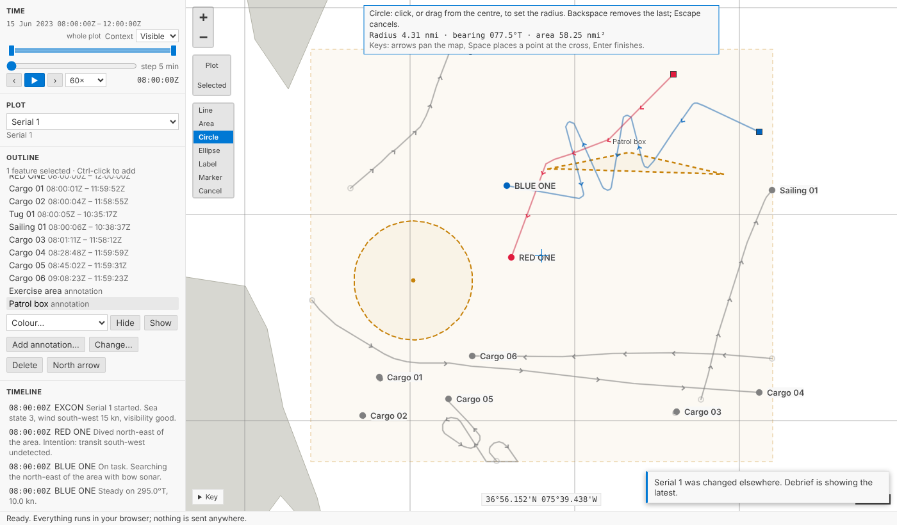
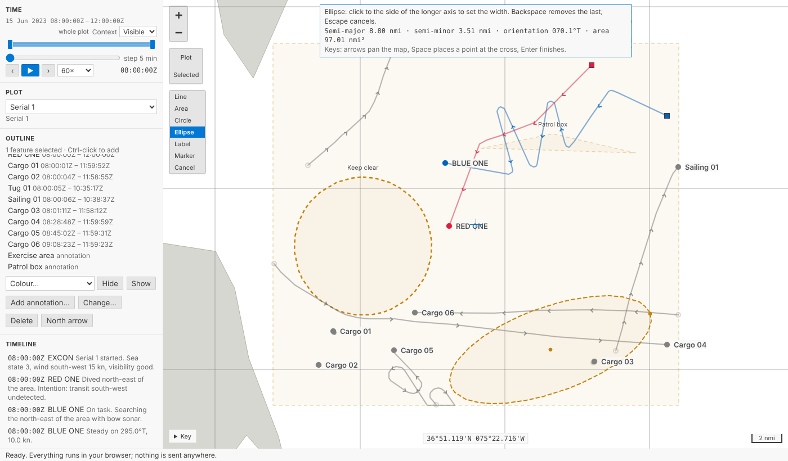
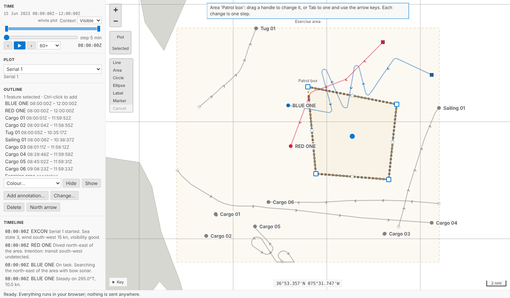
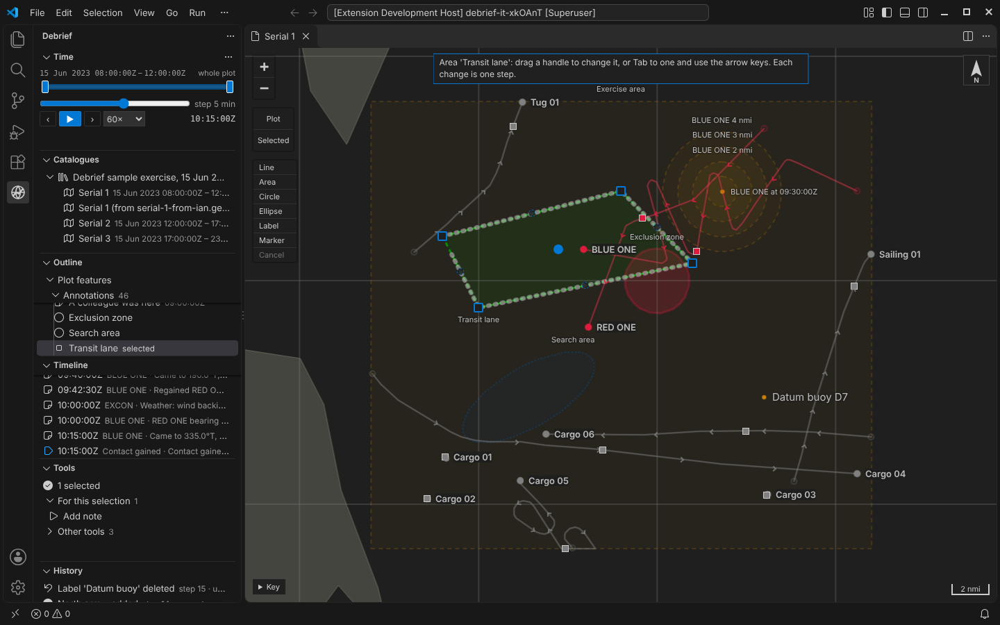

# Drawing on the map

Annotations can now be drawn straight onto the map: a line, an area, a circle, an ellipse, a label or a marker, with the range, bearing and size shown as you draw. Select one and handles appear, to drag a corner, move a circle or turn an ellipse. Each finished annotation is one step in the plot's history, and so is each change, so `Ctrl+Z` takes it back. Everything can also be done from the keyboard.

<!-- more -->

*The playground pictures come from the playground test, which plays the demo below in a browser with the pointer and the keyboard. The VS Code picture comes from the integration test, which drives the real VS Code with the real Python tool service.*

## A toolbar on the map

This morning's post added annotations through a form, which is exact: "4 km around 37°00.000'N 075°30.000'W". Often, though, an analyst wants a box around where the contacts were, or a circle about there. That's quicker to draw than to type.

The map now has a small toolbar under the zoom buttons: **Line**, **Area**, **Circle**, **Ellipse**, **Label**, **Marker** and **Cancel**. Choose one and the map changes mode: the button stays pressed, the map gets a focus outline, the pointer becomes a cross, and a note at the top says what to do next. It doesn't touch current time, the time window or the selection.

For a line or an area, click each position or corner, and double-click the last (or press `Enter`). `Backspace` takes away the last point; `Escape` stops and keeps nothing. As you go, the map says what you've drawn in your own units: the leg to the pointer, the range and bearing back to the start, and the length so far or the area enclosed. Ranges and bearings are along geodesics, like everything else Debrief measures (see [Measuring on the real Earth](2026-10-11-geodesic.md)).

## Circles and ellipses

A circle is a centre and a radius: click the centre and click again at the radius, or press at the centre and drag outwards. The note says the radius, its bearing and the area inside it as you drag.

The radius that's saved is the one the note showed, in your length unit and to the decimals you read lengths to. If the note said 4.31 nmi, the plot holds 4.31 nmi, not 4.30862.

An ellipse takes three clicks: the centre, the end of the longer axis (which sets its orientation) and a point to one side, which sets the width. The side can't make the shorter axis the longer: the width stops at the length of the longer axis, where the ellipse is a circle.

Labels and markers are one click.

## Naming it is the step

When you finish drawing, the annotation form opens beside the map, with the kind, corners and size already filled in and the cursor in **Name**. Name it, give it a time or a style if you like, and press **Add**. That's one step in the History view: *Area 'Patrol box' added*. **Cancel** keeps nothing, and the dashed sketch leaves the map.

We considered adding the annotation as soon as it's drawn, with a made-up name like "Area 1", and opening the form afterwards. That makes two steps for one annotation, *added* then *renamed*, so `Ctrl+Z` would undo only the name, and made-up names would end up in plots. Opening the form first means one step per annotation, named by you, and nothing in the history if you change your mind.

## Handles

Select an annotation on its own and handles appear in the theme's focus colour:

- **Line or area:** a square at each corner, a small dashed circle between each pair, and a filled circle in the middle that moves the whole thing.
- **Circle:** its centre, which moves it, and its radius.
- **Ellipse:** its centre, the end of its longer axis (length and orientation) and its side (width).
- **Label or marker:** its position.

Drag a handle and the annotation follows, with the note saying what it now measures. Let go and the change is saved as one step, named for what you did: *Circle 'Keep clear' moved*, *Circle 'Keep clear' resized*, *Area 'Patrol box' reshaped*. Drag a dashed handle between two corners to add a corner there. Press `Escape` before letting go and it goes back, with nothing recorded.

If a colleague (or an agent) changes the plot while you're dragging, Debrief shows their change at once, drops your drag and says so. Your change isn't made on top of theirs; drag again if it still applies. That is the same rule as for tools and undo: nothing is ever silently overwritten.

## Without a mouse

The forms already let you type every position and size exactly. Drawing and handles work from the keyboard too:

- **Drawing:** `Tab` to the toolbar and press `Enter` on a kind. A cross appears in the middle of the map; the arrow keys pan the map under it, `Space` places a point at the cross, and `Enter` finishes.
- **Handles:** `Tab` to one. Each is named for screen readers, such as *Area 'Patrol box': corner 2 of 4; drag it, or use the arrow keys; Delete removes it*. The arrow keys move it 5 pixels at a time, or 25 with `Shift`. A run of presses is saved as one step when you stop, rather than one step per press, which would bury the History view. `Escape` puts it back first. `Delete` removes a corner, unless that would leave an area with fewer than three.

## In VS Code

It's the same map in VS Code: the same toolbar, the same handles, the same form beside the map, and the same steps through the Python tool service.

## Try it

Choose **Area** on the map's toolbar, click three or four corners and double-click the last. Name it and press **Add**. Then drag a corner, and press `Ctrl+Z`. Or `Tab` to the toolbar and do it all from the keyboard:

## Not yet

- **Snapping** to a track, a fix or another annotation's corner. Use the form when it needs to be exact.
- **Rotating** a whole line or area.
- **Moving several annotations at once.** Handles appear on an annotation selected on its own.
- **Touch.** The handles take pointer events, so a pen or a finger can drag them, but drawing on a tablet hasn't been tried.
