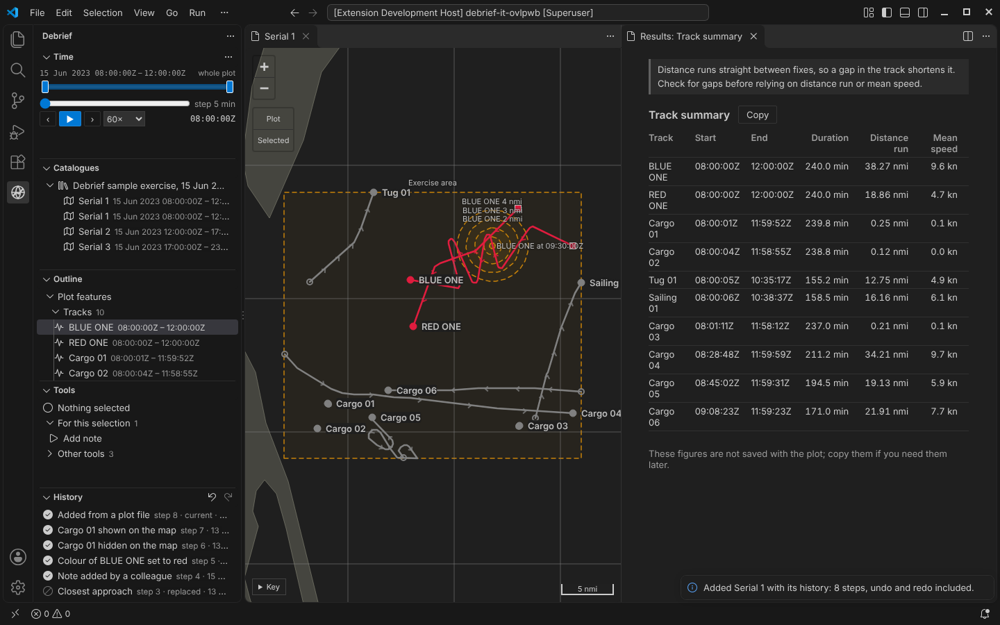
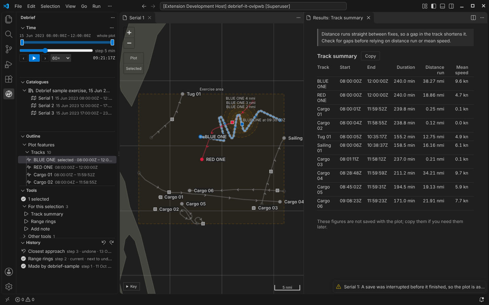

# One file, history included

A plot is now one file an analyst can pass to a colleague, and its whole history goes with it. The colleague can undo a step the sender made, go back to any step, and see who did what, with nothing else beside the file.

<!-- more -->

*The pictures come from the integration test, which drives the real VS Code with the real Python tool service on the sample exercise.*

## What the product owner decided

On 13 October the product owner settled three questions:

1. **A plot is one file.** `plot.geojson` carries the plot's content, its view (the island) and its full history: every step, with what made it and what it changed, its provenance, whether it is undone or replaced, and which step is current. Pass the file and you pass undo, redo, going back to a step, and provenance.
2. **Sources are not transported.** When Debrief first imports a REP or `.dpf` file, the imported tracks and annotations are recorded in the plot's first step. Replay starts from that step, so it never needs the original file. A catalogue may keep its sources for audit, and the history still names each source and its checksum, but the plot file doesn't depend on them.
3. **Keep all history, always.** No limit on steps, no folding, no "flatten history" command.

Until now the history lived in a `history` folder beside the plot: one file per step and a file saying which step was current. That made a plot a folder, not a file.

## Sending a plot to a colleague

The analyst sends serial 1 as a single file. The colleague uses **Add a plot file…** on the Catalogues view (the button with the plus on a page) and chooses it. Debrief checks the history, adds the plot to the catalogue and says how many steps came with it.

The History view lists the sender's steps exactly as they were: the import, two tool runs (the second undone, then replaced), a note added by a colleague, the colour change, the hidden track, and **Show all**. The newest step, **Added from a plot file**, records the arrival: its note names the file (*serial-1-from-ian.geojson*) and the catalogue, and it records who added it. No earlier step is changed.

The colleague then presses `Ctrl+Z` twice. The first undo takes back the arrival step, which changes nothing on the map. The second takes back the sender's **Show all**, so the cargo track the sender had hidden is hidden again, and the map says *1 hidden*. Redo brings both back. To go further, **Go back to this step** on any step works as it did for the sender.

You can try this in the playground: under **Import your own**, choose a Debrief plot file (`.geojson`). It's added in your browser and never uploaded.

## Checked for changes made outside Debrief

A plot file is a text file, and someone might edit it. The product owner asked that the history be protected, not trusted blindly. So:

- **Each step carries a checksum** that covers the step and the step before it. Change a step, remove one or swap two, and the chain breaks.
- **The current step records the checksum of the plot's content**, so content edited without changing the history is noticed too.
- **The view is outside every checksum.** A new time window is never mistaken for an edit.

When something doesn't match, Debrief says so in plain words, and never carries on silently:

- *"This plot's history has been changed outside Debrief: step 2 of its history is not as Debrief recorded it."* The plot is shown as its file holds it, but undo, redo and changes are refused. A file like this is refused by **Add a plot file…** too.
- *"This plot's history does not match its content: it may have been edited outside Debrief."* The plot is rebuilt from its history, and the file as found is kept beside it.

The checksums catch mistakes and edits made without Debrief. They are not a signature: someone who sets out to forge a history can work out new checksums. Protecting a plot from a determined forger is a job for the folder's permissions and the network it sits on (SEC-01).

## Crash safety, simpler

Every change now rewrites the whole plot file. Debrief writes the new file in full under a temporary name, makes sure it is on the disk, and only then puts it in place of the old one. So the plot file is always the whole plot before the change or the whole plot after it.

The integration test still kills a Debrief process part-way through a save, now just before the new file replaces the old one. Opening the plot again shows it exactly as it was, and says *A save was interrupted before it finished, so the plot is as it was before that change. Nothing else was lost.* The machinery that finished half-written changes has gone, because there is no half-written change any more.

Plots that still have a history folder have it moved into their plot file the first time someone who can write opens them. Debrief replays the moved history, checks it gives the same plot, and only then removes the folder. Before the data format reaches 1.0 only plots of the current format open at all, so in practice this rarely runs.

## What it costs

One file holding everything is bigger, and every change rewrites it. We measured on a synthetic plot of 40 tracks and 100,000 fixes (10.8 MB of content) with 200 steps, before and after:

| | History in a folder | History in the plot file |
| --- | --- | --- |
| On disk | 48.2 MB, in about 200 files | 27.6 MB, one file |
| Make a change | 6.0 s | 4.4 s |
| Undo | 2.0 s | 0.7 s |
| Redo | 2.0 s | 0.7 s |
| Read the plot again | 0.5 s | 0.4 s |
| Open in a new session, with its history listed | 14 to 15 s | 14 to 16 s |

On the sample exercise's serial 1 (0.4 MB) every one of these takes a quarter of a second or less, before and after. Most of the time on the large plot goes on checking the plot's content against the data format, as it did before; opening it in a new session also checks every step once. Undo is quicker now because the content a step recorded is recognised by its checksum, so it isn't checked again.

The history is written one step a line, without the indentation the content has, which keeps the file far smaller than indenting it would. Checks are only done once: steps this process has already checked are not checked again, and when another process adds a step, only that step is.

## Also

- **The STAC item is now just catalogue metadata**: title, period and extent, all derived from the plot file. The plot file alone is enough to make it again, which is what **Add a plot file…** does.
- **Changes made elsewhere** are spotted by watching the plot file alone: Debrief compares the history's current step, how many steps it has, and the content checksum the current step recorded. A colleague's new time window changes none of those, so Debrief shows the new window without reading the whole plot again.
- **Save as new** after a conflict now copies the history up to the analyst's starting point unchanged, checksums and all.
