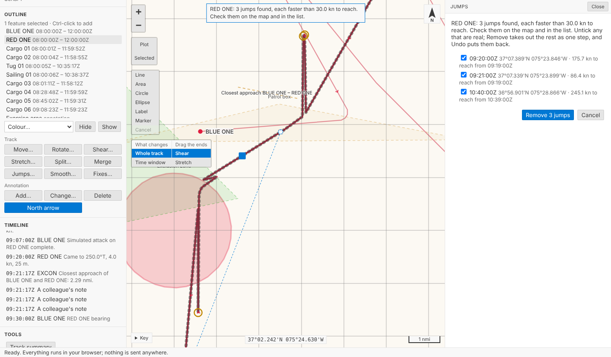
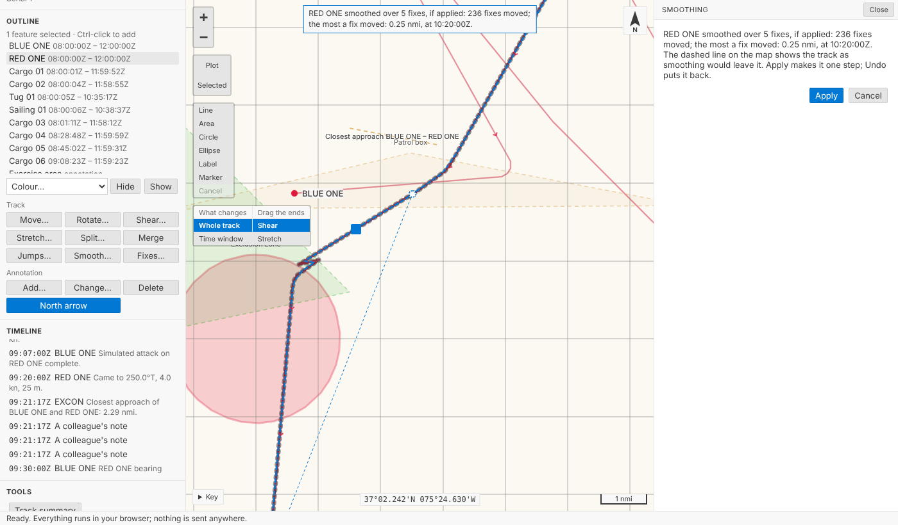
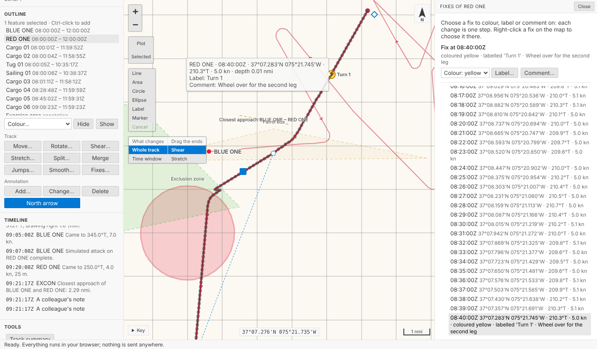
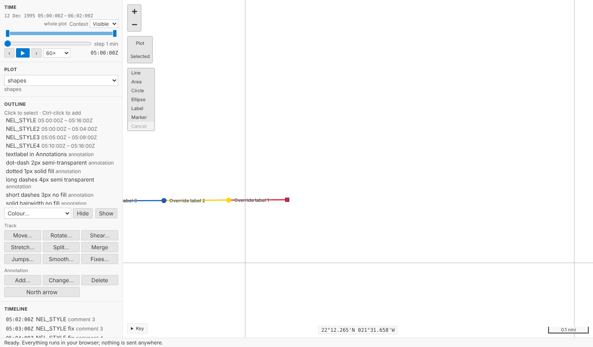
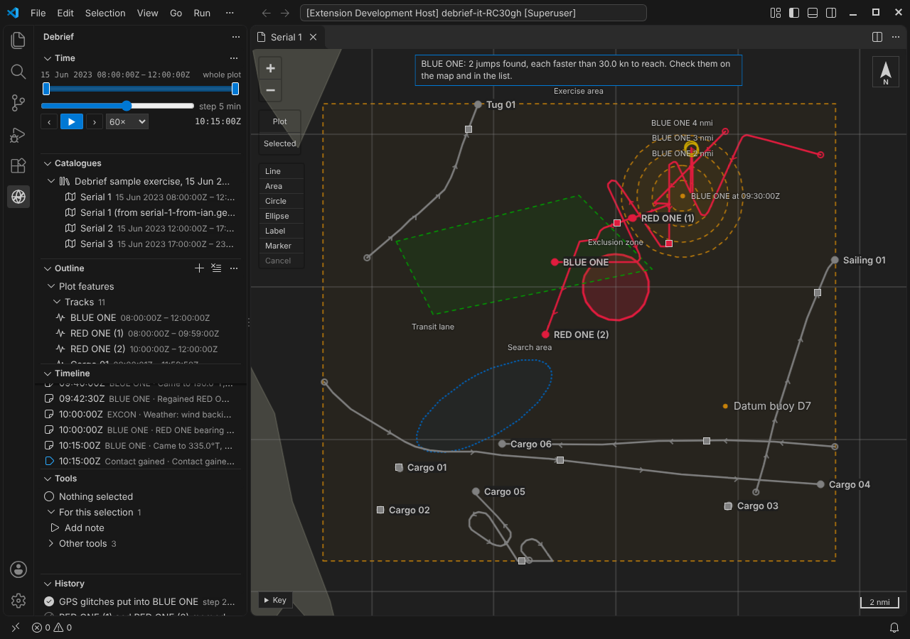
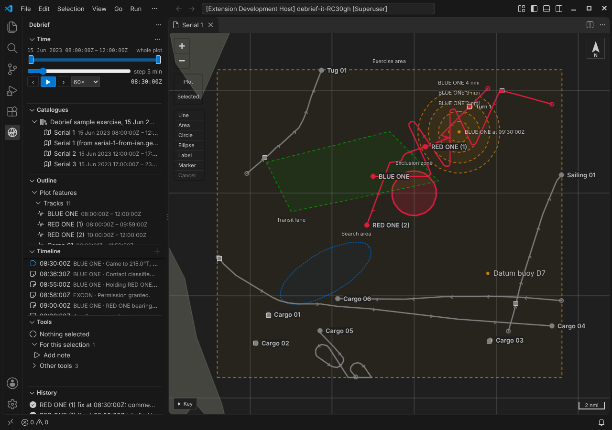

# Cleaning tracks: jumps, smoothing and marking fixes

Three ways to tidy a track have arrived. **Jump removal** finds fixes a platform could not have reached in time, shows them to you on the map and in a list, and removes the ones you confirm. **Smoothing** shows you the track as it would be, and how far it would move each fix, before you apply it. And single fixes can now have a **colour, a label or a comment** of their own, as they could in legacy Debrief, so legacy plots no longer lose them on import. Each is one step in the plot's history, and `Ctrl+Z` takes it back.

<!-- more -->

*The playground pictures come from the playground test, which plays the demo below in a browser. The VS Code pictures come from the integration test, which drives the real VS Code with the real Python tool service. By then, earlier steps of the tests have moved, split and coloured some of the tracks.*

## Nothing removed unseen

Real tracks have glitches: a GPS fix a few miles off, a position typed with one digit wrong. Each looks like the platform leapt somewhere and back. Debrief calls such a fix a **jump**: a fix the platform could not have reached in time from the last good fix before it.

How fast is too fast? It depends on the platform. A helicopter does 120 knots; a submarine on patrol, 5. So the speed Debrief offers is **three times the track's median speed between fixes**, and never less than 10 knots. Three times the median is far above any change of speed a real platform makes between fixes; the floor stops a stopped or slow platform's position noise from counting. You can change it: type `30`, `30 kn` or `15 m/s`, and the form says what it understood.

Debrief compares each fix with the last *good* fix, not just the one before it, so a burst of two or three bad fixes in a row is found whole; and a fix only counts as back on the track when the track carries on from it. A track that goes somewhere and stays (a ship at anchor getting under way, say) isn't a jump, and nor is a real burst of speed the track carries on smoothly from (a sprint between drifts), so nothing is offered.

What it finds, it shows. Each jump is ringed on the map, the note at the top says *RED ONE: 3 jumps found, each faster than 30.0 kn to reach*, and the list beside the map gives each one's time, position and how fast the platform would have had to go. Every jump starts ticked. Untick any that are real (its ring goes), and **Remove** takes out the rest as one step: *RED ONE: 3 jumps removed*.

The step's notes say when the jumps were and the speed they were found at, so a colleague reading the history later can see exactly what went. Every series stays in step: the positions, times, speeds, courses, depths and marked fixes all lose the same fixes.

## Smoothing, previewed

A track recorded by a noisy sensor wobbles. **Smooth…** takes each fix to the average position of itself and the fixes either side: 5 fixes unless you say, always an odd number, so each fix sits in the middle of its window. We chose this one method, a moving average, because you can say exactly what it did; a simplifier that drops fixes is a different operation, and isn't offered.

It's worked out properly on the earth. Each fix's neighbours are measured as ranges and bearings from it, along geodesics, averaged, and the fix moved by that average, so it's as right far north or across the date line as in the Channel. Near the ends of what you smooth the window narrows evenly, so **the first and last fixes never move**, and times never change. A gap in the data counts as an end too: fixes either side of a long stretch with none (more than ten times the usual time between fixes) are never averaged together. Recorded courses and speeds are averaged over the same fixes, courses as directions, so 350° and 010° come out as 000°, not 180°.

Before anything changes, the smoothed track is drawn dashed over the track as it is, and the note says what it would do: *RED ONE smoothed over 5 fixes, if applied: 236 fixes moved; the most a fix moved: 0.06 nmi, at 09:22:00Z.* **Apply** makes it one step; **Cancel** changes nothing.

## A colour, a label or a comment for one fix

Legacy Debrief let you colour one fix red, label it *Turn 1*, or note that the navigator doubted it. Our .dpf import has, until now, had to say *fix comments not imported*. Now a fix can carry any of the three. Right-click a fix on the map (on a touch screen, press and hold it), or open the **fix list** (every fix of the track, with its time, position, course, speed and any mark) and choose one; then **Colour…**, **Label…** or **Comment…**.

On the map, a coloured fix is a dot in its colour, and the line from it to the next fix is drawn in it too, as legacy Debrief drew it. A label sits beside its fix. A comment shows when you point at the fix, and it's in the **Timeline**, at the fix's time, alongside the narrative. Each change is one step: *RED ONE fix at 08:40:00Z labelled 'Turn 1'*.

How should a plot file hold them? A track keeps its fixes as parallel lists (positions, times, speeds, courses, depths). We could have added three more, a colour, a label and a comment for every fix; but most fixes have none, and a track of 10,000 fixes would carry 30,000 empty entries. Instead each track has a short list of **marked fixes**, each found by its fix's **time**, not its place in the list. That choice does real work: remove three jumps before a marked fix and its mark is still on it; split the track and each part keeps its own marks; merge them and they come back together; move, rotate or smooth it and nothing about the marks changes. And the plot is still plain GeoJSON to any other tool.

Legacy plots bring theirs in. A .dpf file's per-fix colours, labels and comments are imported as marked fixes. Legacy Debrief labels *every* fix with its time unless told otherwise, so a label that only repeats the fix's time isn't imported (Debrief shows times itself), and the import says how many it skipped. Here is the legacy sample plot's NEL_STYLE track, its fixes in their own colours and labelled as they were saved:

## In VS Code

The same commands sit on the outline's menu for a track: **Find and remove jumps…**, **Smooth track…** and **Fixes: colour, label or comment…**. The jumps are listed in a VS Code list, all ticked; the fix list is a list you can type a time into.

Agents get the same through the tool service: `debrief/find_jumps` and `debrief/preview_smoothing` look without changing anything, and `debrief/remove_jumps`, `debrief/smooth_track` and `debrief/mark_fix` change the plot, one step each, with who asked and what they asked for in the step's record.

## Try it

Select **RED ONE**, choose **Put GPS glitches into the selected track** under **Try** (the playground records that as a step of its own, so it's never mistaken for real data), then **Jumps…** under *Track*, below the outline. Then **Smooth…**, and **Fixes…**, or right-click a fix on the map (press and hold it on a touch screen):

## Not yet

- **Dragging single fixes**, and the legacy OTG and DR import modes.
- **Simplifying** a track (dropping fixes it doesn't need), which is a different job from smoothing.
- **Where a legacy label goes** (above, below, left or right of its fix), and fix symbols and arrows, which the import still lists.
