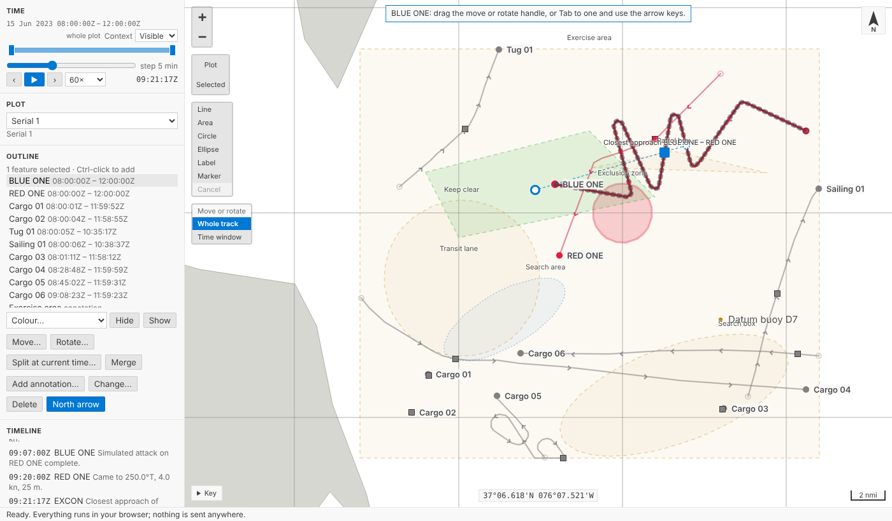
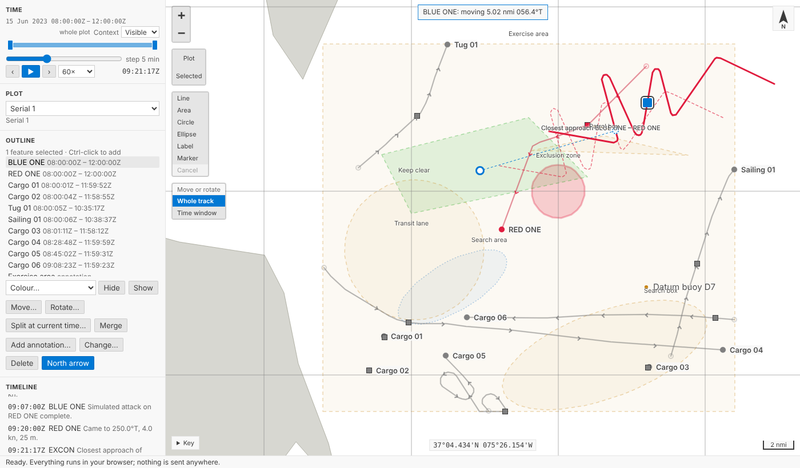
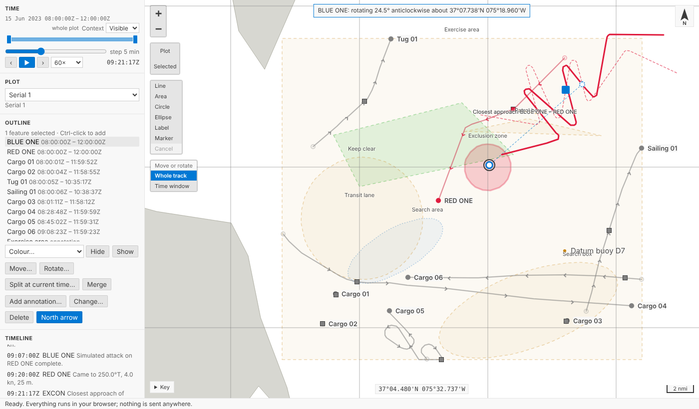
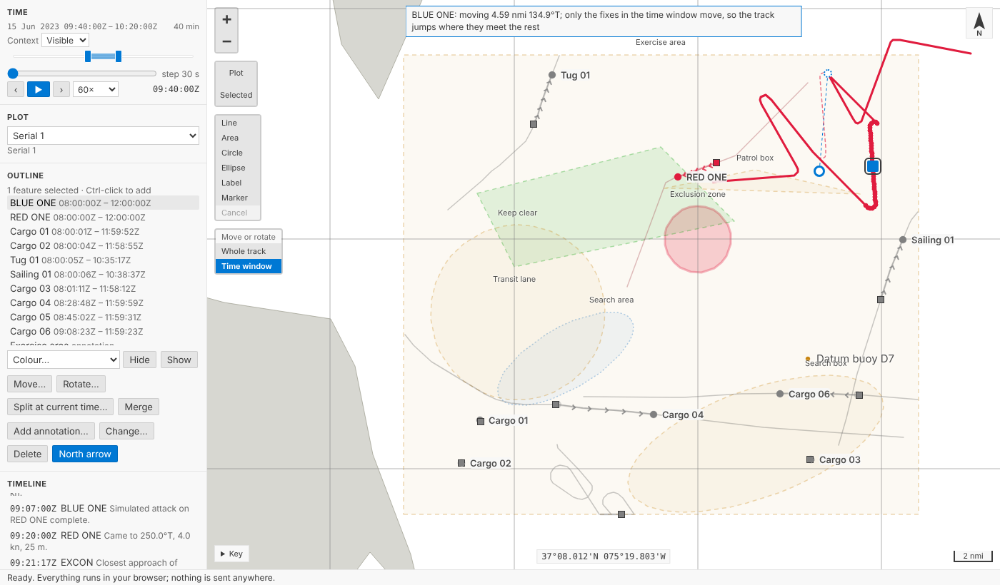
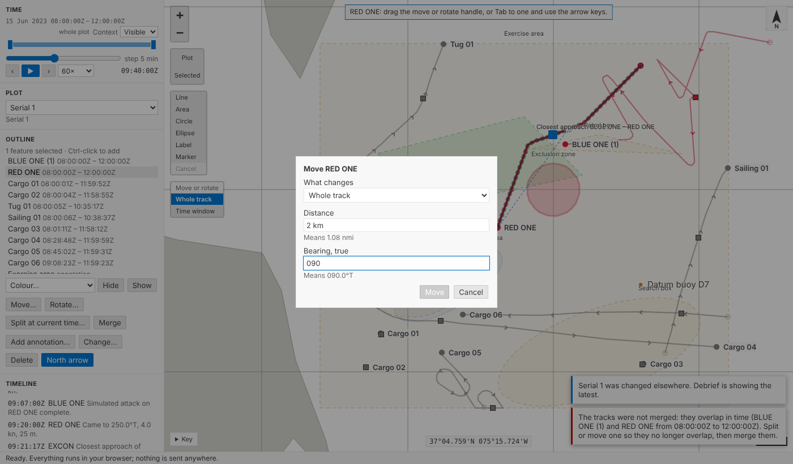
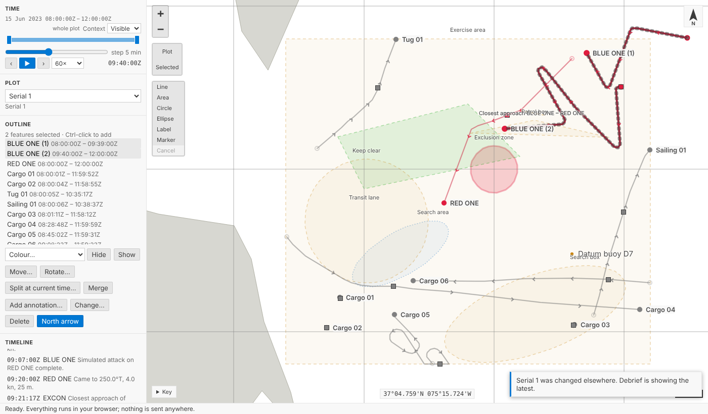
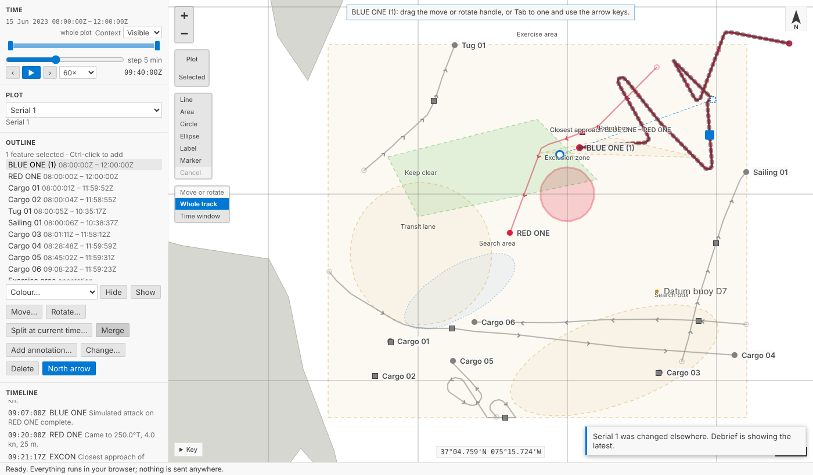
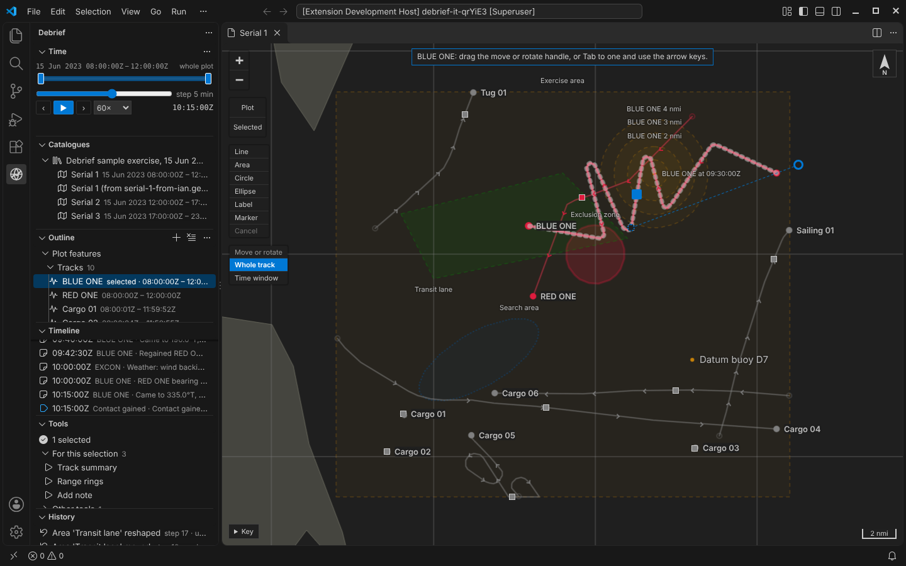
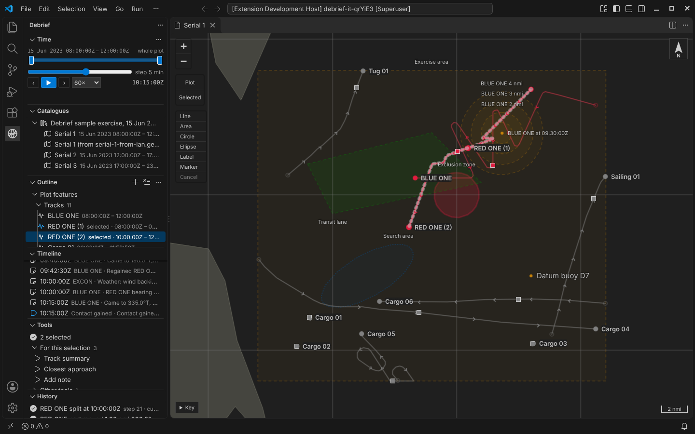

# Moving and splitting tracks

A track can now be moved and rotated on the map: the whole track, or only its fixes in the time window. Drag a handle and the track follows, with the range and bearing (or the angle) shown as you go; let go and it's one step in the plot's history. Tracks can also be split at current time and merged again. Everything can be done from the keyboard or a form, and `Ctrl+Z` takes any of it back.

<!-- more -->

*The playground pictures come from the playground test, which plays the demo below in a browser with the pointer and the keyboard. The VS Code pictures come from the integration test, which drives the real VS Code with the real Python tool service. By the time they reach BLUE ONE, earlier steps of the tests have coloured it red and added a few annotations.*

## Why move a track at all?

Debrief's data comes from many places: a ship's navigation log, a submarine's own estimate of where it was, a plot reconstructed afterwards. They rarely agree exactly. An analyst who knows that RED ONE was at the datum buoy at 09:30 needs to slide RED ONE's track over so that it was, or turn it a few degrees about a fix they trust. Legacy Debrief has done this for years with its *drag track* tool, and analysts rely on it.

The product owner's decision, yesterday: as in legacy Debrief, dragging moves the **whole track, or a selected time period of it**, by translation or by rotation about a pivot. Dragging single fixes comes later.

## Three handles

Select a track on its own and three handles appear in the theme's focus colour:

- a **filled square** on a fix in the middle of the track, to move it;
- a **ring** beyond the fix farthest from the pivot, on a dashed arm, to rotate it;
- the **pivot**, a dotted ring, which the track turns about. Unless you move it, it's on the fix nearest current time.

Drag the square and the track follows the pointer. The track as it was stays on the map, dashed, so you can see how far you've come, and the note at the top says by how much: *BLUE ONE: moving 5.02 nmi 056.4°T*. Let go and that's one step in the History view, named as the note said it: *BLUE ONE moved 5.02 nmi 056.4°T*. Press `Escape` before letting go and it goes back, with nothing recorded.

Drag the ring round the pivot and the track turns with it: *BLUE ONE: rotating 24.5° anticlockwise about 37°07.738'N 075°18.960'W*.

## Along geodesics, not across the chart

Everything Debrief measures is along geodesics on the WGS84 ellipsoid (see [Measuring on the real Earth](2026-10-11-geodesic.md)), and moving a track is no different. A move takes **every fix the same range along the same true bearing**, each along its own geodesic. That is not the same as adding the same change of latitude and longitude to every fix, which is how an annotation's whole-shape move works and how you'd slide a track across a paper chart. Near the equator the two hardly differ; far north they do, because a degree of longitude shrinks as you go towards the pole, so a latitude-and-longitude shift would stretch the track or squeeze it. The tests check a track at 88° north and one crossing the antimeridian: every fix moves exactly the distance asked, along exactly the bearing asked.

A rotation keeps **each fix's range from the pivot** and turns its bearing from the pivot by the angle. The courses recorded with the fixes turn with them; speeds and times don't change.

## Only part of a track

Sometimes only an hour of a track is wrong: a navigation fault, say, between two fixes you trust. Choose **Time window** in the small *Move or rotate* control on the map, and only the fixes in the time window move or turn.

We didn't stretch the rest of the track to meet them. The fixes before and after stay exactly where they were, so the track **jumps** where the moved part meets them, and the map shows that while you drag, saying *only the fixes in the time window move, so the track jumps where they meet the rest*. A jump you don't want is for jump removal, which comes next, and which you'll then see doing its job rather than something done quietly on your behalf.

The step says so too: *BLUE ONE part moved 4.59 nmi 134.9°T*, with *Only the fixes from 09:40:00Z to 10:20:00Z* as its second note.

## Exactly, or without a mouse

**Move track…** on the outline's menu (**Move…** under the outline in the playground) asks what moves, how far and which way. Type `2 km`, `1.2 nmi` or just `1.2` in your own unit, and a bearing like `045`; the form says what it understood (*Means 1.08 nmi*) before you commit. **Rotate track…** asks about which fix (nearest current time, first or last, or in VS Code any position you type) and by how much: `12`, `12 clockwise` or `12 anticlockwise`.

From the keyboard, `Tab` to a handle. The arrow keys move the square 5 pixels at a time (25 with `Shift`), and turn the ring 1° (10° with `Shift`), `Right` and `Up` clockwise. A run of presses is saved as one step when you stop, not one step per press; `Escape` puts it back first.

## Split and merge

**Split track at current time…** splits the selected track in two, offering *BLUE ONE (1)* and *BLUE ONE (2)* as the names, which you can change. Both keep the track's colour and provenance; the first keeps its identity, so anything that referred to the track still does; sensor observations from the split time on go with the second.

**Merge selected tracks** joins two or more tracks into one, in time order. Tracks that overlap in time aren't merged: we considered asking which track should win where they overlap, and chose a plain refusal instead, which says exactly where the overlap is: *The tracks were not merged: they overlap in time (BLUE ONE (1) and RED ONE from 08:00:00Z to 12:00:00Z).* Split or move one first, then merge.

## In VS Code

Same map, same handles, same steps. The integration test moves BLUE ONE as its handle does, rotates it, moves only part of RED ONE, splits it and merges it again.

## Every step has its reasons

Each operation's step records who made it, which tracks it chose and what was asked: the distance and bearing, the angle and the pivot's position, the period, the time of a split and the names of its parts. An agent doing the same through the tool service (`debrief/edit_track`, `debrief/split_track`, `debrief/merge_tracks`) leaves the same record, so a moved track is as traceable as a tool's output. If a colleague changes the plot while you're dragging, Debrief shows their change, drops your drag and says so; nothing is overwritten.

## Try it

Select **BLUE ONE** in the outline and drag the filled square. Then drag the ring. Choose **Time window** on the map, narrow the window in the time controller, and drag again to see the joins jump. Try **Split at current time…** and **Merge** under the outline, and `Ctrl+Z`:

## Not yet

- **Dragging single fixes**, which comes after this.
- **Jump removal and smoothing**, the rest of tidying tracks, and the legacy OTG and DR modes.
- **Stretching and shearing**, which belong with TMA solutions (CAP-21).
- **Choosing which track wins** where merged tracks overlap.
