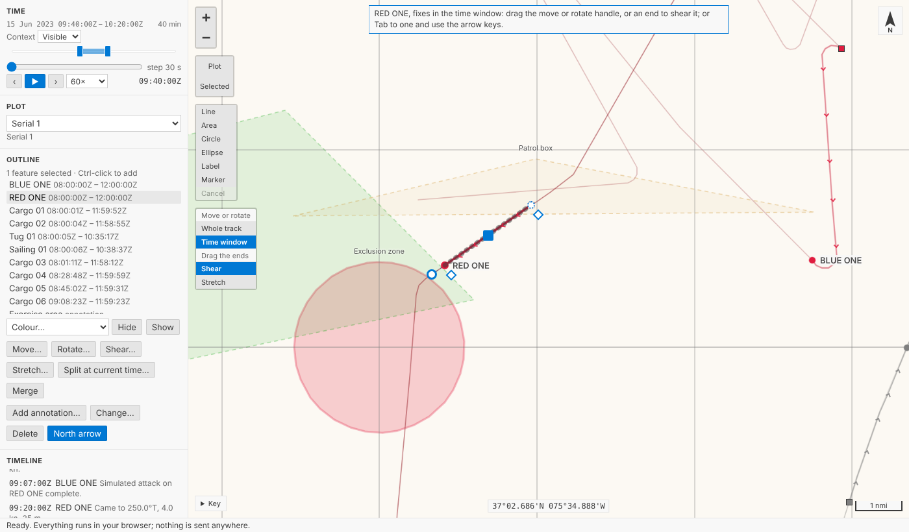
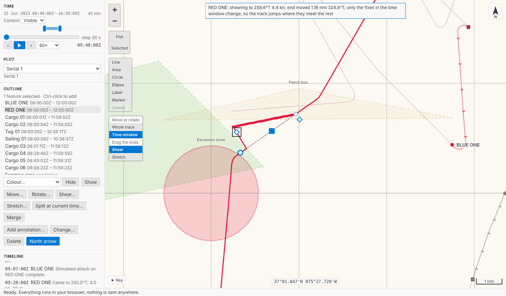
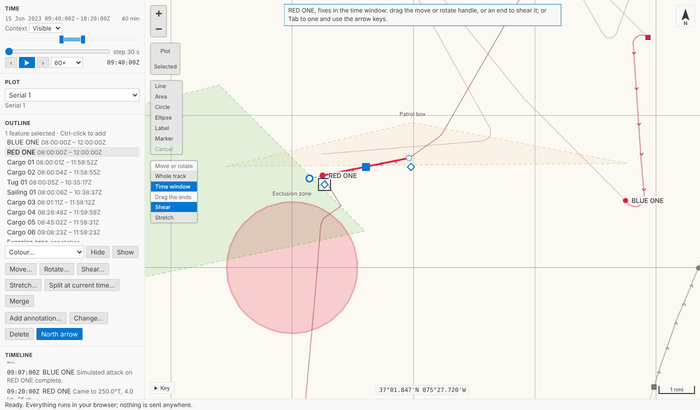
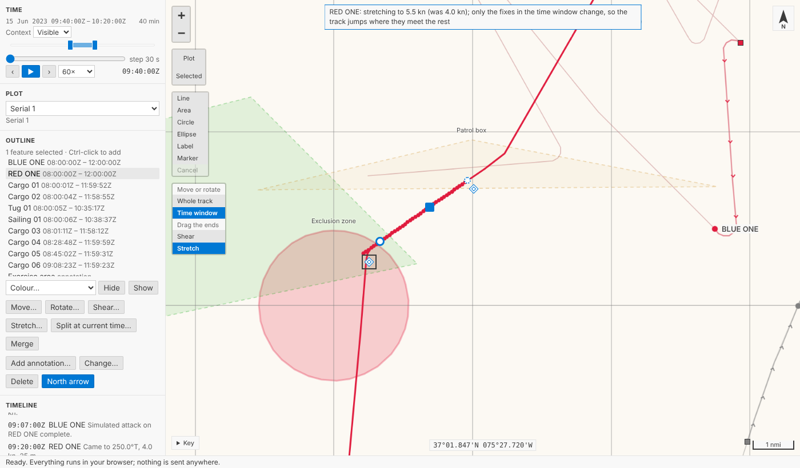
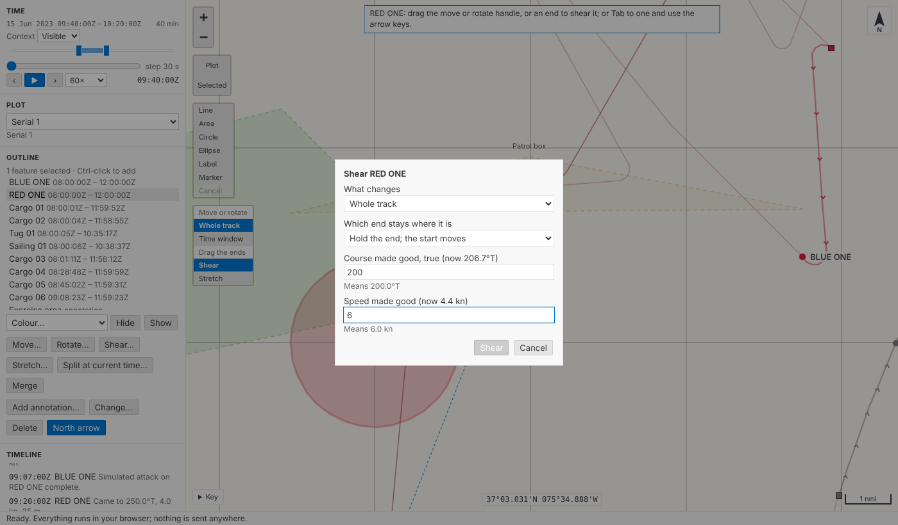
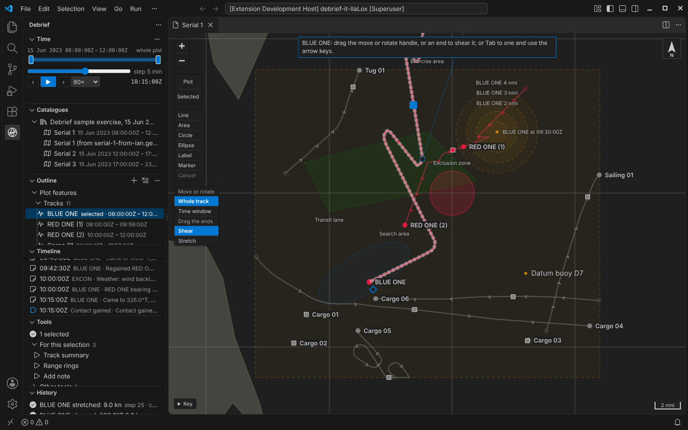
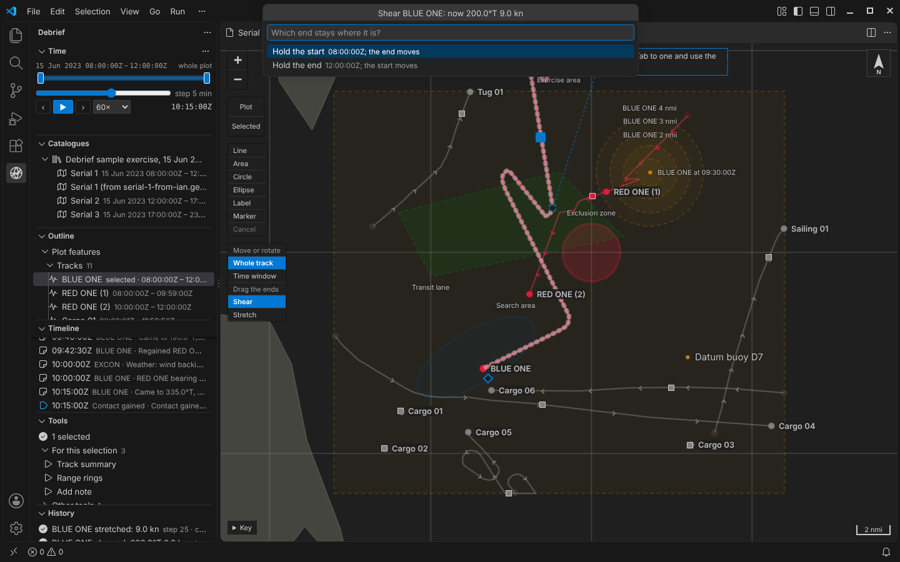

# Shear and stretch

A track, or its fixes in the time window, can now be **sheared**: hold one end, drag the other, and every fix in between moves in proportion to its time from the end you held. A straight leg stays a straight leg, with a new course and speed, and the map tells you both as you drag. **Stretch** does the same with the speed alone. Each release is one step, and the keyboard and two small forms do it too.

<!-- more -->

*The playground pictures come from the playground test, which plays the demo below in a browser with the pointer and the keyboard. The VS Code pictures come from the integration test, which drives the real VS Code with the real Python tool service. By the time they reach RED ONE and BLUE ONE, earlier steps of the tests have moved and turned both.*

## Why shear first

When an analyst works up a target motion analysis (TMA), the solution is a set of legs: straight lines, each run at a steady speed. The bearings pin one end of a leg reasonably well; what's uncertain is where the target went from there. Legacy Debrief's answer was to *shear* the leg: keep one end where it is and drag the other, so the course and speed change together. The product owner told us yesterday that this is the drag analysts use most with TMA legs, so it comes before the rest of the track tidying (jump removal, smoothing, dragging single fixes).

The live bearing residuals that make this a full TMA tool belong to the TMA module, which comes later. What arrives today is the drag itself, on any track, so it can be tried, tested and argued about now.

## Two diamonds

Select a track on its own and, beside the move and rotate handles from [the last post](2026-10-14-moving-and-splitting-tracks.md), two diamonds appear: one beside its first fix and one beside its last. Here RED ONE's leg between 09:40 and 10:20, a straight run at a steady 4 knots, with **Time window** chosen on the map so only that leg changes:

Drag the diamond at the end. The start stays exactly where it is, the end follows the pointer, and every fix in between moves part of the way: a third of the way for a fix a third of the way through the leg in time, and so on. The note at the top gives the new course and speed, and how far the end has gone: *RED ONE: shearing to 258.6°T 4.4 kn; end moved 1.16 nmi 324.8°T*.

Let go, and it's one step in the History view, named by what the leg now makes good: *RED ONE part sheared: 258.6°T 4.4 kn*, with *Held at the start, 09:40:00Z* and the course and speed it made good before as its notes. Only the fixes in the window changed, so the track jumps where they meet the rest of it, just as a move does.

Choose **Stretch** under *Drag the ends* on the map and the diamonds get a double edge. Now only how far you drag *along* the leg counts: the course stays, and the note gives the new speed against the old, *RED ONE: stretching to 5.5 kn (was 4.0 kn)*.

## The geometry, on a curved earth

The obvious way to shear on a chart is to slide each fix by a fraction of the end's move: a third of the distance, along the same bearing. On the earth that isn't quite right. Meridians close in towards the poles, so "the same bearing" points in slightly different directions at different fixes, and a sheared leg would come out very slightly bent: tens of metres over a 10 nmi leg at 50° north, more further north.

So Debrief works from the end you're holding. Every fix is placed by its range and true bearing from that end, measured along geodesics as everything in Debrief is (see [Measuring on the real Earth](2026-10-11-geodesic.md)). Seen that way, any geodesic through the held end is a straight line, and ranges from it are exact. The shear is done there, so a straight leg at a steady speed comes out *exactly* straight and steady, at 50° north, at 84° north or across the antimeridian; the tests check all three. A stretch keeps each fix's bearing from the held end and scales its range, so a leg stays on its own line.

The courses and speeds recorded with each fix aren't thrown away and worked out again from the new positions, which would replace what the log recorded with the jitter of the fixes. They're carried through the same change instead: a shear adds the leg's change of velocity to each fix's own, so a fix that the log says was steering 000 at 10 knots, on a leg that has just gained 10 knots east, now says 045 at 14.1 knots. On a clean straight leg, every fix ends up with exactly the leg's new course and speed.

## Keyboard and forms

`Tab` to a diamond. Shearing, the arrow keys move it 5 pixels at a time (25 with `Shift`). Stretching, `Up` makes the leg 0.1 knots faster and `Down` 0.1 knots slower (1 knot with `Shift`). As with every handle, a run of presses is one step, not one per press.

For an exact answer there's **Shear track…** on the outline's menu (**Shear…** under the outline in the playground): which end stays, then the course and speed you want the leg to make good, offered as what it makes good now. **Stretch track…** asks only for the speed. Speeds can be typed in knots, metres per second or kilometres an hour.

## In VS Code

The same map, diamonds and steps. The integration test shears BLUE ONE as its end would, then through **Shear track…** and **Stretch track…** with values given, as an agent does through `debrief/edit_track`, and opens the form.

## Every step has its reasons

Each shear or stretch records which end was held and when, how far and which way the other end went, and the course and speed the leg then made good. An agent doing the same through the tool service leaves the same record, and `Ctrl+Z` takes any of it back.

## Try it

Select **RED ONE**, narrow the time window to one of its legs, choose **Time window** on the map, and drag the diamond at the leg's end. Then choose **Stretch** and drag again, or try **Shear…** under the outline:

## Not yet

- **Live bearing residuals** while you drag, and solutions rooted in a period of bearings: the TMA module.
- **Shearing one leg of a multi-leg solution** while its neighbours follow.
- **Dragging single fixes**, jump removal and smoothing.
