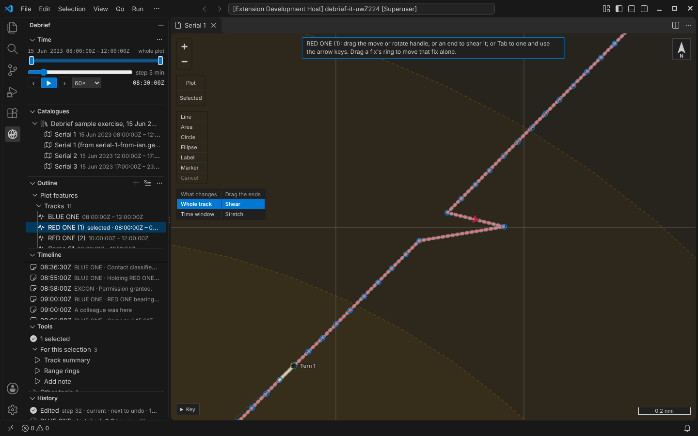
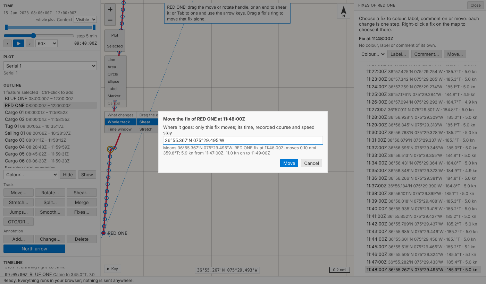
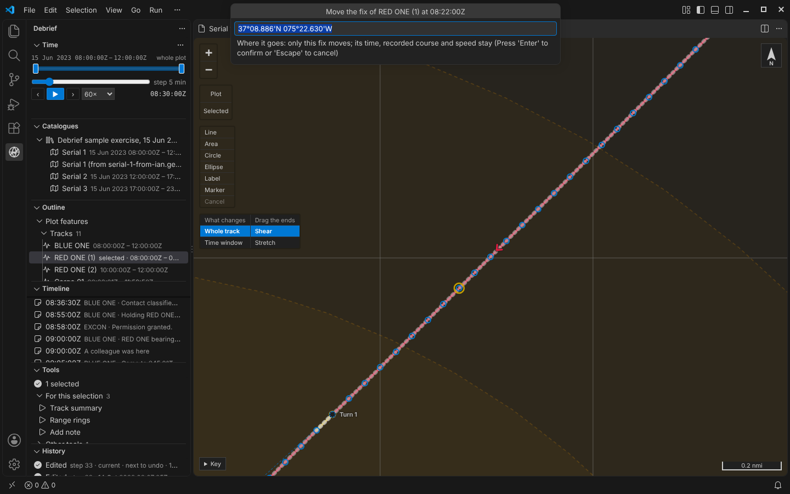
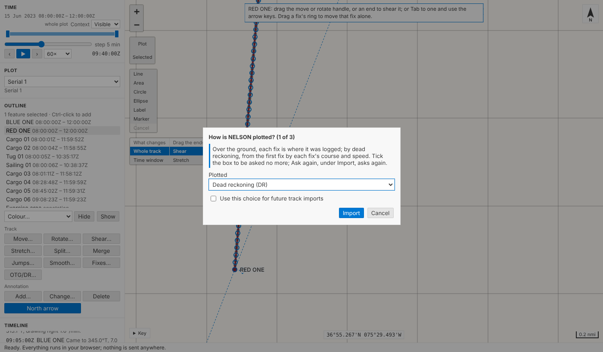
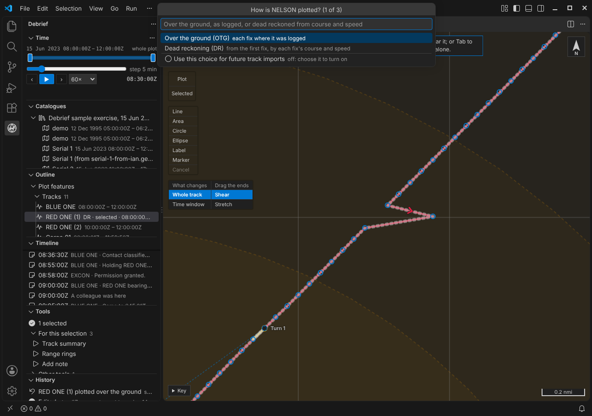
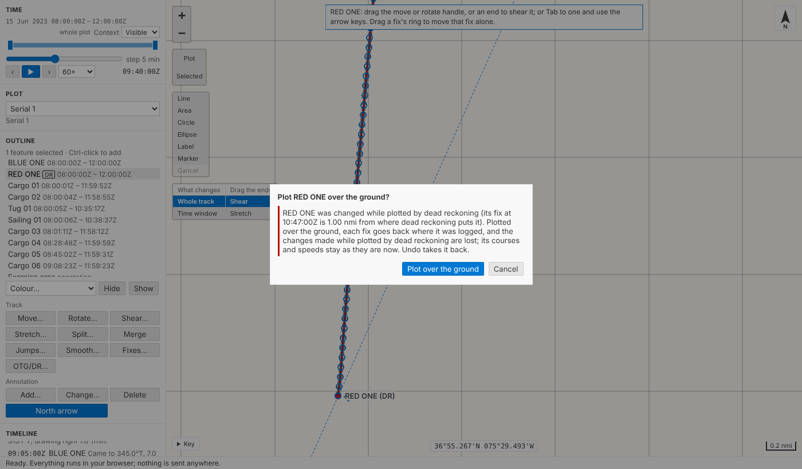

# Dragging a fix, and dead reckoning

The last of the track operations has arrived. Zoom in on a track and each fix has a small ring of its own: **drag one, and only that fix moves**. Its time stays, its neighbours stay, and the map tells you, as you drag, how fast the platform would now have to go to reach it and to carry on. And the legacy **OTG and DR** modes are back, the legacy way: import a REP file and Debrief asks, for each track, whether it is plotted over the ground or dead reckoned from its courses and speeds, and you can tell it to use that choice for future imports. Each change to a plot is one step, and `Ctrl+Z` takes it back.

<!-- more -->

*The playground pictures come from the playground test, which plays the demo below in a browser with the mouse, a finger and the keyboard. The VS Code pictures come from the integration test, which drives the real VS Code with the real Python tool service. By then, earlier steps of the tests have moved, split and cleaned the tracks.*

## One fix, the legacy way

We asked the product owner how a single-fix drag should behave, and the answer was: as legacy Debrief did, unless there's a reason not to. So only the fix you grab moves. Nothing either side of it is stretched or smoothed to meet it, its time is unchanged, and if it carries a colour, a label or a comment of its own, that stays with it (marks are found by their fix's time, as [the last post](2026-10-14-cleaning-tracks.md) explained).

The one real question was the fix's course and speed. A plot holds, for each fix, the course and speed the platform logged. When you move a fix, should Debrief work them out again from the new positions? We decided not to, for the same reason a move of the whole track keeps them: they are what the platform's compass and log (or its GPS) said, not something Debrief derived from where the fix was plotted, and a fix plotted in the wrong place doesn't change what the ship was doing. Recomputing them would quietly swap logged data for guesses.

What the new position *implies* is still worth knowing, though, so Debrief says it: the speed needed to reach the fix from the one before, and to get from it to the one after, each along the geodesic. Pull a fix too far and the note says so: *faster than 15.0 kn, as a jump would be*, using the same threshold [jump removal](2026-10-14-cleaning-tracks.md) offers.

Let go, and that's one step in the history: *RED ONE fix at 09:43:00Z moved 0.31 nmi 056.5°T*, with notes giving the new position and the speeds before and after.

## Rings only when you can grab one

A track of 241 fixes, seen whole, is a line of dots a pixel or two apart; rings on all of them would bury it, and you'd grab the wrong one. So the rings appear only when you've zoomed in far enough that the fixes are apart on the screen (at least 14 pixels, and no more than 60 in view). Until then, the note at the top says *Zoom in to move a single fix*.

We considered a single ring that follows the pointer to the nearest fix instead. We chose rings that are simply there, once you're close enough, because they work the same with a finger (a tablet has no pointer to hover) and from the keyboard: `Tab` reaches each ring after the track's other handles, the arrow keys nudge it, and a run of presses is one step. The rings sit beneath the move, rotate and pivot handles and the shear diamonds, so those keep working as before; where one shares a fix, drag the pivot off it, or `Tab` to the fix.

## Or type where it goes

**Move a fix…** (on the outline's menu in VS Code, or **Move…** in the playground's fix list, or right-click a ring) asks where the fix goes. Type a position in any notation Debrief reads, and the field tells you what it understood, how far and which way that moves the fix, and the speeds it would imply, before you commit.

## Over the ground, or dead reckoned

Legacy Debrief could plot a track two ways. **Over the ground** (OTG) puts each fix where it was logged. **Dead reckoning** (DR) starts from the first fix and places each one after it by the course and speed logged at the fix before, the way a navigator plots a DR track. As each track came in, legacy asked which you wanted, with a checkbox: *Use this choice for future track imports*. The product owner told us that worked well, because a community tends to stick with one or the other, so we've done the same.

Import a REP file and Debrief asks, track by track: *How is NELSON plotted? (1 of 3)*. Choose over the ground or dead reckoning and, as in legacy, tick *Use this choice for future track imports* if you'd like Debrief to stop asking. The import's notes say how each track was plotted, and, when your remembered choice was used, how to change it.

VS Code asks in a list. A VS Code list has no check box, so the box is the list's last line, an empty or a ticked circle that says *off* or *on*: choose it to tick it, and the list stays open for your answer. That's one question per track, the same with the keyboard, the mouse or a screen reader, rather than a second question after each.

Where that remembered choice lives matters. It's yours, not the plot's: a colleague you send a plot to shouldn't inherit it, and it mustn't change what's in a catalogue. So it is kept with your own Debrief settings (the same file VS Code and the Python services both read), never in a catalogue or a plot file. In VS Code it's an ordinary setting, **Debrief: Track import mode** (ask, OTG or DR), and **Debrief: Ask again whether imported tracks are OTG or DR** puts it back to asking; in the playground, **Ask again** sits under *Import*. The importer itself is simply told the answer, which is also how an agent says which it wants.

What *is* the plot's is how each track is plotted: the mode is kept on the track, like its colour, and changing it later (**Plot over the ground or by dead reckoning…**) is one step. A track plotted by dead reckoning keeps its positions as logged beside the dead-reckoned ones, so switching back puts them back exactly; and the track's line is always the positions as plotted, so any other GeoJSON tool draws what Debrief draws. It's tagged **DR** beside its name, in the outline and in its label on the map; its line is drawn as any track's.

Switching back does lose something, though: if you've moved the track, or dragged a fix, while it was plotted by dead reckoning, its fixes go back where they were logged and those changes go. So Debrief asks first, saying which fix moved furthest and by how much; it's still one step, and `Ctrl+Z` brings the changes back.

We checked our dead reckoning against legacy's. Legacy plot files save a DR leg's worked-out positions, and placing each fix from the one before, by that fix's course and speed, along the geodesic, puts every fix of the legacy sample plots back within 0.1 m of them. Those plots aren't asked about at all: they say how each leg was plotted, and come in that way, with a note saying so.

## For agents

The same through the tool service: `debrief/edit_track` with `{"action": "move_fix", "fix_time": …, "distance": …, "bearing": …}` (or a `position`), and `{"action": "set_plotting_mode", "plotting_mode": "dr"}`, each one step with what was asked in its record (back over the ground after a change made while plotted by dead reckoning is refused, saying why, unless the change says `"discard_dr_changes": true`); and `debrief/import_rep` takes the mode for each track.

## Try it

Select **RED ONE**, zoom in until its fixes have rings, and drag one. Then try `Tab` and the arrow keys, **Move…** in **Fixes…**, or **OTG/DR…** under *Track*, below the outline; and import a REP file of your own to be asked how its tracks are plotted:

## Not yet

- **How often fixes are labelled, given a symbol and a direction arrow**, set for several tracks at once, every second to every 24 hours: a new requirement from the product owner, planned but not yet scheduled.
- **A ring on the fix nearest the pointer** when zoomed out.
