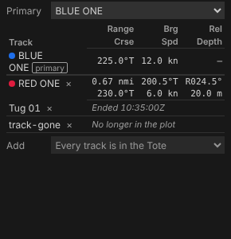

# The Tote

The Tote is back. Choose a **primary** track, usually your own ship, and add the **secondaries** you want to watch: for each one the Tote gives the range, the true bearing and the relative bearing from the primary, and its own course, speed and depth, at current time. Drag current time, step it or press play, and the values keep pace. It's in VS Code's sidebar under **Time**, and in the playground under the time controller.

<!-- more -->

*The playground pictures come from the playground test, which plays the demo below in a browser with the mouse, a finger and the keyboard. The VS Code pictures come from the integration test, which drives the real VS Code with the real Python tool service.*

## What it shows

Legacy Debrief's Tote listed, for the primary and each secondary, the same few measures, and that is the **core** of the new one:

| Measure | From | Written |
| --- | --- | --- |
| Range | primary to secondary | in your length unit: `3.49 nmi` |
| Bearing | primary to secondary | true, three figures: `322.5°T` |
| Relative bearing | primary to secondary, from its head | red to port, green to starboard: `R081.3°`, `G108.0°` |
| Course, speed, depth | each track | `226.1°T`, `5.0 kn`, `20.0 m` |

The primary comes first, with its own course, speed and depth; then each secondary. Units and decimals are your display settings, the same as everywhere else in Debrief. A track with no depth recorded shows a dash, not a zero.

In a sidebar there isn't room for six columns, so each track's values take two lines of three, every value under its heading: the measures from the primary, then the track's own. Widen the view and they fit on one line.

## Where a track is, now

A Tote is only useful if its numbers agree with the map. Each track's square on the map at current time sits on the geodesic between the fixes either side, in proportion to time; the Tote places each track in exactly the same way, and a shared set of test cases holds the map's code and the Python to the same positions, in the Arctic and across the antimeridian included. The range you read is the range between the two squares.

Course, speed and depth are what the platform recorded at the fixes either side, interpolated the same way, with course going the shorter way round through north (from 350° to 010° passes 000°, not 180°). A track with no recorded courses, such as a sketched one, gets its course and speed from its positions instead.

When a track has no data at current time, the Tote says why rather than leaving a blank: *Starts 08:28:48Z*, or *Ended 10:35:17Z*.

## Choosing tracks

**Primary** is a list at the top of the Tote; **Add** is a list beneath it, and each secondary has a **×** to remove it, or press `Delete` on it. From the outline, a track's menu has **Set as Tote primary**, **Add to Tote** and **Remove from Tote**: right-click it, press and hold it on a tablet, or press `Shift+F10`. In VS Code those act on every track you've selected, so adding five AIS tracks is one menu choice.

## Saved with the plot, but not a step

Which tracks the Tote compares is a choice about how you're looking at the plot, not a change to it. We put it where the product owner put the time window: in the plot file's *island*, the part that travels with the plot but sits outside its history. Send the plot to a colleague and they open the same Tote. But choosing tracks is never a step in **History**, `Ctrl+Z` never changes it, and it can never conflict with a change to the plot's content. If a colleague changes the Tote's tracks while you do, Debrief shows theirs and tells you, rather than overwriting either. Legacy Debrief, as it happens, made the same call: it kept its Tote's tracks in the GUI part of a plot file, beside the data.

## Fast enough to play

A Tote has to keep pace with current time: the requirement says within 100 ms. The values are worked out in Python, where all of Debrief's measurement lives, so each change of current time is a request to Python. In the first phase we measured that architecture and found it fast enough; now we've measured the real thing:

| Where | Typical | 95% within |
| --- | --- | --- |
| VS Code, through the tool service | 5 ms | 9 ms |
| The playground, Python in your browser | 5 ms | 15 ms |

Two things keep it there. The tracks are prepared once and kept until the plot changes, so a request does a few interpolations and geodesics, not a read of the plot. And the Tote never queues: it sends one request, and when the answer comes, one more for wherever current time has got to by then. Playing at 3600× can't build a backlog, and the table is never more than one answer behind. Those numbers come from checks that run with every change, so if the Tote ever slows down, we'll see it.

## In VS Code

The **Tote** view sits below **Time** in the Debrief sidebar, folded until you first use it; the outline's menu opens it.

## Measure groups

The SRD says the Tote is a *view onto a measure group*: a named set of measures for a mode of analysis, which a study's lead analyst defines and keeps in the study catalogue, so every plot in the study shows the same Tote. This post's Tote shows the core group. The schema and the tool service already describe groups and their measures, and the Tote shows whatever group it is given, so the next part adds study groups, and measures beyond the core, such as bearing rate and angle on the bow, without changing the view.

## For agents

`debrief/tote` with a time (and, if you like, the tracks) returns the values, in metres, degrees and metres per second; `debrief/measure_groups` lists what can be measured; and `debrief/set_view` with a `tote` member chooses the tracks, as the Tote view does.

## Try it

Choose **BLUE ONE** as the primary, add **RED ONE** and a cargo ship, and press play:

## Not yet

- **Study measure groups**, kept in the study catalogue, and measures beyond the core.
- **A heading separate from course**, for relative bearing when a platform crabs across a current.
- **A depth setting.** Depths are in metres (feet where your lengths are), to one decimal.
- **Showing on the map** which tracks are in the Tote.
