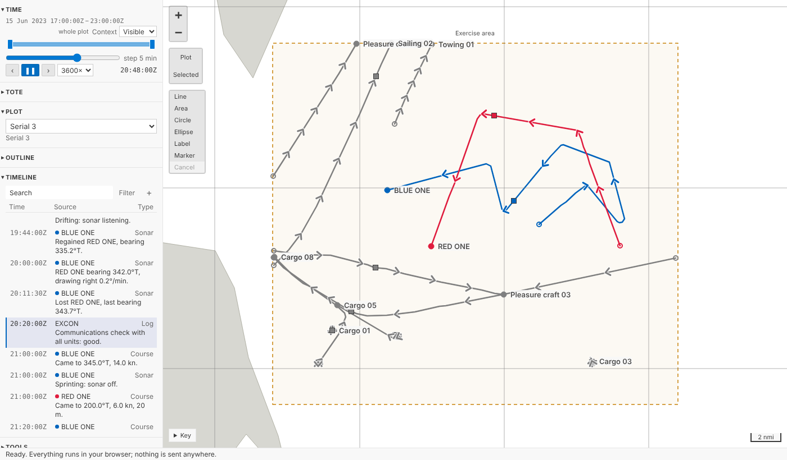
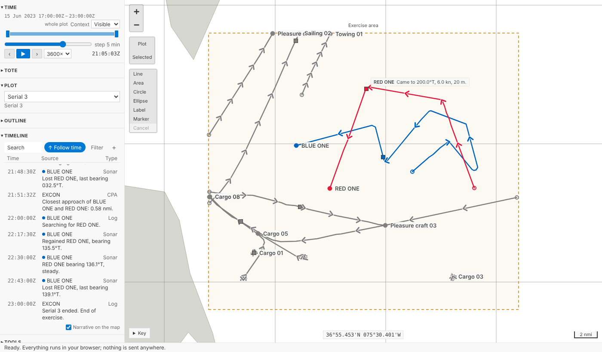
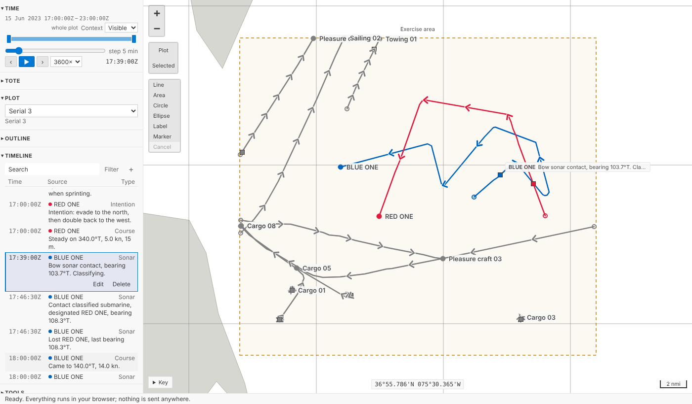
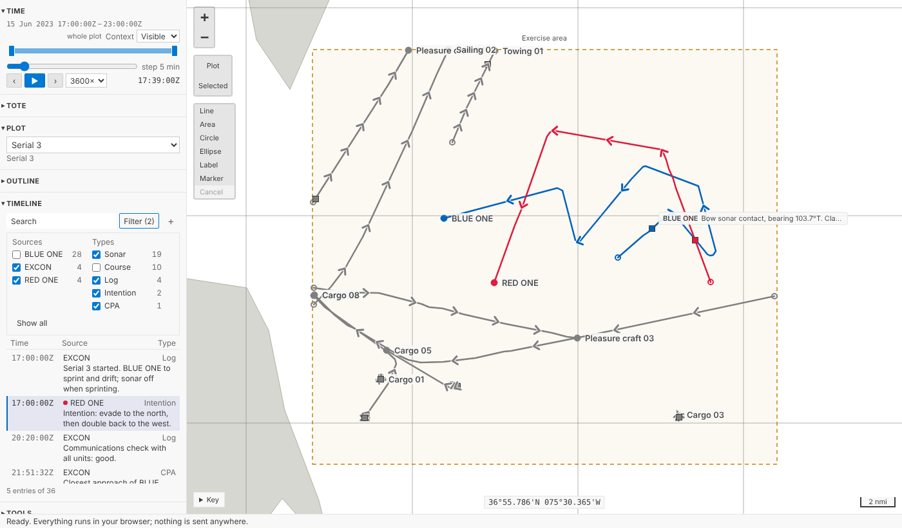
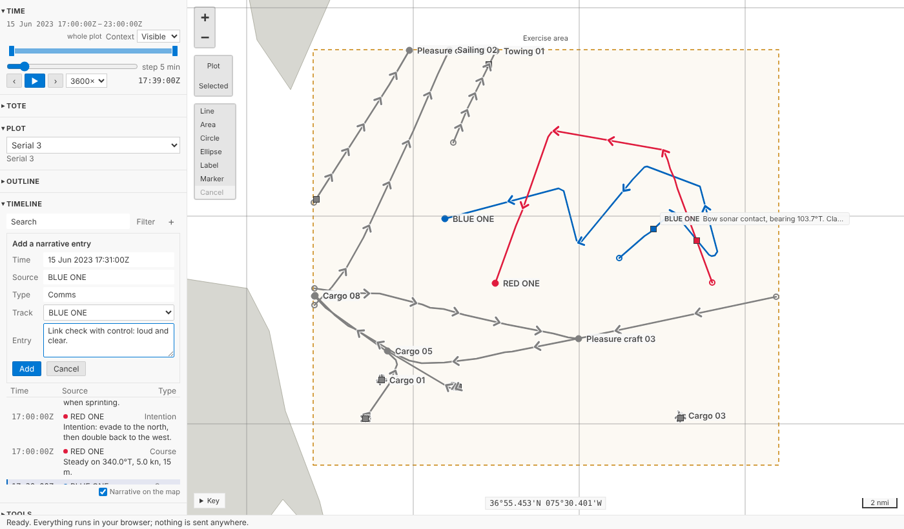
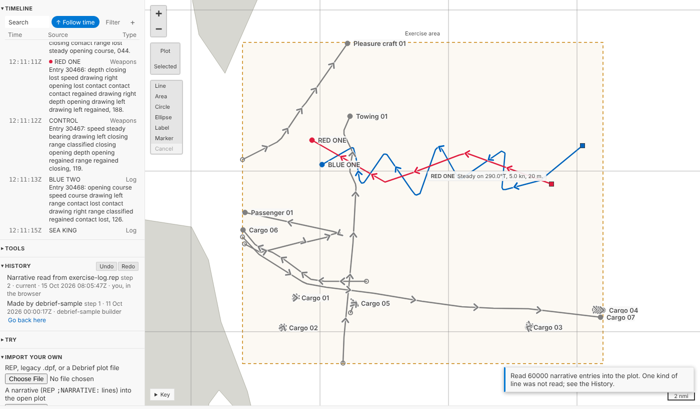
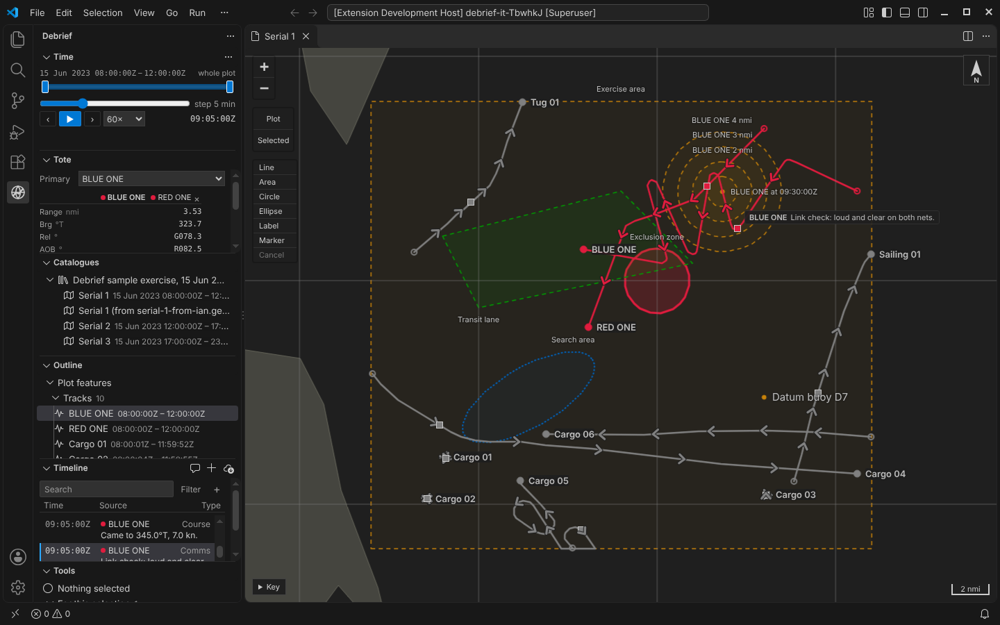
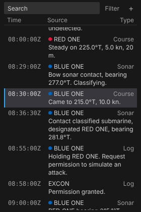
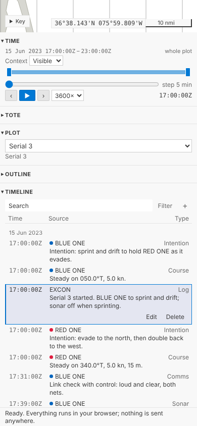

# Narrative in the Timeline

Every platform in an exercise keeps a log, and reconstructing what happened means reading them side by side, against the tracks. Debrief now holds narrative properly: each entry has its time, who wrote it, what kind of entry it is and its text, and every platform's entries sit on one Zulu time axis. You read them in the **Timeline**, with notes and periods of interest, and it follows current time as you play, without ever fighting your own scrolling. Choose an entry and current time moves to it. Filter by source or type, search the text, add and correct entries, and see the current one beside its track on the map. It copes with sixty thousand entries.

<!-- more -->

*The playground pictures come from the playground test, which plays the demo below in a browser with the mouse, a finger and the keyboard. The VS Code pictures come from the integration test, which drives the real VS Code with the real Python tool service.*

## One list, not two views

We started building a Narrative view of its own, beside the Timeline. The product owner stopped us: the Timeline already listed notes and periods in time order, and choosing one already moved current time; a second list in time order, a few centimetres below the first, would only make you choose which to read. So narrative went into the Timeline, which became one list of narrative entries, notes, periods and the comments on fixes, and is where data coverage will join them when collation arrives.

It reads as a table, because it is one: the headings *Time*, *Source* and *Type* once at the top, then a row an entry, with nothing labelled in the rows. (We'd learned that one from the Tote.) Times are monospaced so they line up; the source carries its track's colour where it has one; the type is quieter; the text wraps. A day's date heads its first entry. In a sidebar or on a phone the text goes under the time, source and type, so the times run down the left like a log's margin. Entries outside the time window are fainter, still there to read and choose.

## Reading along with the replay

Press play and the list keeps the entry current time is at in sight. It doesn't scroll every time an entry passes: it waits until the current entry is about to leave the middle of the view, then puts it a third of the way down, so you can see what's coming. It never moves the keyboard, and it never animates.

The moment you scroll the list yourself, or move through it with the arrow keys, it stops following, so it never drags you away from what you're reading. **Follow time** appears in the bar, with an arrow pointing to where current time has got to; press it, choose an entry, or press **Play** again, and it follows again.

Choose an entry (click it, tap it, or `Enter`) and current time moves to it; if it's outside the time window, the window widens to take it in, without saving, exactly as when a tool moves time. When several entries share a second, the one you chose is the one marked. And the entry current time is at, if it belongs to a track, is shown on the map beside that track's square: its source and the start of its text, gone once ten minutes of plot time have passed without another. **Narrative on the map**, under the list, turns that off for the plot, and on again; like the Tote's lines, it's kept in the plot, not in your undo history.

## Finding things

**Filter** opens a list of every kind, source and type in the plot, each with how many entries it has; untick what you don't want. The search box finds words in an entry's text, its source or its type, and highlights them. Under the list, *5 entries of 36* reminds you that you're not seeing everything. Your filter is yours: it's kept in the page, not the plot, because two analysts reading the same narrative want different filters, and filtering doesn't change what the plot says.

## One step at a time

**+** opens a short form above the list: the time (starting at current time, typed any way you'd write it, `09:30Z` or `150930Z JUN 23`), the source, the type, the track it belongs to (which follows the source's name until you choose one) and the entry. **Edit** and **Delete** appear on the entry you're working with, so the rest of the list stays quiet. Each change is one step in **History**, named like *Narrative entry by BLUE ONE at 17:31:00Z added*, and `Ctrl+Z` undoes it like any other, from the Timeline itself too (in its search box and form, `Ctrl+Z` undoes your typing instead).

Each entry is a feature of its own in the plot, with no position, like a note. That matters for the history: changing one entry records just that entry. If a whole platform's log were one feature, every correction to it would put the whole log into the history again.

## Where narrative comes from

- **REP files.** `;NARRATIVE:` and `;NARRATIVE2:` lines are read the way legacy Debrief read them, quirks included: on a plain `;NARRATIVE:` line an unquoted two-word platform is read as its first word, and the rest is text, because that's what an analyst's old files mean. We ported legacy's test cases, on lines we made up. A REP file of narrative alone now makes a plot.
- **A second platform's log, into the plot you have open.** **Read narrative into this plot (REP)…** adds its entries as one step, keeping the file as a source of the plot, so it can be checked later and undone in one go.
- **Legacy plots.** A .dpf file's narrative comes in with its types, which the first .dpf import had to leave out.
- **The sample.** The sample exercise's scripted log was a set of notes; it's narrative entries now, each with a kind (*Course*, *Sonar*, *CPA* and so on), and BLUE ONE's and RED ONE's belong to their tracks. A note you add is still a note: your own annotation, with a name and a style.

Each entry belongs to the plot's track of its source's name, if there's one. Every source's entries go in one order, the same in Python and in the views: by time, then by source, then in the order the log gave them. Two platforms logging the same second always come out in the same order, whichever you imported first, and one platform's entries at one second stay in the order it wrote them. (Legacy Debrief sorted entries at one second by their text, which could put *Contact lost* before *Contact gained*.)

## Sixty thousand entries

Most narratives are a few hundred entries. At two thousand, changing an entry takes Python about 20 ms, and reading a 2,000-line log into a plot in your browser under a second.

The requirement says Debrief must cope with the legacy sample's 12,000 narrative entries scaled by three to five, so we tested that too, with 60,000 made-up entries from five sources over a day:

| Where | What | Time |
| --- | --- | --- |
| Python | Reading all 60,000 into a plot, as one step | 1.4 to 2.5 s |
| Python | Changing one entry; undoing it | under a second; about half a second |
| The playground | Reading a 60,000-line log into a plot, in your browser | 8 to 30 s |
| The playground | Building the list | under a tenth of a second |
| The playground | Scrolling: time between frames | 16.7 ms, 60 a second |
| The playground | Searching all of them | 30 to 60 ms |

The list only ever draws the rows you can see, measuring each one as it's drawn and estimating the rest from the length of their text, so scrolling through 60,000 is as smooth as through 36. The Python side needed one change to get there: checking each feature against the schema for its own kind first, rather than trying every kind of feature in turn, which took reading 20,000 entries from 37 seconds to one.

## In VS Code

The **Timeline** view in the Debrief sidebar is the same list, now a webview rather than a plain tree, because a tree couldn't search, filter, follow time without stealing the keyboard, or hold sixty thousand rows. Its title bar has **Add narrative entry…**, **Add annotation…** and **Read narrative into this plot (REP)…**.

On a phone it's the same list, one column for the text, and the page never scrolls sideways.

## From the keyboard

With the list focused, `Up` and `Down` (and `Page Up`, `Page Down`, `Home`, `End`) move through it without moving time; `Enter` moves current time to the entry; `F2` changes it, `Delete` deletes it, `N` adds one, and `/` jumps to the search box. Screen readers hear each entry's full date and time, its source, type and text.

## For agents

`debrief/narrative` returns the narrative in its one order, filtered by `sources`, `types`, `text` and a period, a page at a time, and which entry a given time is at. `debrief/add_narrative`, `debrief/edit_narrative`, `debrief/delete_narrative` and `debrief/import_narrative` change it, each one step, exactly as the Timeline does.

## Try it

Press play under **Time** and watch the Timeline follow; scroll it and choose **Follow time**; filter out a source; add an entry with **+**:

## Next: Word and PDF

Most narrative arrives as Word documents and PDFs, in several house styles that legacy Debrief's parsers know. That's part B: porting those parsers and their tests (with made-up documents), and asking the questions legacy asked, such as which types to bring in and which track an unknown platform is. The entries they produce are exactly what Debrief now holds, so they'll appear in the Timeline with everything else. Fire-control solutions logged in the narrative will wait for TMA in the data model, later.

## Not yet

- **Word and PDF narrative** (part B).
- **Data coverage** in the Timeline, which comes with collation.
- **Legacy's Narrative viewer extras**: highlighted phrases, an off switch for choosing an entry moving current time, text size and wrapping, and choosing the columns shown.
- **Plain-text and CSV logs**; for now a log can be read in as REP `;NARRATIVE:` lines.
