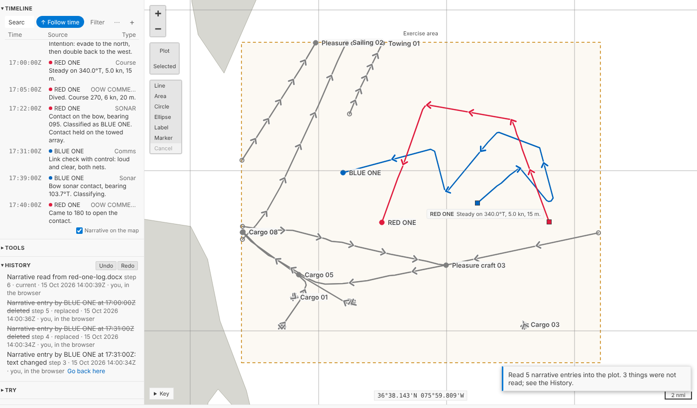
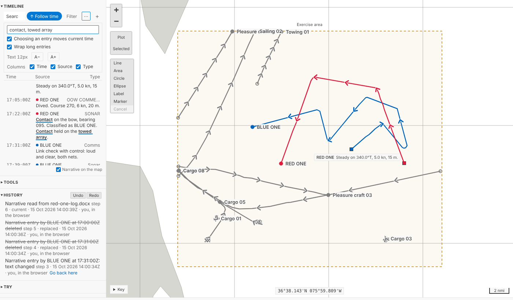
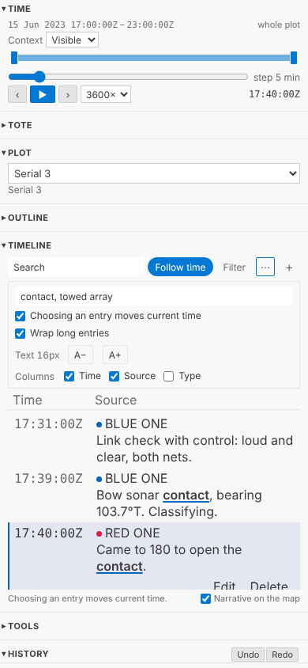
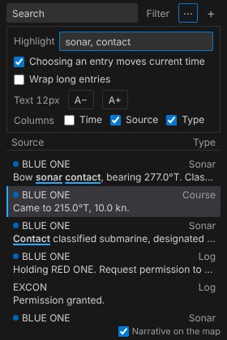

# Narrative from Word and PDF

Most of an exercise's narrative doesn't arrive as REP lines. It arrives as Word documents and PDFs: a ship's log typed up with its metadata hidden in the text, a rider's table of times, bearings and remarks, a printout of either. Legacy Debrief read four of these house styles, and Debrief now reads them too, on the desktop and in your browser, asking the questions legacy Debrief asked before it reads anything in. And the Timeline has gained legacy's Narrative viewer extras: words highlighted wherever they appear, choosing an entry without moving time, text size and wrapping, and the columns shown, all tucked into one small menu so the list stays quiet.

<!-- more -->

*The pictures come from the playground test, which plays the demo below in a browser, and shows VS Code's Timeline view as VS Code does. The log in them is made up for the sample exercise, as the exercise is.*

## Four house styles

Legacy Debrief's Word parsers, `ImportNarrativeDocument` and its relatives, are ported to Python with the cases of their tests. We didn't copy their test documents, or a line of their text: the tests build made-up documents that exercise the same cases. Where a checkout of legacy Debrief is at hand, a separate test reads its sample documents and checks we get the same counts its own tests expected, entry for entry: 13, 5, 18, 364, 350, 371, 285, 15 and 28.

| Style | Debrief knows it by | What it holds |
| --- | --- | --- |
| A **narrative log** | anything else | An entry a paragraph: a DTG, then day, month, year, platform and type, comma-separated and usually hidden in Word, then the text. Short entries take the date and platform from the one before; text alone continues the entry above; `12 Mar 20` starts a new day. |
| A **Rider's narrative** | a table that starts *DTG Start* | A row an entry: time of day, bearing, beam, remarks. |
| **ASW data** | lines starting `TMPOS` | Positions of one platform: a track, not narrative. Import it as a plot and you're asked what to call the track. |
| **Dated lines** | `2023,06,15,17:22,…` | Type, platform and text after a full date. |

You never say which: Debrief looks at the document. It doesn't trust the name either; legacy Debrief met `.docx` files called `.doc`, and so will we.

Legacy Debrief also corrected the mistakes these logs are prone to, and so do we, saying so in the import's record each time: a day that goes backwards with no new month (a cut and paste gone wrong) keeps the day before; an entry at 23:45 whose hidden date is the next day, because it was typed in just after midnight, goes back to the evening it describes. A few things we do differently, on purpose. Every time is UTC; legacy Debrief read some in the computer's own time zone. 31 April is reported rather than quietly read as 1 May. A bad line is listed with its number and why, and reading carries on; legacy stopped some imports at the first. A rider's log that runs past midnight goes on into the next day. And an entry keeps every line that follows it, up to the next entry: legacy Debrief joined six, dropped the seventh and carried on, which in a PDF, where every printed line is a paragraph, lost the ends of long entries.

## Asked first, as before

Before a document goes into the open plot you're asked what legacy Debrief asked: which types of entry to read, with how many of each; all of them, or only those within the plot's period; and which track a platform belongs to when none has its name. (*HMS BLUE ONE* still finds *BLUE ONE* on its own: the prefixes legacy skipped are skipped.) An entry matched to a track takes the track's name, and so its colour, in the Timeline; the name as the document wrote it stays in the import's record.

Your answers are remembered for that house style, as your own setting, never in the plot: next time the questions come filled in, said in a line, and one key reads the document as last time.

Then it's one step, like a REP file's narrative: the document is kept with the plot as its source, untouched; the step's record names the importer, the document, the style it was read in and what you chose, and lists what wasn't read and why. Undo takes the whole document out again.

These documents come from elsewhere, so each reader has firm limits: a file that would take too much memory or too long to read, a zip bomb or a PDF that draws millions of operations, is refused with a reason, rather than tying up Debrief or your browser tab.

In VS Code it's **Read narrative into this plot (REP, Word, PDF)…** on the Timeline's title bar, and the questions are a few quick picks. **Import plot file (REP, .dpf, Word, PDF)…** makes a plot of a document's narrative alone.

### What waits for later

Fire-control solutions (*FCS* entries: bearing, range, course, speed, classification) are read exactly as legacy Debrief read them, but they stay narrative: turning them into TMA solution positions on the platform's track waits for TMA solutions in the data model. A rider's bearings, which legacy Debrief also drew as sensor cuts, stay in the entry's text until sensor data arrives. The import's record says how many of each there were, so nothing is lost on the way.

## Word and PDF in your browser

Everything above runs in the playground too, in your browser, nothing uploaded. That came down to choosing readers written in pure Python: the standard library for `.docx`, olefile and a small reader of Word 97's insides for `.doc`, and pypdf for PDF. The Pyodide check reads the same documents in the browser and on the desktop and compares the answers; they match.

A PDF of a log is the one case that needs a little help: the metadata that was hidden in Word isn't printed, so the entries have times and text but no platform. They're given the plot's one track, as legacy Debrief did, or the document's name, which you can change.

## The Timeline's extras

The product owner kept legacy's Narrative viewer extras, with one condition: the Timeline mustn't get busy. So they live in one small menu, **⋯** beside **Filter**, and the bar stays as it was.

- **Highlight.** Type words or phrases in the box labelled *Highlight*, separated by commas, and they're marked wherever they appear in an entry's text: bold and underlined, so they're told apart from what the search finds (shaded) without relying on colour.
- **Choosing an entry moves current time.** On, as before. Turn it off to read back through a log while the replay holds its place: choosing an entry just puts you on it.
- **Wrap long entries.** Off, each entry is one line, cut short.
- **Text size**, from 11 to 18 pixels, with **A−** and **A+**.
- **Columns**: time, source and type, each on or off. The entry's text is always there.

Like your filter, these are yours: kept with your view, never in the plot, so two analysts reading the same narrative see it their own way. **⋯** is drawn like **Filter (2)** when you've changed anything. Nothing ever scrolls sideways, at any size, in a sidebar 210 pixels wide or on a phone.

## For agents

`debrief/preview_narrative` says what a file holds before anything is read: its style, its types and platforms with counts, the track each platform would go to, and how many entries fall outside the plot's period. `debrief/import_narrative` takes the answers (`types`, `within_period`, `tracks`, `platform`), or reads everything.

## Try it

Download [a made-up Word log for RED ONE](files/red-one-log.docx), then under **Import your own** read it into serial 3 as *A narrative into the open plot*. Open **⋯** in the Timeline and highlight *contact*:

## Not yet

- **FCS entries as TMA solution positions**, with TMA solutions in the data model (Phase 4).
- **Rider bearings as sensor cuts**, with sensor data (Phase 4).
- **Word 6 and Word 95** documents, and password-protected ones: saved again as `.docx`, they read. **Scanned PDFs**, which are pictures of text, need text recognition first.
- **Data coverage** in the Timeline, which comes with collation.
