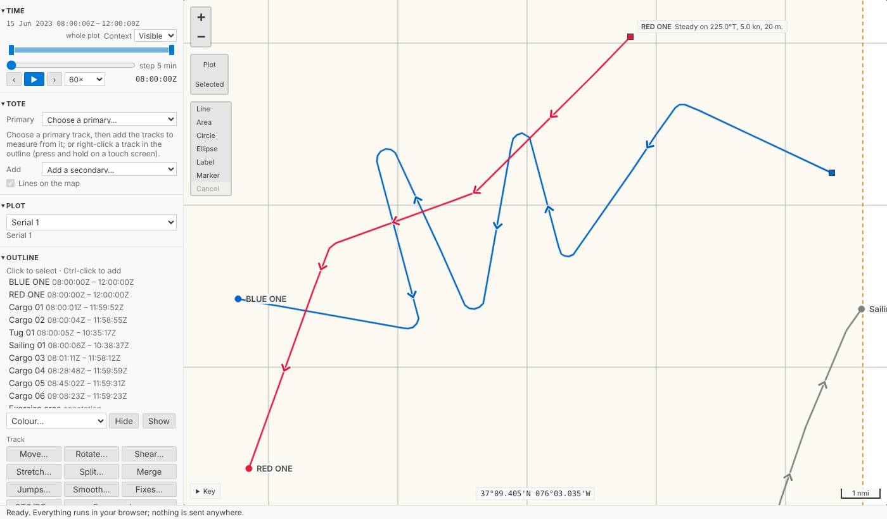
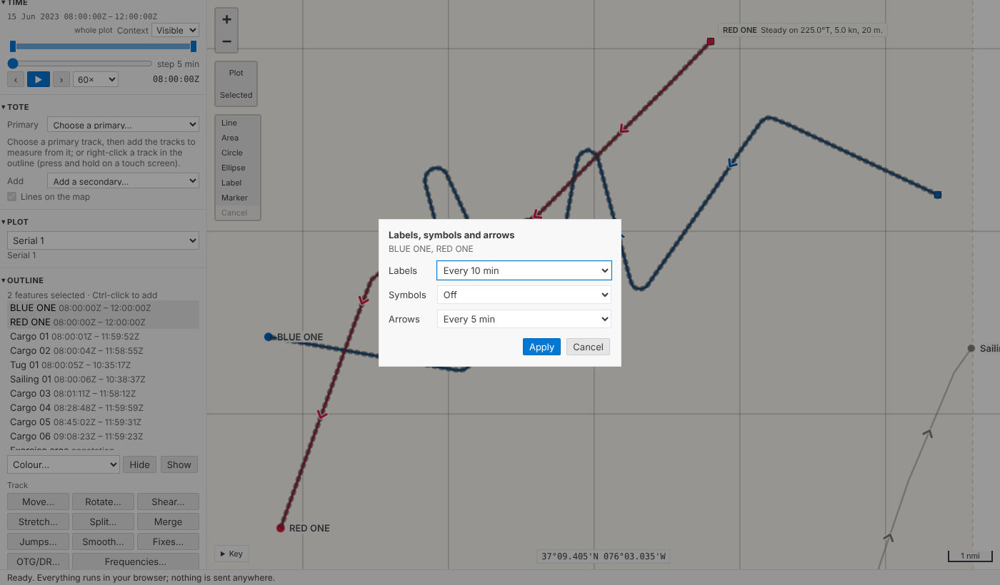
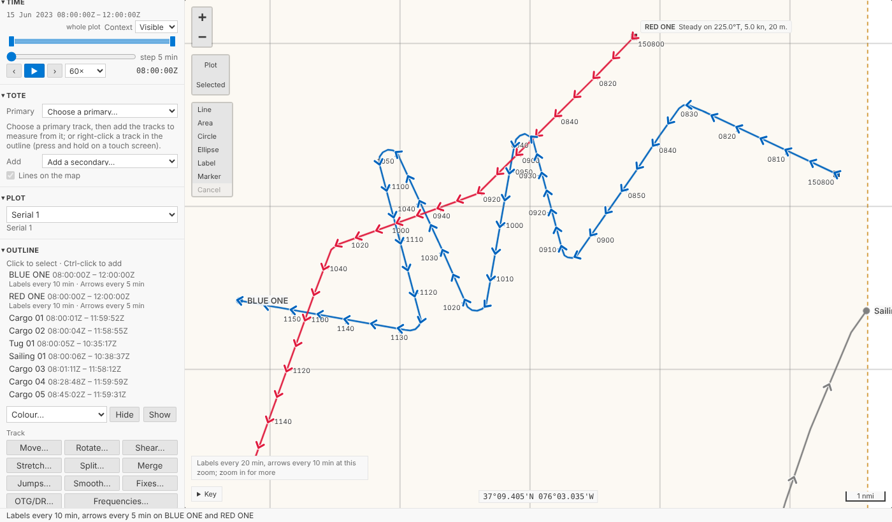
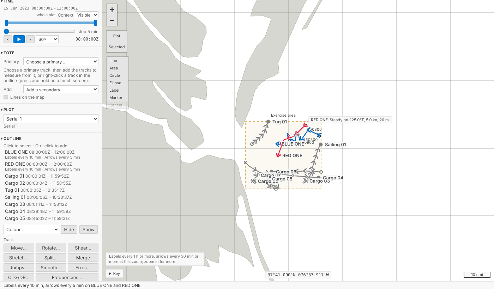
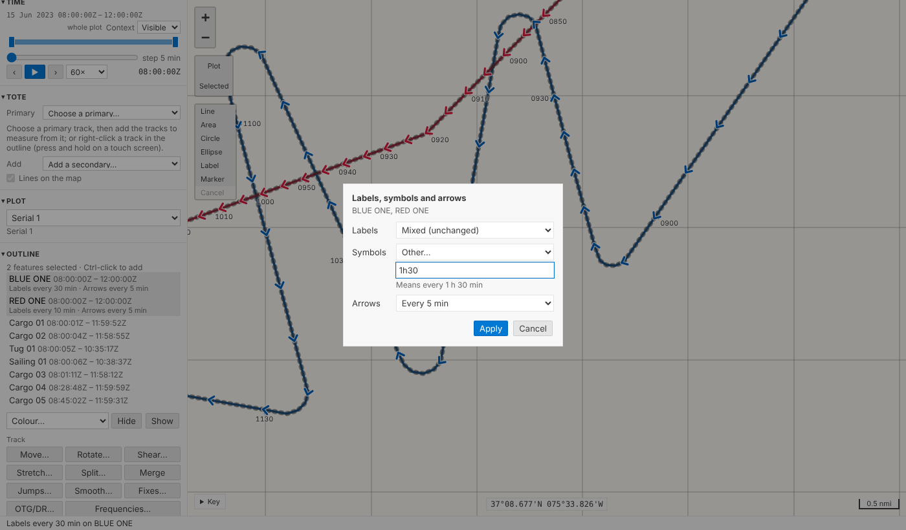
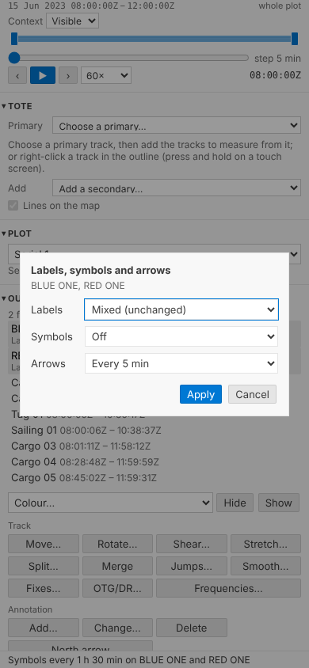
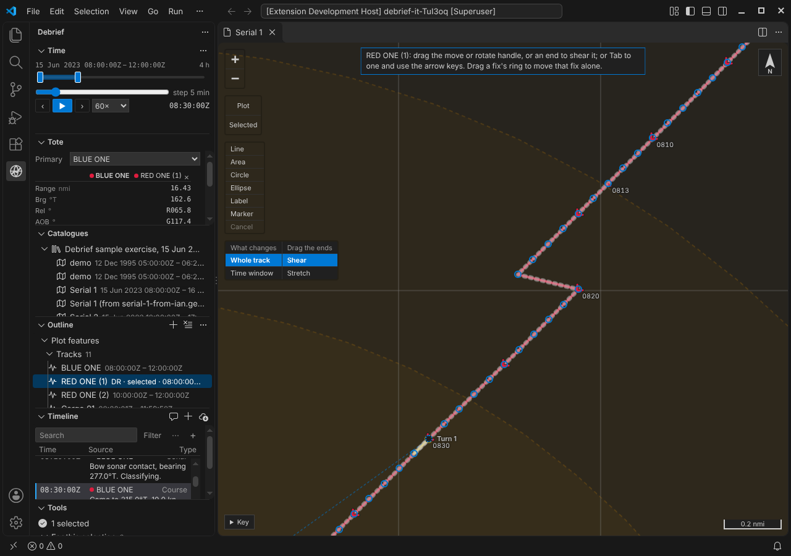

# Labels, symbols and arrows

A track on a chart is more use with the times written along it. Legacy Debrief let you label a track's fixes every so often, mark them with its symbol, and put direction arrows along it, each at its own frequency. Debrief now does the same: select one or more tracks, say how often, and the map labels the times on the clock's round numbers, beside each track, thinning them as you zoom out so it never turns into a smudge.

<!-- more -->

*The pictures come from the playground test, which plays the demo below in a browser, and from VS Code's own test. The tracks are the sample exercise's, made up as the exercise is.*

## Before and after

BLUE ONE and RED ONE as the map drew them before: a few arrows along each, a dot at each end.

Select both (Ctrl-click the second, in the outline or on the map) and choose **Frequencies…** under *Track*. The form is three choosers: **Labels**, **Symbols**, **Arrows**. Labels every 10 min and arrows every 5 min:

One step for both tracks, named *Labels every 10 min, arrows every 5 min on BLUE ONE and RED ONE*, and undone as one. The map then labels each track at 0820, 0830, 0840 and so on, beside it, and puts an arrow on the line every five minutes:

## As legacy Debrief did, mostly

- **On the clock's round numbers.** Every 10 min is 0900, 0910, 0920, wherever the track starts, as legacy Debrief aligned its frequencies: it rounded each track's start up to a multiple of the interval. Every 24 h is midnight Zulu, every day; UTC has no daylight saving to shift it.
- **Legacy's labels.** The time as `HHmm`, legacy's default fix label; with seconds where the interval has them, `0930.05`; and with the day first, `150800`, on the first label of each day, so a long deployment's labels never leave the day in doubt.
- **To port.** Legacy Debrief put a fix's label on the port side of its course, so labels keep to one side of a track instead of sitting on it. So do we, at the end of a short leader in the track's colour. The text is in the theme's text colour with a halo, so it reads on any track colour, light or dark.
- **The time asked for, not the nearest fix.** Legacy Debrief marked the first fix at or after each multiple, so on a track with sparse fixes it might say 0931 for "every 10 min". Debrief draws where the track was at 0930 itself, along the geodesic between the fixes either side, exactly as it places each track's square at current time, so the label always says the time you asked for. It draws nothing inside a gap in the data, though: no position is made up where nothing was recorded.
- **Off and default.** Each chooser has **Off**; arrows also have **A few (default)**, what the map drew before. A track never set keeps the old picture.

## Thinned to fit, and said

Zoom out and labels set every 10 minutes would pile on top of one another. The map raises the interval to the next round one that leaves them apart, 20 min, 30 min, 1 h, never 50 min, so the labels you see are still on round times; where a track is slow or doubles back, any still too close to the one before is left out. A quiet note above the key says so: *Labels every 1 h or more, arrows every 30 min or more at this zoom; zoom in for more*. It draws only what is in view, again after each pan or zoom, and never more than 100 labels on one track, so panning stays smooth.

## Several tracks, set apart

The intervals are held by each track, so tracks set together can later differ. Set BLUE ONE's labels to every 30 min, then select both again: **Labels** says **Mixed (unchanged)**, and leaving it so changes neither. **Other…** takes an interval typed as you'd say it, `90 s`, `1h30`, `2 hours`, and says what it read, or what's missing:

On a phone the form keeps its three rows, a heading each and nothing else, and never scrolls sideways, down to 210 pixels:

## One fix, always

Sometimes one time matters more than the rest: the moment of a turn, a weapon firing, a contact gained. The product owner asked for a single fix to be able to show its time label, or its symbol, whatever the track's intervals. **Fixes…** lists a track's fixes; choose one and press **Time label** or **Symbol** (in VS Code, **Always show its time label** in the fix's menu; right-clicking or pressing and holding the fix on the map opens it too). Each is one step. A fix forced on is never thinned away, since you asked for it, and drawn once where an interval falls on it as well. There is only *on*: a fix cannot hide a label its track's interval puts there.

## In VS Code

**Frequencies: labels, symbols and arrows…** is on the outline's menu for tracks, and in the Command Palette: three short lists, one after another, each starting at what the selected tracks have now; type an interval and it's offered at the top. A track's tooltip in the outline ends with its intervals, *Labels every 10 min · Symbols default · Arrows every 5 min*.

## For agents

`debrief/set_track_frequencies` takes the track ids and any of `label_interval`, `symbol_interval` and `arrow_interval`: a duration such as `{"value": 10, "unit": "min"}`, text such as `"10 min"` or `"1h30"`, `"off"`, or `null` for the default. One step, named as the form's is. `debrief/mark_fix` takes `show_label` and `show_symbol`. Python and TypeScript read typed intervals and name them alike, held to shared test vectors.

## Try it

Select BLUE ONE, Ctrl-click RED ONE, and choose **Frequencies…** under *Track*:

## Not yet

- **Legacy's *All*** (label every fix, however irregular) and its 48 h and 72 h choices aren't offered: the presets run from 1 s to 24 h, as asked.
- **A legacy plot's labels and symbols.** A .dpf file keeps which fixes showed a label, not the frequency that chose them; reading those in as fixes always showing their labels would mark thousands of fixes, so they're left as they were.
- **Labels avoiding each other across tracks.** Labels keep clear of their own track's other labels and its name, not of another track's.
