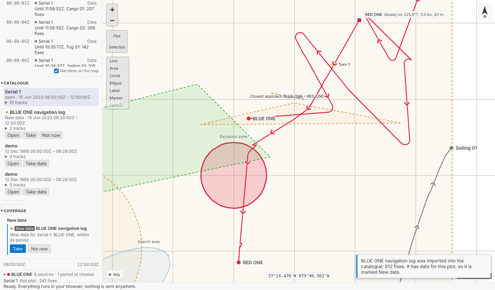
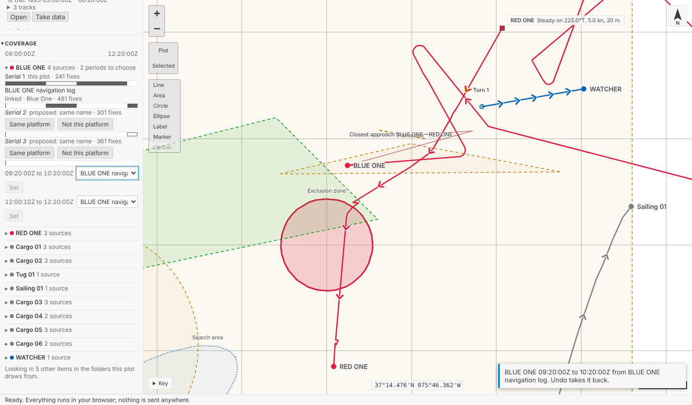
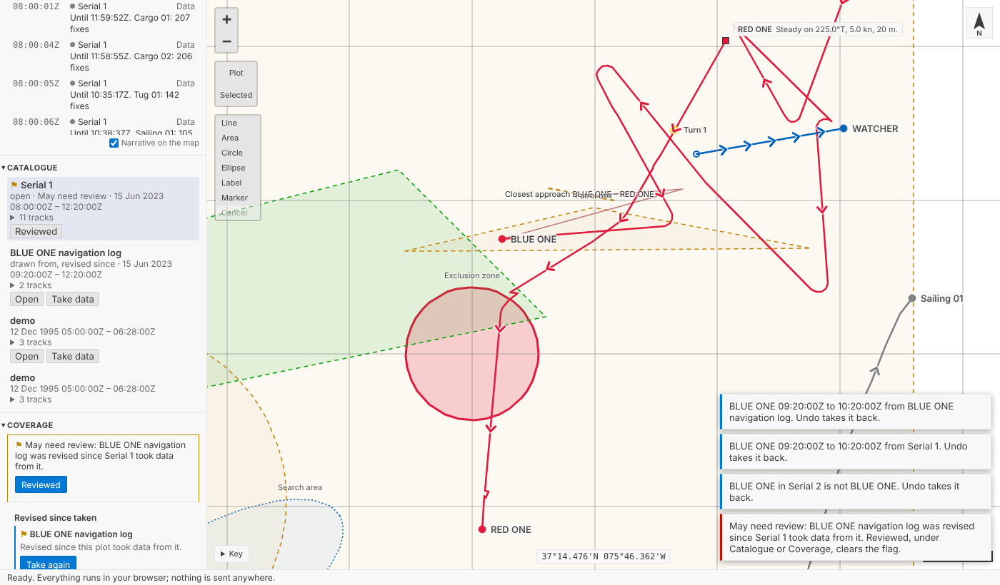
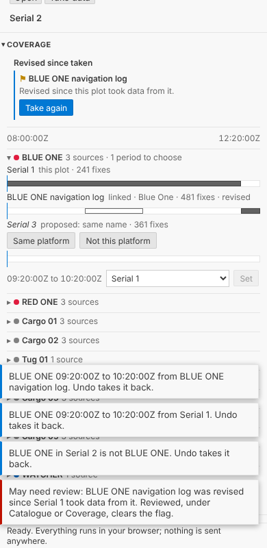
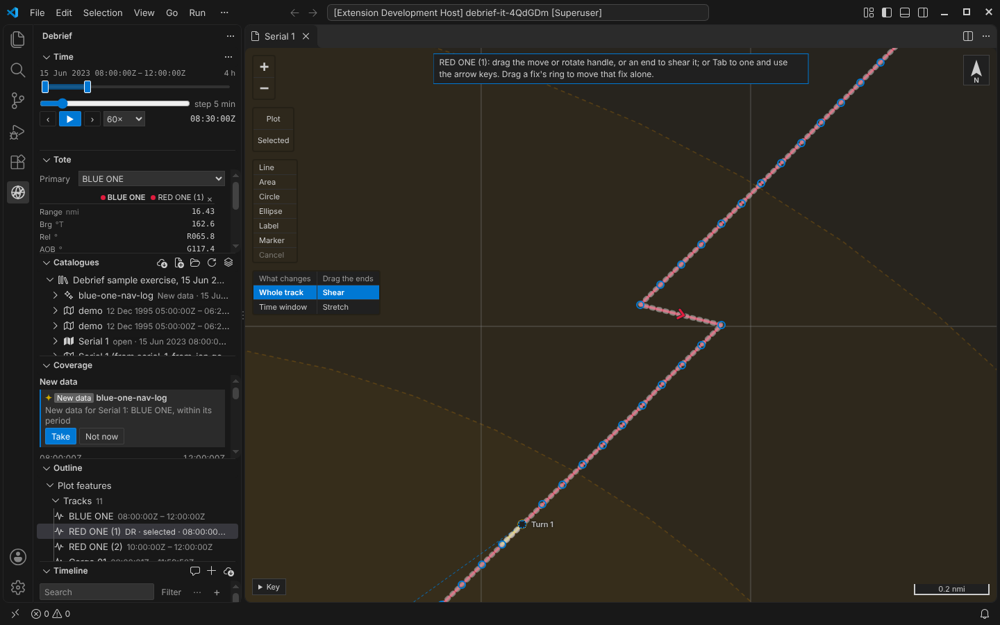
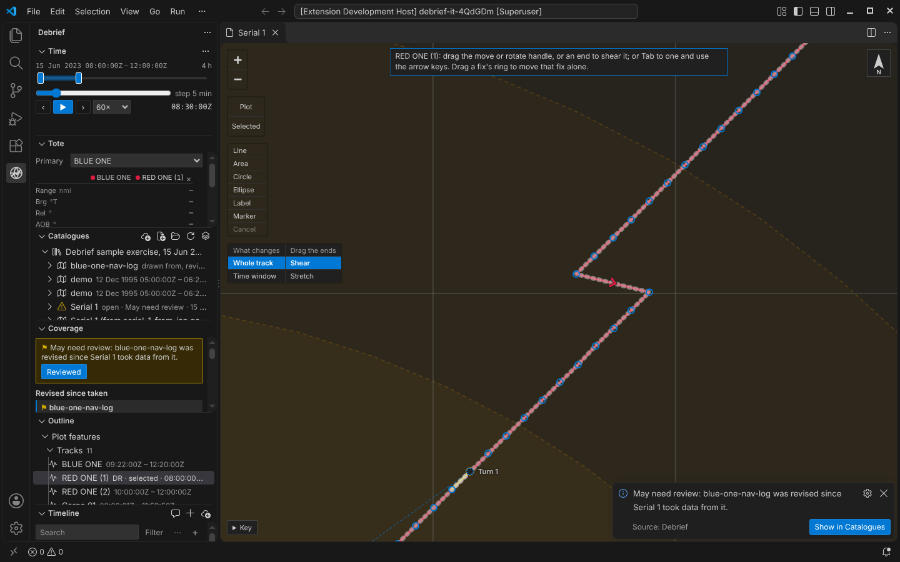

# Collation: one plot from many sources

An exercise rarely arrives in one file. The serial comes in from the range, a ship's own navigation log a day later, a colleague's corrected track the week after. Collation is putting them together: seeing which items have data for which platforms and when, choosing which supplies each period, and taking new data as it arrives without losing the work already done on the plot. Debrief now does all of that, from the catalogue, and keeps a record of every choice.

<!-- more -->

*The pictures come from the playground test, which plays the demo below in a browser, and from VS Code's own test. The tracks and the navigation log are made up, as the sample exercise is.*

## A source is a catalogue item

The product owner settled what a "source" is: a catalogue item. A serial, a navigation log, a colleague's plot file: each is an item in the catalogue, and Debrief keeps, in each item's STAC metadata, when it came in, its revision, and the periods each of its tracks has data for. So the catalogue knows its coverage from its items alone, without opening every plot.

## New data, marked

New data comes in only through Debrief's import: no folder is watched, nothing polled. Import a navigation log for BLUE ONE into the catalogue, and it is marked **New data** for the open plot, with a sparkle and the words, never colour alone. Its reason, *New data for Serial 1: BLUE ONE, within its period*, is its tooltip and what a screen reader says. Only files imported are marked, and only when they share a platform with the plot and have data within its period, in the folders the plot draws from: never a plot made from this one, nor one that is itself a collation of others. A colleague's copy of the plot is marked only once it adds data.

The log's track is called *Blue One*. Debrief proposes it as the plot's BLUE ONE, ignoring case and spaces, and leaves the analyst to confirm, refuse or link a track of another name by hand.

## Taking it, as one step

**Take** is one step, named for the item: *New data from BLUE ONE navigation log*. BLUE ONE gains the log's fixes where the plot had none, here its twenty minutes after the plot's track ended; WATCHER, a contact the plot had never seen, is added. Where the plot already has data, it stays the plot's, and the step's record says the log has data then too. The mark clears; the item is now *drawn from*. Undo takes all of it back.

The analyst's work on the plot comes through: annotations, the narrative, marks on fixes, colours. A track moved, rotated, sheared, stretched or smoothed carries the same correction onto the new fixes, worked out from each existing fix's offset from where its source puts it, their courses and speeds changed with it. A fix dragged on its own moves only the new fix at its time. A track plotted by dead reckoning carries its corrections to course and speed.

The Timeline lists each period of data as an entry, by the item supplying it (*Until 12:20:00Z. BLUE ONE: 120 fixes*), so the coverage of a plot can be read, searched and filtered with everything else.

## Which source, period by period

The log and the serial both have BLUE ONE from 09:20 to 10:20. Which is right? Per period, the analyst decides: Coverage cuts each platform's time, within the plot's own period, wherever the sources with data change, and offers a list for each period. Pick the log for that hour and press **Set** (or `Enter`; moving through the list changes nothing), and BLUE ONE is stitched: the serial's fixes before, the log's in the hour, the serial's after. One step, *BLUE ONE 09:20:00Z to 10:20:00Z from BLUE ONE navigation log*, whose record says what the period had and has. Clicking a source's bar in a period chooses it too.

Serial 2's BLUE ONE turns out to be a different ship. **Not this platform** is one step, *BLUE ONE in Serial 2 is not BLUE ONE*, and it is proposed no more.

## Revised since taken

A colleague corrects the navigation log. Any recorded change to an item is a new revision, so Serial 1, which took data from it, **may need review**. The playground says so in a note, VS Code in a notification with **Show in Catalogues**, and the plot is flagged in Catalogue and Coverage until the analyst presses **Reviewed**. **Take again** reads the periods the log supplies from its latest revision, carrying the analyst's edits again. Each period remembers the revision it was read at, so a plot that took one hour of the log before the correction and another after says so, and stays flagged until the older hour is read again. Taking a revision that changed nothing the plot took makes no step at all.

On a phone, Coverage keeps every source's line and bar and never scrolls sideways, down to 210 pixels and in a wider font:

## In VS Code

Catalogues lists each item's tracks and marks items *New data*, *May need review* or *drawn from*, each with its icon and words. An item's menu has **Take data into the open plot…**, **Not now** and **Reviewed**; a track's has **Same platform as a track in the open plot…** and **Not this platform**, all from the keyboard with `Shift+F10`. Coverage is a view below Catalogues, the same component as the playground's.

## For agents

`debrief/coverage` gives a plot's platforms, their sources and periods, and the items marked as new data. `debrief/take_new_data`, `debrief/set_source_preference` and `debrief/link_tracks` each make one step; `debrief/review_flags` lists every plot that may need review.

## Try it

Under *Try*, **New data arrives for this plot** imports a navigation log for the open plot's first track; **A colleague revises an item this plot drew from** corrects it once taken:

## Not yet

- **The Tote's study measures** (groups of measures, course and speed rates, Doppler, range rate, time) wait for multi-plot bulk analysis, as the product owner decided.
- **Folders aren't watched.** New data comes only through Debrief's import, by decision.
- **Reviewed isn't a step.** Clearing a review flag is view state, kept with the plot with who cleared it and when, not in its history, as the product owner decided.
