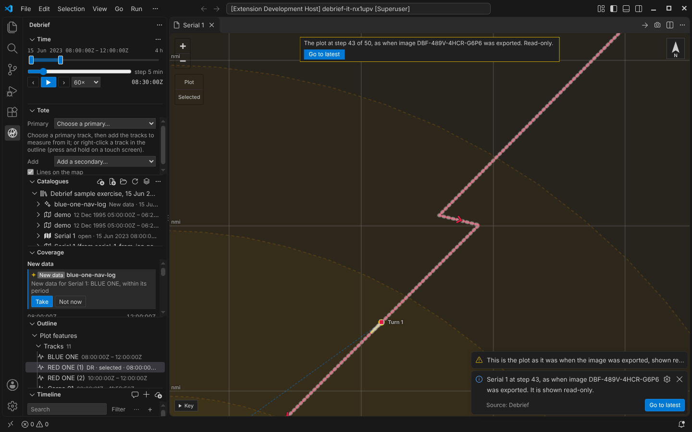

# Traceable figures: every image knows where it came from

A figure in a post-exercise report is only as good as the analysis behind it. Months later, someone asks: which plot is this, and was it before or after the track was corrected? Debrief's exported images now answer that themselves. Each carries an ID naming its plot and the exact step of the plot's history it was exported at, in its metadata and, small, in its corner; and **Find source of image…** takes the image, or that ID typed in, back to the plot as it was then.

<!-- more -->

*The pictures come from the playground test, which plays the demo below in a browser, and from VS Code's own test, on the sample exercise, which is made up.*

## The map, as you see it

**Export image…** draws the map as the analyst sees it: tracks, labels, symbols and arrows at their intervals, annotations, the narrative box, current time's markers, the north arrow and the scale bar. It is written from the map as the map drew it, so labels are where the map placed them, kept clear of one another, not placed again by something else. The map's buttons, its key, handles and the selection's highlighting are left out: they are for working, not for a report.

Three sizes: as on screen, a 16:9 slide (1600 × 900) and A4 landscape (1754 × 1240, 150 dots an inch). For a slide or A4 the map is laid out at that size for a moment, so its labels are placed for it, then put back. The colours are the editor's, or light ones for print whatever the theme. PNG or SVG; no JPEG.

## An ID in every image

Every image carries an ID like `DBF1-PTETVDX3-KG8RB9E5X7Y58R98-M6SC7N75-Z` in its metadata: a PNG's own text chunk and its XMP, an SVG's metadata. It names three things: the plot (by its catalogue and item, hashed: never its title), the plot's revision at the moment of export (the content hash its history records for that step), and the export itself. Nothing else goes into the image.

Word and PowerPoint may keep a picture's metadata, but often will not: Word compresses a document's pictures when it saves, by default, and saving as PDF re-encodes them. So a short form of the ID, `DBF-PTET-KG8R-B9EM-69`, is drawn in a corner, haloed so it reads on any colours, in whichever corner it covers least of the plot, and big enough (1.4% of the image's width) to read when the picture sits at half a page's width. That footer is the main trace. It is on for every export: turned off for one, it is on again for the next. Fourteen letters and digits, with no I, L, O or U to confuse, and a check: a mistyped one is caught, not looked up. Two of them are the export's own, so two images of the same view have different footers, and typing one opens that export's own view and time.

Each export is recorded in the plot itself, in its export log: the ID, when, who, the area and time shown, the Tote's tracks, the size and the file's name. A plot in a read-only catalogue cannot be written, so its exports go into the analyst's own export log, beside their Debrief settings, which **Find source of image…** reads too: every export stays traceable. The log is view state, like the time window, so an export is never a step in the plot's history: it changes neither the plot's revision nor anything that drew data from it.

## Back to the source

The plot moves on: a track recoloured, a fix corrected. The figure in the report still shows the plot as it was. **Find source of image…** takes the image file (or a Word or PowerPoint file, read picture by picture) or the ID typed from its corner, finds the plot in the analyst's catalogues and opens it at the step the image was exported at, rebuilt from its history and checked, as undo is, at the area and time exported, its Tote worked out as it was then. It is shown read-only: the map says so, every change is refused and said, and **Go to latest** returns to the plot as it is now.

A plot that has since moved to another catalogue, or been sent to a colleague, is still found, by its revision, and said to be a copy. Where an ID matches more than one export, each is listed with when it was made and the area it showed, and the analyst chooses: Debrief never guesses. A report with several figures is read picture by picture, so each traces.

## In VS Code

**Export image…** is on the map's title bar (the camera), the Outline's menu and the Command Palette: a size, what it shows (the ID in a corner, light colours), and where to save it. **Find source of image…** is on the Catalogues' menu: choose a file, or type the ID.

## For agents

`debrief/export_image`, `debrief/find_image_source` and `debrief/open_revision` do the same for an agent. An agent's export is drawn by the map open in VS Code, exactly as the analyst's is: the tool service asks VS Code, which draws it (the map laid out at the image's size for a moment, under a picture of itself) and writes the file, only into the workspace or the folder set for exports, and never over a file without asking the analyst. With no map open, the agent is told so.

## Try it

Export the map, change the plot (recolour a track), then choose the image you saved, or type its ID, under **Find source of image**:

## Not yet

- **No map, no agent export.** An agent's export needs the map open in VS Code; the playground has none for agents.
- **A PDF of a report loses the metadata.** Its pictures are re-encoded; the footer is the trace there.
- **One view at a time.** Several views exported together come with the storyboard.
