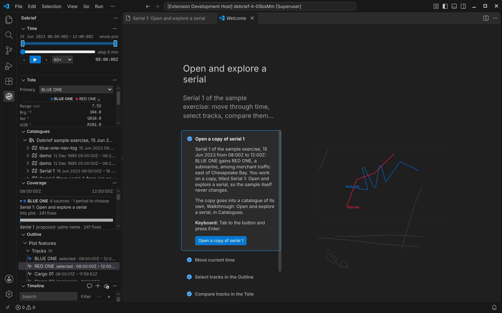
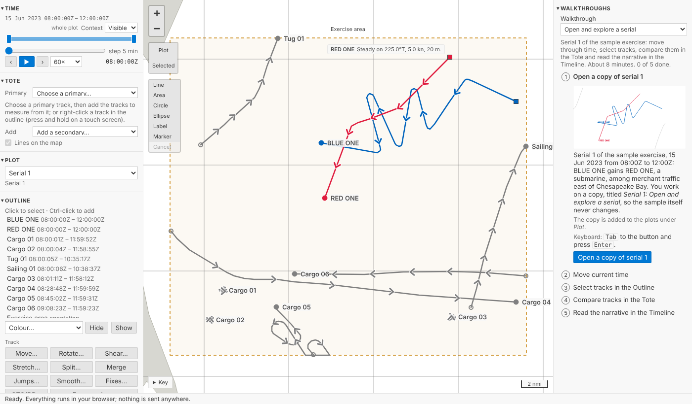

# The first hour: walkthroughs, and a web demo to try them in

An analyst new to Debrief should be producing something useful within an hour of first opening it (OUT-05). Debrief now has four short walkthroughs that teach the common work on the sample exercise, each step ticking itself off as the analyst does it, in VS Code and in the browser alike; and a web demo, full screen, where anyone can try them without installing anything.

<!-- more -->

*The pictures come from the playground's test, which plays every walkthrough start to finish in a browser, and from VS Code's own test, on the sample exercise, which is made up.*

## Four walkthroughs

| Walkthrough | What it teaches |
| --- | --- |
| Open and explore a serial | Current time and the time window; selecting tracks in the Outline; comparing them in the Tote; reading the narrative in the Timeline |
| Import and collate | Importing a REP file; seeing which source has data when, in Coverage; taking new data; choosing which source supplies a period |
| Tidy a track | Removing GPS glitches; smoothing; marking and labelling a fix; shearing a leg, the drag analysts use most in TMA |
| Annotate and export a figure | Drawing an annotation; labelling tracks with their times; exporting an image that traces back to its plot; finding that plot from the image |

Each takes about ten minutes and works on **a fresh copy** of the sample's serial 1, titled after it (*Serial 1: Tidy a track*), so the sample itself never changes. A walkthrough can always start again clean: its copy is replaced and its steps unticked. *Tidy a track*'s copy comes with three GPS glitches in RED ONE, put in as a step of their own in its history so they are never mistaken for real data; *Import and collate*'s comes with BLUE ONE's navigation log, a REP file waiting to be imported.

## Ticked by doing, not by clicking

Every step says what to do, where it is, and how to do it from the keyboard, with a picture drawn from the sample. Its button only takes you there: it opens the copy, or brings the panel or the command to hand. The step ticks itself off when you have actually done it, however you did it: from the form, on the map, from the keyboard. Finding the jumps ticks nothing; removing them does. A preview of smoothing is not smoothing; moving or stretching a track is not shearing it. And only the walkthrough's own copy counts: the same change to another of your plots ticks nothing, and with another plot open a step's button opens the walkthrough's copy before it does anything.

## In VS Code: the Get Started page

In VS Code the walkthroughs are on the **Get Started** page, as any extension's are: **Debrief: Walkthroughs** in the Command Palette, or **Start a walkthrough** in Catalogues before any catalogue is added. **Open a copy of serial 1** builds the sample into a catalogue of the walkthrough's own, *Walkthrough: Tidy a track*, never touching the analyst's catalogues; pressed again, it asks whether to start again with a fresh copy or carry on.

The words of every step live in one file, which VS Code's walkthroughs are written from and the browser's panel reads, so the two never say different things.

## The web demo

The <a href="../../../../../demo/">web demo</a> is Debrief full screen in your browser: every panel, the walkthroughs open in a column of their own on the right of the map, and the three serials of the sample exercise. With the steps beside the map, a step's words stay in sight while you do it in the side panels and on the map; fold the column and the map takes its place. On a phone the walkthroughs are the first panel instead. The Python tools run in the page, under Pyodide, as in the blog's demos. You can open a file of your own there too, a REP file, a legacy plot or a Word narrative: it is read in your browser and nowhere else. The demo's test opens such files, filters and highlights them in the Timeline, and exports and traces an image, watching every request the page makes. None carries the files, nothing is sent at all, not even as the tab closes, and nothing derived from them is kept in any of the browser's stores, so they are gone when you close the tab. The page also carries a strict Content-Security-Policy. One thing it cannot vouch for: Python itself, Pyodide, comes from the jsDelivr CDN without an integrity check, a risk we have accepted.

## Is an hour enough?

The SRD's target (NFR-09) is an hour to import a serial, compose a storyboard and export it. The storyboard comes in Phase 4, so for now the product owner will trial what exists: import a REP file and a legacy plot, tidy a track, annotate, and export a figure traced back to its plot, against a provisional 40 minutes, with analysts who know the domain but have never used Debrief. It is a formative trial, its pass rule written down before it starts: four in five finish without help, the median quiet run within 40 minutes, no one over an hour. The protocol is written; the trial itself is still to be run. Meanwhile the playground's test does the trial's four tasks as a speed run, as fast as the page answers: 32 actions in all.

## Try it

Open **Walkthroughs**, at the top of the side column (in the web demo, on the right), choose one and press its first button:

## Not yet

- **The trial.** The onboarding trial with analysts is pending; its results will be posted.
- **The storyboard.** NFR-09's full hour, storyboard included, is trialled again when the storyboard arrives in Phase 4.
