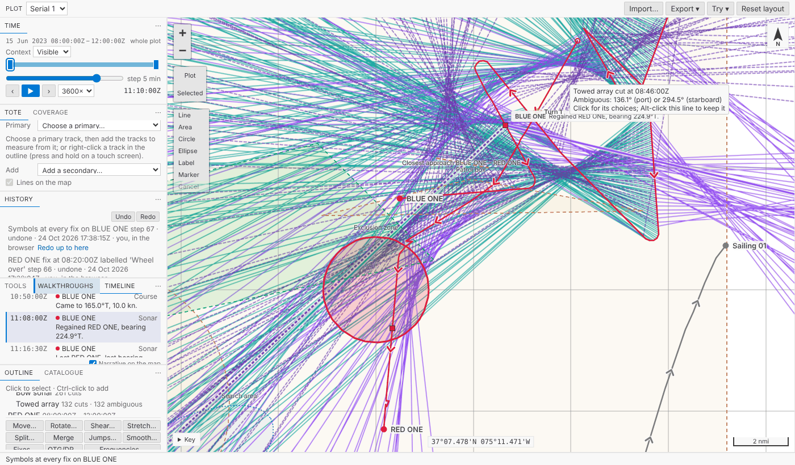
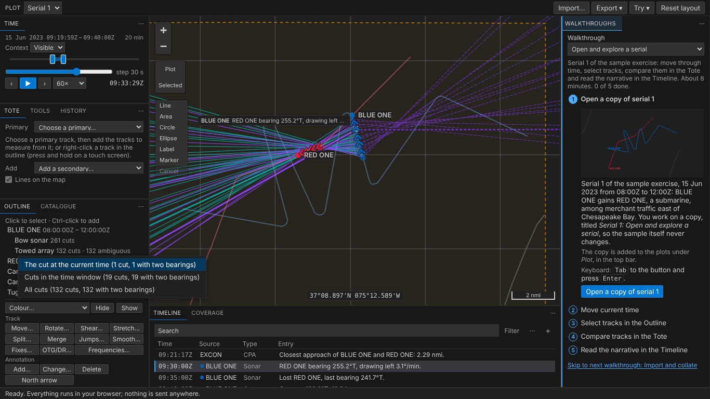
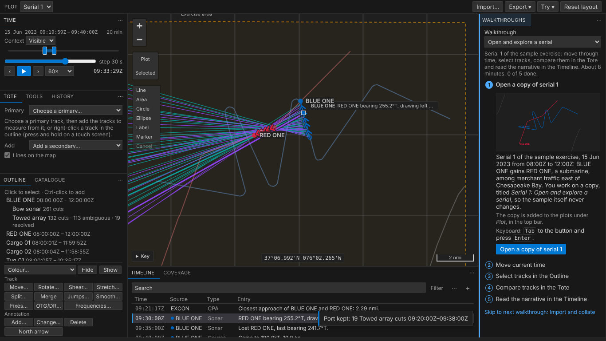
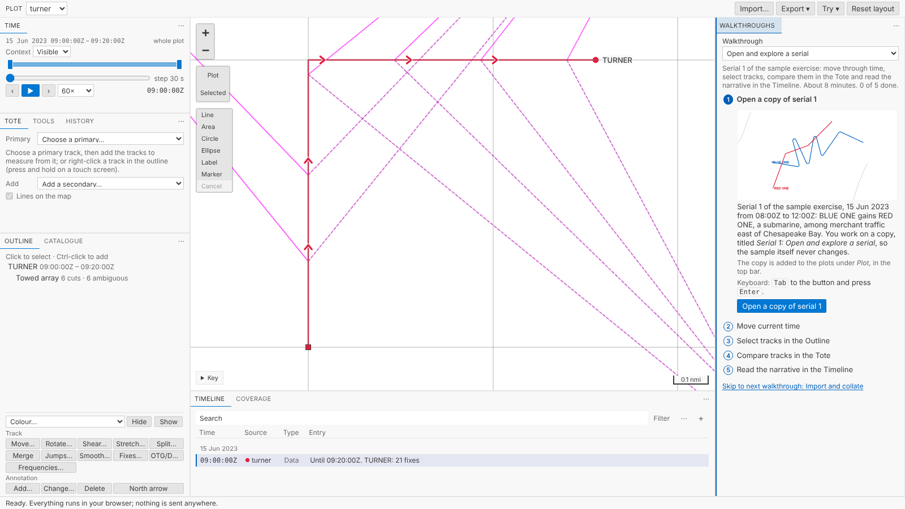

# Sensor bearings

Bearings are where TMA starts. Legacy Debrief drew a platform's sensor cuts as lines from its track, and let you say which side of a towed array a contact was on. Debrief now does the same: bearings come in from REP and DSF files, legacy plots and a Rider's narrative, are drawn from the track at their time (or from a towed array trailing behind it), only in the time window, and a towed array's ambiguous pairs are resolved one cut at a time or a period at once, each an undoable step.

<!-- more -->

*The pictures come from the playground, which runs in a browser, and from VS Code's own test. The tracks and bearings are the sample exercise's, made up as the exercise is.*

## Cuts in the window, from the track

The sample's BLUE ONE now carries two sensors: a **bow sonar** (teal) and a **towed array** (purple). Each shows in the Outline under its track, saying how many cuts it has and how many are still ambiguous. With a twenty-minute window, the map draws only that window's cuts, each from where BLUE ONE was when it was taken. The bow sonar's point at RED ONE. The towed array's come in pairs: the array can't tell left from right, so each cut is two bearings mirrored about BLUE ONE's course, the one to port solid and the one to starboard darker and dashed. The cut current time is at is wider, with a dot where it was taken from.

Point at a line and it says what it is: the sensor and time, both bearings and the side each is on.

## Keep a side

**One cut:** click it. A click only selects the cut, and its choices appear beside it: what it is, **Keep 051.0° (port)**, **Keep 129.0° (starboard)** and **More…** for its menu. Choose the bearing you believe and the other goes, one step: *Port bearing kept on Towed array cut at 09:09:30Z*. In a hurry, `Alt`-click the line you believe. A click never keeps a side by itself, so selecting a cut, or double-clicking to zoom, can't change it by accident (the review panel caught that the first version kept a side on any click). Right-click (or press and hold on a touch screen) for the cut's menu: keep either bearing, make it ambiguous again, or select it.

**A period:** the usual case after a turn, when the true bearings held steady and their mirrors swung. A sensor's menu in the Outline (right-click, or `Shift+F10`), or, with the sensor selected, **Port…** and **Starboard…** under *Sensor*: choose the side, then which cuts, the one at current time, those in the time window, those you've selected, or all of them, each saying how many it holds.

Port is kept for each cut by the side of the course BLUE ONE *logged* at that cut's time, as legacy Debrief told it. One step for all nineteen, named so the History says what was done: *Port kept: 19 Towed array cuts 09:20:00Z–09:38:00Z*. Its record holds the side, the sensor and the period asked for. Undo takes it back; **Both again…** (*Make ambiguous again*) is a step of its own, for when you change your mind later.

## Port and starboard, as legacy told them

Which side is port depends on the course, and at a turn "the course" is a choice. Legacy Debrief took the course logged at the first fix at or after the cut's time. Our first version took the direction of the line between the fixes either side, and the review panel found legacy's own `legs_20.rep` where the two disagree: a cut taken in the minute the ship turned. TURNER above logs 000 heading north, then 090 at the 09:10 fix, having turned. Its cut at 09:09:30 is told against 090, as legacy told it: 051° is to port. Against the line between the fixes, still running north, it would have been starboard, and keeping port would have kept the wrong bearing. The case is now in the vectors both languages are held to.

## The array is behind the ship

A towed array trails hundreds of metres astern, and through a turn it's still on the leg the ship has left. Legacy Debrief drew its cuts from there, and now Debrief does too. **Towed array offset…** on the sensor's menu in the Outline: type the distance in your units, and how it follows: **worm in the hole** (legacy's default, back along the ship's own track) or **plain** (straight astern). One step, undone like any other: *Towed array: 600 m astern, worm in the hole*. A legacy plot's array offset comes in with the plot.

The cuts are drawn, and their sides told, from the array. Where the track before a cut is shorter than the array, it is run on astern of the first fix, as legacy did.

## Where the bearings come from

The product owner asked for every source legacy Debrief read, ported with its tests and its quirks:

- **REP `;SENSOR:`, `;SENSOR2:` and `;SENSOR3:` lines**: a bearing and range; a bearing and its ambiguous twin; a bearing with its accuracy, kept with the cut as written. `NULL` and `NaN` are no value, as legacy read them, and a line with no bearing gives no cut and is counted. A range of 0 on a `;SENSOR2:` or `;SENSOR3:` line is a dot where the cut was taken, as legacy drew it.
- **DSF files**, REP files of sensor lines alone, read into the open plot: **Read sensor data into this plot (DSF, REP)…** on the Outline's menu, or *Sensor data into the open plot* under **Import…** in the playground. A sensor's track is the plot's track of its name, or the first starting with the same six letters, as legacy matched it; otherwise you're asked which track carries it, as legacy asked. A match by the first six letters only is offered first and asked to be confirmed, since a near name may be another ship.
- **Legacy plots (.dpf)**: each track's sensors and their contacts, with an array's offset, no longer listed as not imported. Older legacy Debrief wrote an ambiguous bearing of `0.000` on cuts that never had one; those come in as plain bearings, and cuts legacy resolved come in resolved.
- **A Rider's narrative (Word)**: a Rider entry's bearing, and its ambiguous twin, becomes a cut of the sensor *Rider bearings* on the platform's track, as legacy made it.

**Frequency isn't imported**: acoustic analysis stays in the acoustic replay application, and the import says how many cuts gave one.

## Lines, not wedges

We were asked to draw a bearing with its error as a wedge, where the data gives an error. We checked every format: `;SENSOR:` and `;SENSOR2:` carry none; `;SENSOR3:` carries a "bearing accuracy" that legacy Debrief read and threw away, that legacy's samples leave `NULL`, and whose meaning no format or code states; legacy plots carry none. So, by the product owner's decision, bearings are lines, and `;SENSOR3:`'s accuracy is kept with each cut as written, for when its meaning is agreed. A wedge waits for an error field agreed with the acoustic replay application's owners; the model can take one later without changing anything you see.

## Thousands of cuts, smoothly

A towed array reporting every few seconds over a long deployment gives tens of thousands of cuts. Only those in the time window are drawn, painted as one picture rather than thousands of lines, each worked out once along the geodesic and cut into only as many pieces as the screen needs. The current cuts have a picture of their own, so playing time redraws one line per sensor. Measured: legacy Debrief's own large sample, 200,000 fixes with 611 cuts, draws in 46 ms and redraws in under 2; 10,000 cuts in the window redraw in about 13 ms, within a frame; moving current time takes a tenth of a millisecond however many there are. Working out which side 600 cuts keep, on that 200,000-fix track with a 500 m array, took 2.75 s; it now takes 0.21 s, reading only the fixes it needs. Saving the step still takes about 4 s on a plot that size, the cost of writing any change to it, which the History will take on next.

## In VS Code

The same, in VS Code's own way: sensors under their track in the Outline, **Ambiguous bearings: keep port or starboard…** and **Cut at current time…** on a sensor's menu, and quick picks for the side and the cuts.

## For agents

`debrief/sensors` lists a plot's sensors, and with `cuts: true` each cut in a period with its time, bearings, which was kept, the side and where it's drawn from: what a TMA solution will be rooted in. `debrief/resolve_ambiguity` keeps a side for cuts named, or for a sensor's cuts in a period, as one step. `debrief/set_array_offset` puts an array astern. `debrief/import_sensor` reads a file's sensor lines in, naming the track for any the plot hasn't.

## Try it

Set a short window in *Time*, then click one of the towed array's lines and choose a bearing to keep, or select the Towed array in the Outline and use **Port…** under *Sensor*:

## Not yet

- **Wedges**, until an error field is agreed.
- **Proposing the sides for you**: a tool that reads ownship's turns and proposes each cut's side, for you to confirm, is a recorded future requirement.
- **A list of a sensor's cuts**, coming with TMA, where a solution's period is chosen.
- **TMA** itself, next: a solution rooted in the window's cuts, dragged with its bearing residuals live.
