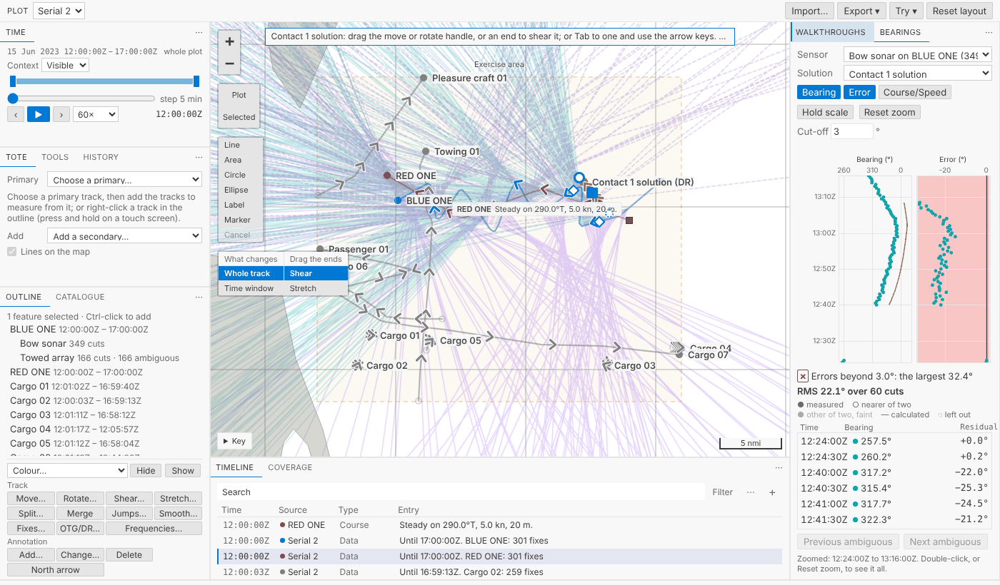
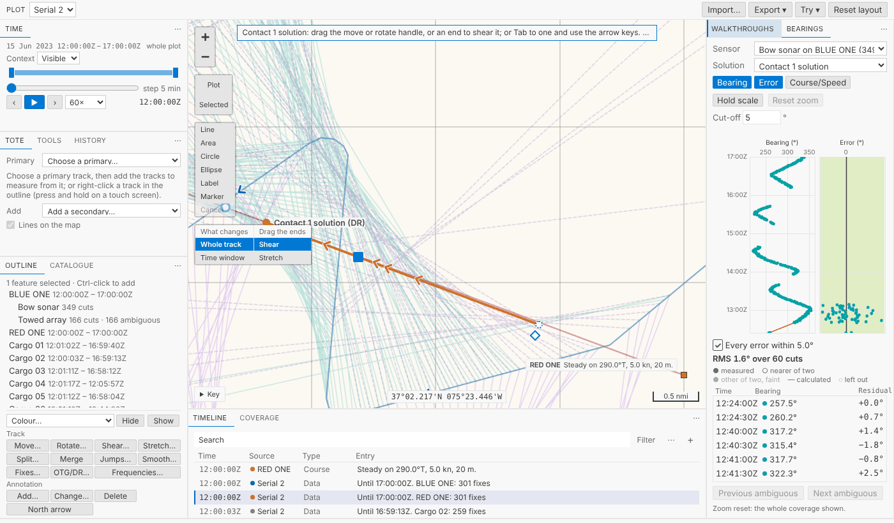

# TMA solutions

Bearings were the ground; this is what stands on it. Choose a period of a sensor's cuts, make a first guess at where the contact was and how it moved, and drag it on the map while its bearing residuals follow the drag, after legacy Debrief's Stacked Dots. Leave a wild bearing out of the RMS, split the solution into legs at a manoeuvre, and drag each leg on its own. Every one of those is a step you can undo, and a legacy plot's solutions come in as solutions.

<!-- more -->

*The pictures come from the playground, which runs in a browser. The tracks and bearings are the sample exercise's serial 2, made up as the exercise is: BLUE ONE zigzags astern of RED ONE to get its range.*

## Choose the period

A new **Bearings** view stands tall to the right of the map, a tab behind the walkthroughs (in VS Code, in Debrief's side bar). Select a sensor, or its track, and it lists the sensor's cuts: time, sensor and bearing, both bearings for a towed array's unresolved pairs. The list is virtualised: only the rows in sight are in the page, so a sensor with thousands of cuts scrolls as easily as one with ten. It's a listbox for the keyboard: `Up` and `Down` move, `Shift` with them extends the period, `Home` and `End`, `Enter` moves current time to the cut so the map picks it out. Until you choose, the period follows the time window.

## A first guess

**Make solution…** opens the first guess: where the contact was, along the first cut's bearing, and the course and speed it kept. Debrief fills in its own guess, 10,000 yards out (in your units: *4.94 nmi*), a course across the bearing, 8 knots, and says beneath each field what it has read as you type. Here the analyst does as legacy's tutorial teaches: pins the start on the first bearing, 1.73 nmi out, and guesses the rest, 320°, 5 kn.

Or **Two clicks on the map instead**: the first and last cuts' lines are drawn, and you click on each where you think the contact was. Each click is taken onto its line; the course and speed follow from the two points and the cuts' times.

Either way it's one step, named so the History reads it: *Contact 1 solution made: 60 Bow sonar cuts 12:24:00Z–13:08:30Z*. The solution is an ordinary track plotted by dead reckoning, with a fix at each cut's time, tagged **TMA** in the Outline. That's the important design choice: every drag you already know (move, rotate, shear, stretch) works on it unchanged.

## Residuals, live

With the solution selected, the view becomes legacy's Bearing Residuals, its Stacked Dots, laid out as legacy laid it out: time runs up the left, the latest at the top, and beside each other the **Bearing** pane (every cut of the sensor, the solution's bearings as a line where it is) and the **Error** pane (each residual), with a **Course/Speed** pane to turn on for ownship's course and the solution's course and speed. The Error pane is pink until every error is within your cut-off (3° unless you set another), then green, and says so in words too.

Then do what legacy's tutorial says: drag the solution's end on the map (a shear: course and speed change together, the start held) and watch the errors. They move with the drag, every frame, marked *(while dragging)*, and the Error axis fits them every frame too, so as they shrink they still fill the pane. Drag until they flatten about zero and the pane turns green. Let go and the step is saved, and Python's residuals replace the browser's.

For the fine tuning, drag a box round the leg's errors to zoom in; the zoom stays while you drag, and a double-click undoes it. **Hold scale** keeps the Error axis still if you'd rather; it widens rather than hide an error. Click a dot and its cut is selected, on the map and in the Outline, and current time goes to it.

The residuals are worked out in the browser with the same geodesic and the same rules as Python, held to the same test cases in both languages. A whole frame of 2,000 cuts (the residuals, the list and all three panes) takes 7 to 11 ms in Chromium, 600 about 4 ms.

Every cut of the period counts, from where it was taken, a towed array's from the array astern, except cuts you've hidden on the map, as legacy's *Only plot visible data* left them out: they come back as soon as you show them. A towed array's cut you haven't resolved is measured by whichever of its two bearings is nearer the solution, and the view says so, so you know the RMS assumed a side. Its other bearing is drawn too, faint and not counted, so you can see which side the plot favours. **Next ambiguous** (`Alt+Down`) takes you to the next one to resolve, right there in the view.

## Wild bearings and legs

A bearing you don't trust: choose it and press `Space` (or untick it) and it's left out of the RMS, one step, its dot a dotted ring. Undo counts it again.

A manoeuvre: choose the cut where the contact turned and **Split into legs at 12:53:30Z**. The solution stays one track, in two legs. On the map, choose **This leg** and click the leg you want: only that leg moves. As in legacy, each leg is independent: a leg you've already fitted never moves when you drag its neighbour; only the stretches joining it to the legs either side are worked out again. Merging two solutions moves nothing either.

## From legacy plots

A legacy plot's TMA track now comes in as a solution: absolute legs as they were saved, relative legs (an offset from the host's sensor) turned into positions at import, along the geodesic where legacy used a flat earth, and the notes say how far any fix moved from where legacy drew it (a few hundredths of a mile on legacy's samples). It's rooted in its sensor's cuts, so its residuals are there at once.

## For agents

`debrief/tma_create` makes a solution from a sensor's cuts and a period (or named cuts), a contact, and a first guess or none for Debrief's defaults, and answers its residuals. `debrief/tma_residuals` reads them. `debrief/tma_exclude_cut` leaves cuts out of the RMS or counts them again, and `debrief/tma_split_leg` splits a solution into legs. Each change is one step, recorded with what was asked.

## Try it

Open *Serial 2*, select **Bow sonar** under BLUE ONE in the Outline, open the **Bearings** tab right of the map, choose a period of cuts and **Make solution…**; then drag the solution's end on the map until the Error pane turns green.

## Not yet

- **Generated solutions**: SATC, or a solution fitted to the bearings, stay out of scope.
- **Residuals while ownship is dragged**: they're worked out again when the drag is saved, not while it goes.
- **Several sensors in one list**: agents can root a solution in several sensors' cuts; the view lists one at a time.
