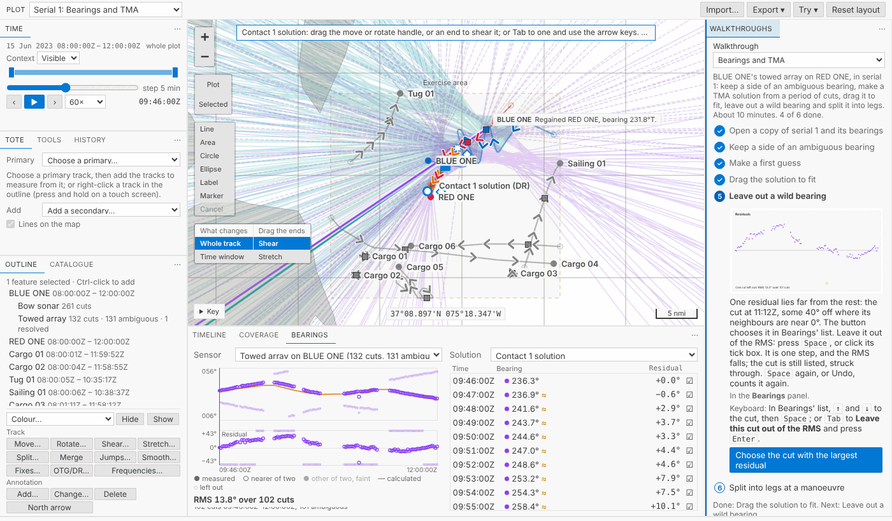
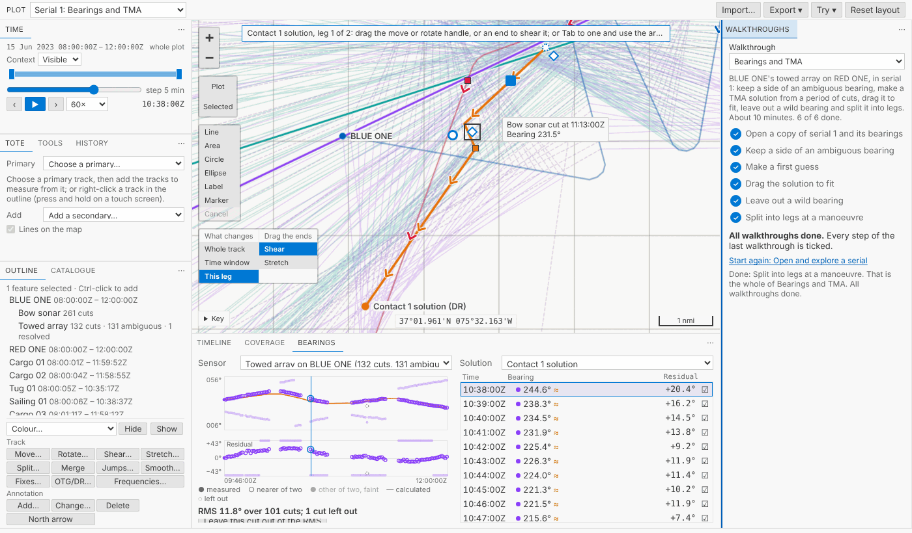

# A walkthrough for bearings and TMA

Sensor bearings and TMA solutions had no walkthrough: the only taste of TMA was *Tidy a track*'s shear. Now there is a fifth, **Bearings and TMA**, after *Annotate and export a figure*. Six steps, about ten minutes, on a fresh copy of serial 1, the same in VS Code's Get Started page and in the browser.

<!-- more -->

*The pictures come from the playground, which runs in a browser. The tracks and bearings are the sample exercise's serial 1, made up as the exercise is.*

## The steps

1. **Open a copy of serial 1 and its bearings.** Bearings lists BLUE ONE's towed array, each cut two lines on the map until you keep one.
2. **Keep a side of an ambiguous bearing.** The button chooses the cut at 09:46Z. The Bow sonar isn't ambiguous and says 235°, so keep 236.3° (starboard).
3. **Make a first guess.** The button chooses the towed array's cuts from 09:46Z to 12:00Z and opens the first guess with Debrief's defaults. Its RMS is over 50°: far off, as a first guess should be.
4. **Drag the solution to fit.** Shear it about its start, by its diamond or by typing about 215° at 3 knots, and watch the RMS fall to about 14°.
5. **Leave out a wild bearing.** The button chooses the cut with the largest residual, at 11:12Z; `Space` leaves it out.
6. **Split into legs at a manoeuvre.** The residuals climb until 10:32Z and fall after it: RED ONE turned. Split at 10:38Z, choose **This leg** on the map and drag the first leg. Its residuals fall and the second leg stays where it is.

Each button does that step's choosing for you, and you do the step. Each step ticks only when you've done it: a side kept, a solution made, dragged, a cut left out, a split.

## What we had to bend

The sample had no wild bearing, because its towed array's errors are about 2°. So the copy has one cut turned 40° off, as *Tidy a track*'s copy has its GPS glitches, and History says so. We chose serial 1 over serial 2 because RED ONE stays close in serial 2, within 3 nmi, so Debrief's 4.94 nmi first guess has nowhere near enough to work with. Serial 1 also has a turn to split at. A test plays the steps on the sample and fails if it stops giving the numbers the steps quote.

## Try it

Open the <a href="../../../../../demo/">web demo</a>, choose **Bearings and TMA** in **Walkthroughs**, and press its first button.
