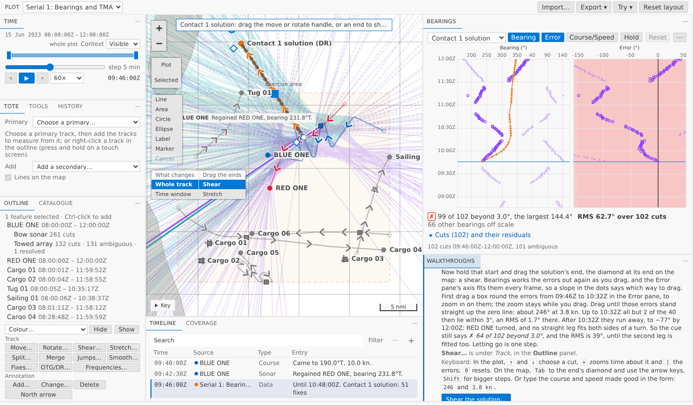
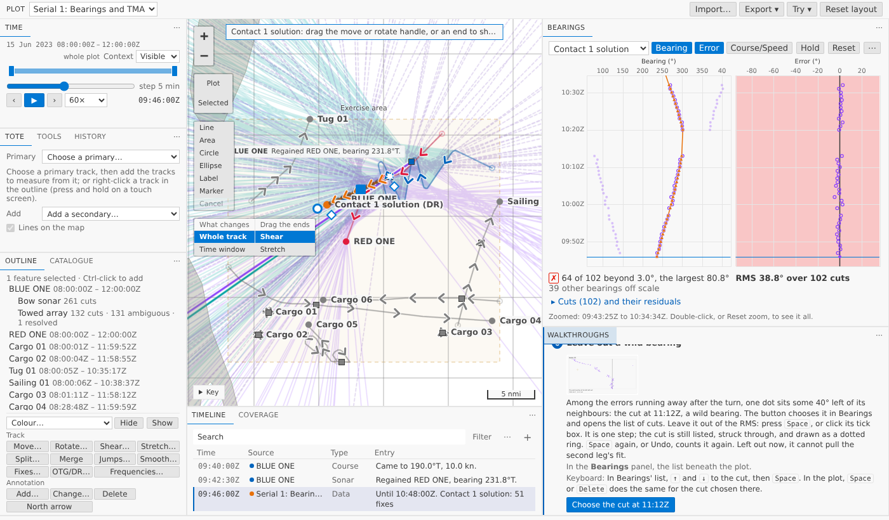
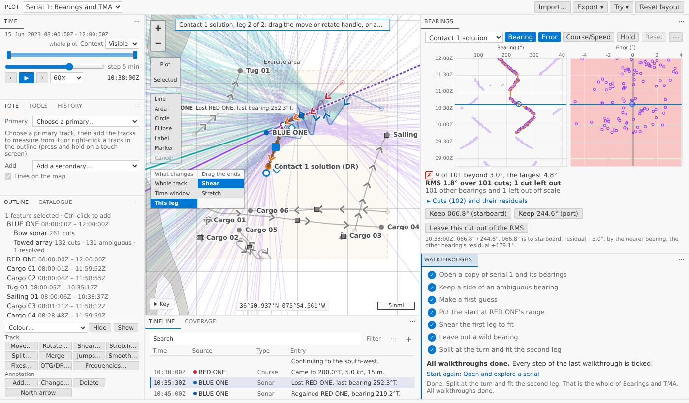

# A walkthrough for bearings and TMA

Sensor bearings and TMA solutions had no walkthrough: the only taste of TMA was *Tidy a track*'s shear. Now there is a fifth, **Bearings and TMA**, after *Annotate and export a figure*. Seven steps, about twelve minutes, on a fresh copy of serial 1, the same in VS Code's Get Started page and in the browser. It fits a solution the way legacy Debrief's TMA tutorial teaches, one leg at a time, and ends near what the bearings allow.

<!-- more -->

*The pictures come from the playground, which runs in a browser. The tracks and bearings are the sample exercise's serial 1, made up as the exercise is.*

## The steps

1. **Open a copy of serial 1 and its bearings.** Bearings lists BLUE ONE's towed array. Each cut is two lines on the map, mirrored about the array's heading, until you keep one.
2. **Keep a side of an ambiguous bearing.** The button chooses the cut at 09:46Z. The Bow sonar isn't ambiguous and reads 235.3° then, so keep 236.3° (starboard). The other ambiguous cuts are measured by whichever side is nearer the solution, and Bearings says so.
3. **Make a first guess.** The button chooses the towed array's 102 cuts from 09:46Z to 12:00Z and opens the first guess: 4.94 nmi out along the first bearing, across it, 8 knots. Its RMS is 56°, far off, as a first guess should be.
4. **Put the start at RED ONE's range.** Bearings never tell you range. An analyst tries one, fits, and tries another; the walkthrough gives it, 3.27 nmi. Move the whole solution 1.67 nmi along the first bearing, towards BLUE ONE. The RMS goes *up*, to 63°, because the course and speed are still the guess's.
5. **Shear the first leg to fit.** Box the errors up to 10:32Z in the Error pane, then drag the solution's end, its start held: about 246° at 3.8 knots. Those 40 errors stand on the zero line, an RMS of 1.7°. After 10:32Z they run away: RED ONE turned.
6. **Leave out a wild bearing.** Among the errors running away, one sits 40° left of its neighbours: the cut at 11:12Z. `Space` leaves it out.
7. **Split at the turn and fit the second leg.** Split at 10:38Z, choose **This leg**, pin the second leg's start on its own first bearing and shear its end: about 200° at 5.2 knots. The RMS comes down to 1.8°.

Each button does that step's choosing for you, and you do the step, from the mouse or the keyboard; each step says which keys. Each step ticks only when you've done it: a side kept, a solution made, moved, sheared, a cut left out, a leg dragged after the split.

## Why the cue stays red

Bearings shades its Error pane green when every error is within the cut-off, 3° unless you set another. The sample's sonar is good to about 1.5°, so over a hundred cuts a few always land beyond 3°. RED ONE's true track leaves 8 of the 101 beyond, the largest 4.4°. The walkthrough ends at 9 beyond, the largest 4.8°, and the last step says what to aim for instead: an RMS under about 2° and only a handful beyond.

## What we had to bend

The sample had no wild bearing, so the copy has one cut turned 40° off, its two bearings turned opposite ways so they still mirror about the array's heading, and History says so. The range in step 4 is given, not found. A test plays the steps on the sample and fails if it stops giving the numbers the steps quote; another plays them in the browser through the forms and gets the same.

## Try it

Open the <a href="../../../../../demo/">web demo</a>, choose **Bearings and TMA** in **Walkthroughs**, and press its first button.
