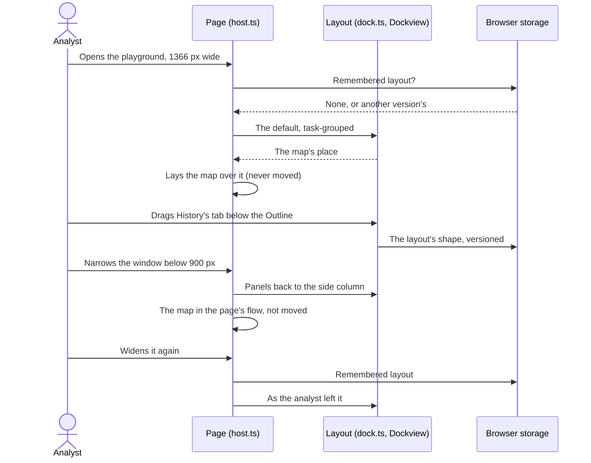

# Browser layout

How the panels are laid out in the browser: the playground, the web demo at `/demo/` and the blog's demos. VS Code is unaffected: it has its own sidebar, panels and editor area, which analysts arrange as they arrange any VS Code view.

## Requirements cited

| SRD | Requirement |
| --- | --- |
| CON-05 | Three hosts: native VS Code views, webviews inside VS Code, and a standalone web build. |
| CON-06 | A web-only host supplies the `--vscode-*` theme variables. |
| CON-09, DEP-06 | The web build serves the demonstration instance and the blog's examples. |
| DEP-07 | Files the analyst chooses are read in the browser only, never sent or stored. |
| NFR-13 | Themes honoured; everything operable by keyboard. |

## Model

1. **Docked, 900 pixels wide and more** (decision, product owner, 23 Oct 2026). The panels sit in tab groups around the map, and the analyst drags a tab to rearrange them. Each group shows one panel at a time; its tabs name the others. The default is *task-grouped*:

    ```text
    ┌──────────────── top bar: Plot ▾ · Import… · Export ▾ · Try ▾ · Reset layout ─────────────┐
    │ Time                │                                │ Walkthroughs | Tools | History  │
    │ Tote                │             map                │ (Walkthroughs in front)         │
    │ Outline | Catalogue ├────────────────────────────────┤                                 │
    │                     │ Timeline | Coverage            │                                 │
    └─────────────────────┴────────────────────────────────┴─────────────────────────────────┘
    ```

    The side columns take about a fifth of the width each, so at 1366 pixels the map keeps more than half (about 790 pixels); the Timeline and Coverage take 30% of the centre's height; Time and the Tote are as tall as the sample needs, with no scroll inside them at 1366 × 768. Nothing scrolls the page; each panel scrolls on its own.

2. **The top bar** holds what is used now and then, so the columns hold only panels (decision, product owner, 23 Oct 2026): the **Plot** list; **Import…**, **Export ▾** and **Try ▾**, each a menu that opens under its button and closes on `Escape`, a click elsewhere, or its button again; and **Reset layout**. The Catalogue panel has an **Import…** button too, opening the same menu. A file chosen to import closes the menu.

3. **Panels.** Time, Tote, Outline, Catalogue, Timeline, Coverage, Tools, History and Walkthroughs. Every panel stays: none can be closed. The map has no tab and takes no panel as a tab; a panel can be dropped beside it, splitting its place.

4. **Rearranging.** Drag a tab onto another group's tabs or its middle to join it; onto a group's edge, or the dock's, to split. Without a pointer, each tab has a menu (`Shift+F10`, the menu key, or a right-click), and each group a **⋯** button that opens the menu of the panel in front: **Move to left: Outline, Catalogue** for each other group (named by where it is and what it holds), **Move to a group of its own**, and **Reset layout**.

5. **Remembered in this browser** (decision, product owner, 23 Oct 2026). The playground and the web demo keep the layout in the browser's local storage, under `debrief.play.layout`, with a version: its shape only, the panels by id and name, the groups and their sizes, never anything from a plot or a file. A layout from another version, with a panel missing or unknown, or unreadable, gives the default. **Reset layout** gives the default and remembers it. A blog's demo (`?panels=…`) always starts from the default made from the panels it lists, the same every time, and remembers nothing.

6. **The frames never reload.** The map, a tool's form, its results and the annotation form are frames, and moving a frame in a page reloads it. So none is ever moved: the map and the form beside it stay where they are and are laid over the map's place in the layout; dragging, tab switching, splitting, Reset and going narrow and back move only panels without frames. Every panel stays in the page while hidden, so what it shows, its scroll and its controls are as they were. Python, in its worker, is untouched. Tested: a marker in the map's and the form's frames, and the plot's history from Python, survive all of it.

7. **Narrower than 900 pixels, and on phones**, the panels are the one side column as before, each folding by its heading (decision, 14 Oct 2026), the walkthroughs first; below 600 pixels the page scrolls, the map first. Docking is impractical at that width and by touch (engineering decision, 23 Oct 2026). Fold buttons show only here: docked, tabs replace them, and which panels were folded is kept for the narrow layout. The top bar is the same at every width, wrapping onto two lines on a phone.

8. **Theme.** Tabs, sashes, groups and drop places are drawn from the theme's variables, light and dark (style guide, [Theme](../style-guide/theme.md)); the Walkthroughs tab carries the guidance accent, as the panel does.



## Keyboard

| Action | Keys |
| --- | --- |
| Reach a group's tabs | `Tab`: the tab in front of each group is in the page's tab order |
| Move along a group's tabs | `←` `→`, `Home`, `End`; `Enter` or `Space` brings the tab's panel to the front |
| Move a panel to another group, or a group of its own | `Shift+F10` or the menu key on its tab, then `↑` `↓` and `Enter`; or `Tab` to the group's **⋯** and `Enter` |
| Reset the layout | **Reset layout** in the top bar, or in a tab's menu |
| Open Import, Export or Try | `Tab` to its button in the top bar, `Enter`; `Escape` closes it, back to its button |

Groups are regions named for screen readers by where they are and what they hold (*Panels, left: Outline, Catalogue*); tabs are tabs in a tab list, the panel in front its tab panel. A panel moved from its menu takes the keyboard with it, to its tab, which a screen reader reads out.

## Reference implementation

`vscode/play/dock.ts` (the layout, its default, remembering it, the menus), `vscode/play/dock.css` (the top bar, its menus and Dockview in the theme), and `vscode/play/host.ts` (*The layout*: docked or narrow, the map laid over its place; *The top bar's menus*). Dockview is `dockview-core`, pinned in `vscode/package.json` and bundled into the page, browser only. Tested by `vscode/test/play/dock.mjs`, and every playground test through its `showPanel` helper; the layout's reading by `vscode/test/unit/dock.test.ts`.
