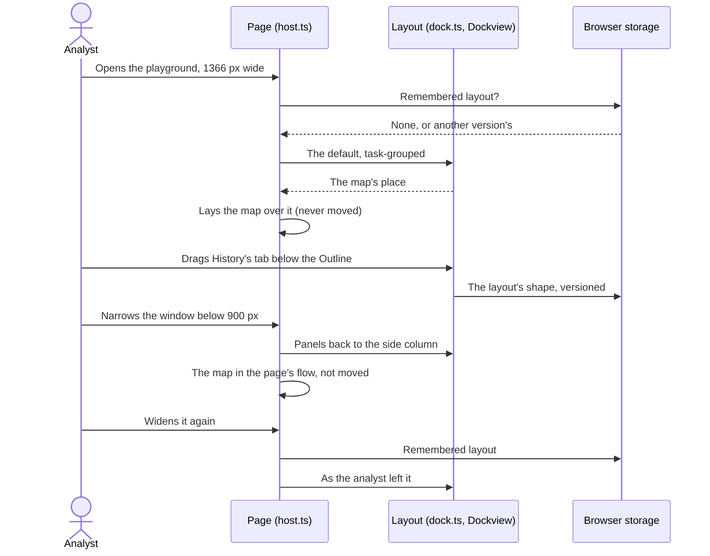

# Browser layout

How the panels are laid out in the browser: the playground, the web demo at `/demo/` and the blog's demos. VS Code is unaffected: it has its own sidebar, panels and editor area, which analysts arrange as they arrange any VS Code view.

## Requirements cited

| SRD | Requirement |
| --- | --- |
| CON-05 | Three hosts: native VS Code views, webviews inside VS Code, and a standalone web build. |
| CON-06 | A web-only host supplies the `--vscode-*` theme variables. |
| CON-09, DEP-06 | The web build serves the demonstration instance and the blog's examples. |
| DEP-07 | Files the analyst chooses are read in the browser only, never sent or stored. |
| NFR-13 | Themes honoured; everything operable by keyboard. |

## Model

1. **Docked, 900 pixels wide and 480 high and more** (decisions, product owner, 23 Oct 2026). The panels sit in tab groups around the map, and the analyst drags a tab to rearrange them. Each group shows one panel at a time; its tabs name the others. The default is *task-grouped* (second round, 23 Oct 2026; the left column's groups, 24 Oct 2026):

    ```text
    ┌──────────── top bar: Plot ▾ · Import… · Export ▾ · Try ▾ · Reset layout ────────────┐
    │ Time                │                                       │ Walkthroughs         │
    │ Tote|Tools|History  │                 map                   │ (alone: a step's     │
    │ Outline | Catalogue │                                       │  words never hidden) │
    │                     ├───────────────────────────────────────┤                      │
    │                     │ Timeline | Coverage (22%)             │                      │
    └─────────────────────┴───────────────────────────────────────┴──────────────────────┘
    ```

    The side columns take about a fifth of the width each. The map is 791 × 556 pixels at 1366 × 768 (58% of the width) and 740 × 519 at 1280 × 720; the Timeline and Coverage take 22% of the centre's height. Tools and History are tabs beside the Tote, the Tote in front, so the Outline and Catalogue take the rest of the column (product owner, 24 Oct 2026): the Outline shows 6 of the sample's rows at 1366 × 768, 3 at 1280 × 720 and all of them at 1920 × 1080 (a row fewer than before Time grew for its large current time, 28 Oct 2026), where under the earlier default it showed about 2 at 768 pixels high. While playing, the Tote is one tab away from Tools, and its lines still show on the map. Time and the Tote are never taller than what they show (product owner, 31 Oct 2026): dragged or resized, they stop at it, and the other panels in the column take the rest; when what they show shrinks, so do they. They can still be made shorter, and then scroll, so a short window never squeezes the Outline away. In the default layout neither scrolls. This holds while Time or the Tote is in front in a group that shares its column; with Tools or History in front, the Tote's group is sized like any other. The Outline's track and annotation buttons stay in sight below its list, which scrolls on its own. No tab strip overflows at 1024, 1280, 1366 or 1920 pixels. Nothing scrolls the page; each panel scrolls on its own.

2. **The top bar** holds what is used now and then, so the columns hold only panels (decision, product owner, 23 Oct 2026): the **Plot** list; **Import…**, **Export ▾** and **Try ▾**, each a menu that opens under its button; and **Reset layout**. A menu closes on `Escape` (the keyboard back on its button), on `Tab` out of it, on a click elsewhere (into the map too), on its button again, and when the window is resized or, narrow, the page scrolls. The Catalogue panel has an **Import…** button too, opening the same menu; a file chosen to import closes it (accepted as built, product owner, 23 Oct 2026).

3. **Panels.** Time, Tote, Outline, Catalogue, Timeline, Coverage, Tools, History and Walkthroughs, listed once in `vscode/play/panels.mjs`. Every panel stays: none can be closed. The map has no tab and takes no panel as a tab; a panel can be dropped beside it, splitting its place.

4. **Rearranging.** Drag a tab onto another group's tabs or its middle to join it; onto a group's edge, or the dock's, to split. Without a pointer, and by touch, each tab has a menu (`Shift+F10`, the menu key, or a right-click), and each group a **⋯** button that opens the menu of the panel in front: **Move to left: Outline, Catalogue** for each other group (named by where it is and what it holds), **Move to a group of its own**, and **Reset layout**. When a column empties, the map takes its room.

5. **A tool's form never squeezes the map** (panel review, 23 Oct 2026). Beside the map, a tool's form, its results or a list such as the fixes takes a third of the map's place, 260 to 380 pixels; where the map's place is narrower than 640 pixels (from 900 to about 1280 pixels wide with the default columns), it goes under the map instead, as on a narrow screen. The map stays at least 380 × 160 pixels.

6. **Remembered in this browser** (decision, product owner, 23 Oct 2026). The playground and the web demo keep the layout in the browser's local storage, under `debrief.play.layout`, with a version (2 since the second round): its shape only, the panels by id and name, the groups and their sizes, never anything from a plot or a file. They share the one key, so the web demo and the playground open as the analyst last left either (accepted as built, product owner, 23 Oct 2026). A layout is used only if it would come out whole: this version's, exactly this page's panels, each in one group once, the map alone in its own, sizes a screen could have (more than 0 and less than 20,000 pixels), nothing floating and every panel rendered always. Any other, unreadable, outdated, incomplete or absurd, gives the default and is forgotten; one that fails to build all the same is forgotten too, and the default built, so the page always comes up. **Reset layout** gives the default and remembers it. Two windows of the playground open at once each remember the layout as they last changed it: the last change wins, the other's is overwritten. A blog's demo (`?panels=…`) always starts from the default made from the panels it lists, the same every time, and remembers nothing.

7. **The frames never reload.** The map, a tool's form, its results and the annotation form are frames, and moving a frame in a page reloads it. So none is ever moved: the map and the form beside it stay where they are and are laid over the map's place in the layout; dragging, tab switching, splitting, Reset and going narrow and back move only panels without frames. Every panel stays in the page while hidden, so what it shows and its controls are as they were. Python, in its worker, is untouched. Tested: a marker in the map's and the form's frames, and the plot's history from Python, survive all of it.

8. **Scroll and the keyboard are kept** (panel review, 23 Oct 2026). A panel moved in the page loses its scroll, so going narrow and back, and Reset, keep each list's place (the Timeline's entry at its top, the Outline's scroll) and each docked panel's scroll, given back as each list gets its size, however long the layout takes to place it, even where the browser had already pulled a list back as the window widened (24 Oct 2026). Going narrow, the keyboard on a panel's tab goes to its heading's fold button; going docked, from the fold button to the tab; on anything inside a panel, it stays there. A menu of the top bar open as the layout changes closes, the keyboard back on its button.

9. **Narrower than 900 pixels, or lower than 480**, the panels are the one side column as before, each folding by its heading (decision, 14 Oct 2026), the walkthroughs first; below 600 pixels the page scrolls, the map first. Docking needs the room (engineering decision, 23 Oct 2026). Fold buttons show only here: docked, tabs replace them, and which panels were folded is kept for the narrow layout. The top bar is the same at every width, wrapping onto two lines on a phone.

10. **By touch, from 900 pixels, docked too** (product owner, 23 Oct 2026): on a touch screen (`pointer: coarse`) tab strips are 32 pixels high, tabs and each group's **⋯** at least 32 pixels, a sash's grip 24 pixels wide, and menu items 32 pixels high; a panel is moved from the **⋯** menu, or dragged.

11. **Theme.** Tabs, sashes, groups and drop places are drawn from the theme's variables, light and dark (style guide, [Theme](../style-guide/theme.md)); the Walkthroughs tab carries the guidance accent, as the panel does.

12. **The drawing note is one line** (product owner, 23 Oct 2026). Drawing on the map, how to draw is one line at the top of the map, the whole of it in its tooltip; once a point is placed the readout takes its place, how to draw still said to screen readers; with the keyboard on the map, a line of keys under it. It never covers more than the top tenth of the map. The note is the map's own, so VS Code shows it the same way.



## Keyboard

| Action | Keys |
| --- | --- |
| Move through the layout | `Tab`: each group's tab in front, then what its panel holds, then the next group's tab; the left column top down, the map (and the form beside it), what is under it, then the right; before the first group and after the last, the top bar. Inside the map's frame, its own order. |
| Move along a group's tabs | `←` `→`, `Home`, `End`; `Enter` or `Space` brings the tab's panel to the front |
| Move a panel to another group, or a group of its own | `Shift+F10` or the menu key on its tab, then `↑` `↓` and `Enter`; or `Tab` to the group's **⋯** and `Enter` |
| Reset the layout | **Reset layout** in the top bar, or in a tab's menu |
| Open Import, Export or Try | `Tab` to its button in the top bar, `Enter`; `Escape` closes it, back to its button |

For screen readers each group's tab strip is a tab list named by where it is and what it holds (*Panels, left: Outline, Catalogue*), and each panel a tab panel named by its tab, holding the panel; the groups are not regions of their own (the panels' contents are drawn outside them), and the map is named *Map*. A panel moved from its menu takes the keyboard with it, to its tab, which a screen reader reads out.

## Reference implementation

`vscode/play/panels.mjs` (the panels and the default, in one table), `vscode/play/dock.ts` (the layout, reading a remembered one, the keyboard's order, the menus), `vscode/play/menu.ts` (the context menus, shared with the Outline's), `vscode/play/dock.css` (the top bar, its menus, Dockview in the theme, touch), and `vscode/play/host.ts` (*The layout*: docked or narrow, the map laid over its place, scroll and focus kept; *The top bar's menus*). Dockview is `dockview-core`, pinned in `vscode/package.json` and bundled into the page, browser only. Tested by `vscode/test/play/dock.mjs`, and every playground test through its `showPanel` helper; the layout's reading by `vscode/test/unit/dock.test.ts`, the trimming of Dockview's stylesheet by `vscode/test/unit/csstrim.test.ts`.
