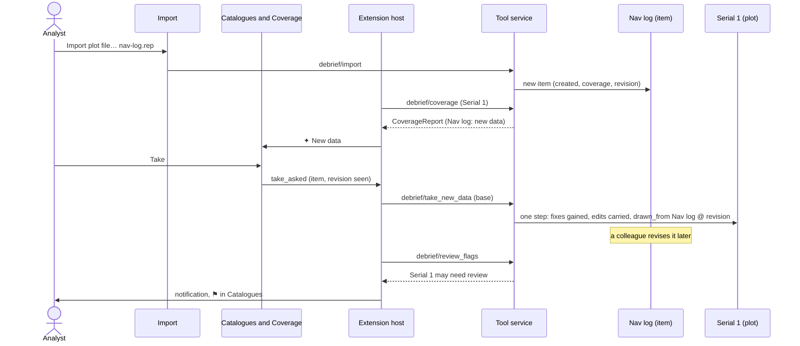

# Collation

How an analyst puts a plot together from the catalogue items that have data for it: which items cover which periods, which item supplies each period of a platform, new data arriving, taking it, and products flagged when an item they drew from is revised.

## Requirements cited

| SRD | Requirement |
| --- | --- |
| CAP-05 | The temporal view shows data coverage per source, with narrative entries and time-only annotations. |
| CAP-08 | Collation is done in the catalogue browser: managing the catalogue, viewing coverage, importing, converting. It is not a separate component. |
| CAP-09 | The choice of which source to prefer is the analyst's, made in the browser with coverage visible. |
| CAP-10 | New data for the current plot is marked in the browser with an icon or halo, limited to the folder tree the plot draws from. |
| CAP-11 | The analyst chooses when to take new data; taking it merges into the plot, preserving annotations and reconstruction. |
| CAP-12 | When upstream data is revised, the analyst is told, and the browser highlights downstream products that may need review. |
| SUB-10, SUB-11 | Sources are never changed; provenance names each, with its content hash. |
| SUB-19, SUB-21 | Every change is a recorded step, undone by replay. |
| SUB-22 | View state in the island is neither undoable nor recorded. |
| NFR-01 | Interactive updates within 500 ms on busy plots. |
| NFR-13 | Everything works from the keyboard, and by touch. |

## Model

1. **A source is a catalogue item** (decision, product owner, 16 Oct 2026). Every file Debrief imports becomes an item of its own: a REP file, a legacy plot, a Word or PDF narrative, a colleague's plot file. Any item can supply data to a plot, and a plot is itself an item, so the plot an analyst collates into can later be a source for another. Collation never changes an item it reads from (SUB-10).
2. **Coverage.** Each item's tracks and the periods each has data for: from a track's first fix to its last, broken at each gap. A gap is a time between two fixes more than ten times the track's median time between fixes (the upper of the middle two, as the map's labels and smoothing judge one) and more than five minutes, so a busy track's pause for breath is not a gap; with fewer than three steps between fixes there is no median, and no gap. A single fix is a period of an instant. Debrief works coverage out at every change to an item and keeps it in the item's STAC metadata (`debrief:coverage`), so a catalogue's coverage is read from its items alone, never their plots. Python and TypeScript work spans out alike, held to `schemas/vectors/collation.json`.
3. **One platform across items.** Tracks whose names match, ignoring case and runs of spaces (*BLUE ONE*, *Blue One*, *blue  one*; not *BLUE-ONE*), are *proposed* as one platform. The analyst confirms (**Same platform**), refuses (**Not this platform**, after which it is proposed no more), or links a track of another name by hand. Each is one recorded step on the plot's track (`platform_links`, `platform_unlinks`), named *Blue One in Nav log confirmed as BLUE ONE*, *BLUE ONE in Serial 2 is not BLUE ONE*, *MERCHANT in Nav log linked to BLUE*. A link to an item that supplies a period of the track cannot be undone by unlinking: choose another source for that period first, or undo the step that took it.
4. **Source preference, per period** (decision, product owner, 16 Oct 2026). For each of the plot's tracks, Coverage lists every source with data for its platform (the plot's own data, items linked, items proposed) and cuts the track's time where the sources with data change. Where two or more have data for a period, the analyst chooses which supplies it; the track is stitched from the chosen periods. The choice is one recorded step, *BLUE ONE 09:20:00Z to 10:20:00Z from Nav log*, whose record says what the period had and has (*Was Serial 1: 61 fixes*, *Now Nav log: 361 fixes*) and names the item and the revision taken (`drawn_from`). The track keeps which item supplies which period (`supplies`, in time order, each from its first fix to its last), so Coverage shows it and the next choice starts from it. The plot's own data, as it was first recorded, is a source like any other: choosing it again puts back what was imported. A period with data no fix of the plot's track comes from yet shows as *Not taken*; choosing a source for it takes that period. The seconds between the last fix one source supplies and the first the next supplies are no period to choose: the track has no gap there.
5. **New data arrives only through Debrief's import** (decision, product owner, 16 Oct 2026): no folder is watched and nothing is polled. An item is marked as **new data** for the open plot when it came into the catalogue after the plot did (STAC's `created`), within the folder tree the plot draws from (its own catalogue, and those of items it has taken data from), with data for the plot's platforms (linked or proposed) or within its period; and the plot has neither taken it nor set it aside at this revision. The mark is a sparkle and the words *New data*, never colour alone; its reason (*New data for Serial 1: BLUE ONE, within its period*) is its tooltip and is read by screen readers. Items outside the folder tree are never marked.
6. **Taking new data is the analyst's choice** (CAP-11): **Take** in Coverage or on the item in the catalogue (**Take data into the open plot…** on the item's menu in VS Code). It is one recorded step, named for the item (*New data from Nav log*), and its record says what it did (*BLUE ONE 120 fixes, WATCHER added*) and names the item at the revision taken. For each track of the item:
    - **matched** (linked, or proposed by name, which taking confirms) to one of the plot's tracks: the plot's track gains the item's fixes where it has no data of its own; where another item supplies a period, that period stays as the analyst chose, and the record says the item also has data then (*choose which in Coverage*); where this item already supplies a period (taken before), that period is read again from the item's latest revision;
    - **unmatched**: added as a new track of the plot, supplied by the item;
    - nothing new at all: refused, saying why, with **Not now** to set the item aside.

    The mark clears once taken. **Not now** sets an item aside for the plot: view state in its island, never a step, until the item is revised. Undo takes a whole take back.
7. **The analyst's work survives** (CAP-11). Annotations and narrative are untouched. Marks stay with their fixes, found by time; a mark whose fix a new source replaces moves to the nearest fix without one, and the record says so. A track's colour, frequencies, hiding and plotting mode are its own and are kept. Edits are carried to new fixes: each existing fix's offset from where its source puts it is worked out (for the plot's own data, the track as the plot first recorded it; for an item's, the item at the revision taken), and a new fix is moved by the offsets of the fixes either side of it in time, in proportion to its time between them, or as the nearest beyond the first or last. A move is carried exactly; a shear, being proportional to time, exactly within the period it covered; a rotation, a stretch, smoothing and a single fix dragged, closely. On a track plotted by dead reckoning the edits change courses and speeds (decision, product owner, 14 Oct 2026), so a new fix's course gains the change in course of the fixes either side and its speed their change in proportion, its course, speed and position as logged are kept beside it, and the positions after it are worked out again by dead reckoning; an item with no courses and speeds cannot supply a DR track, and says so. Replay never reads an item again: each step records its output, so undo, redo and a colleague's copy of the plot need none of the items (SUB-19).
8. **Revisions.** Any recorded change to an item, of its data or its details, is a new revision (decision, product owner, 16 Oct 2026): its revision is its plot's content hash (`debrief:revision`), which changes with every step and comes back with undo. Changing only an item's view (its time window, its Tote) is no revision. A product is any plot whose provenance names an item it drew from (`drawn_from`, kept in its STAC metadata as `debrief:drawn_from`): a plot that took data, a copy saved from one, a colleague's plot file added with its history. When an item it drew from has a revision other than the one taken, the product **may need review**: VS Code says so once, in a notification naming the plot and the item, with **Show in Catalogues**; the playground says so in a note. The product is flagged in the catalogue (a warning symbol and *May need review*, with the reason as its tooltip) and in Coverage, with **Reviewed** to clear the flag. Clearing is view state in the product's island, never a step; the flag comes back at the item's next revision. Taking the item again (**Take again** under *Revised since taken*) reads the periods it supplies from its latest revision. Items a product names that are not in the analyst's catalogues are passed over.

### What is a step, and what isn't

| | Where | Undoable | In the history |
| --- | --- | --- | --- |
| Taking new data | The plot's tracks (`supplies`, `platform_links`), new tracks | Yes | Yes, naming the item and its revision |
| Choosing which item supplies a period | The track's `supplies` and fixes | Yes | Yes, naming the item, the period and its revision |
| Confirming, refusing or linking a platform | The track's `platform_links` or `platform_unlinks` | Yes | Yes |
| Setting new data aside (**Not now**) | The plot's island (`collation.dismissed`) | No | No |
| Clearing a review flag (**Reviewed**) | The product's island (`collation.reviewed`) | No | No |
| Coverage, revisions, what an item drew from | The item's STAC metadata, worked out at each change | | |

### In VS Code

- **Catalogues** lists each item's tracks under it, with the periods each has data for (*08:00:00Z – 12:00:00Z · 241 fixes*), and, with a plot open, how each is known to it (*proposed as BLUE ONE*, *linked to BLUE ONE*). Items are marked *open*, *New data*, *May need review* or *drawn from*, each with its icon and words, the reason in the tooltip and read by screen readers. An item's menu (right-click, `Shift+F10`) has **Take data into the open plot…**, **Not now: set this new data aside** and **Reviewed: clear the review flag**; a track's has **Same platform as a track in the open plot…** and **Not this platform**. **Show coverage** is on the view's title bar.
- **Coverage**, a view below Catalogues (folded until used), is the same component as the playground's: *May need review*, *New data* with **Take** and **Not now**, *Revised since taken* with **Take again**, then each of the plot's tracks with a line and a bar for each source, the periods it supplies filled, the rest outlined, and a list for each period with a choice. Platforms with a choice to make are open; the rest are folded, so a study of fifty items stays readable.
- Agents and keyboard macros: **Debrief: Take data into the open plot…** and **Debrief: Reviewed: clear the review flag** in the Command Palette; `debrief.collate` takes what Coverage would send.

### In the playground

**Catalogue** lists the items in the folder tree the plot draws from, each with its marks, its tracks (folded under *N tracks*) and **Open**, **Take**, **Not now** and **Reviewed**; plots elsewhere in the catalogue that may need review are listed after them. **Coverage** is the same component as VS Code's. Under *Try*, **New data arrives for this plot** imports a navigation log for the open plot's first track (fiction, like the sample: every 10 s over part of its period and on after it ends, 120 m from where the plot has it, under its name in other letters, and a contact the plot has never seen), as an analyst's import would; **A colleague revises an item this plot drew from** corrects that log by 0.1 nmi, as one step in it.

### Keyboard and touch

| Where | Key or gesture | Does |
| --- | --- | --- |
| Coverage | `Tab` | Reaches **Reviewed**, each **Take** and **Not now**, each platform's heading, each **Same platform**, **Not this platform** and **Unlink**, and each period's list |
| A platform's heading | `Enter`, `Space` | Opens or folds it |
| A period's list | `↑` `↓` (or `Alt+↓` to open it) | Chooses the item supplying that period: one step |
| A source's bar | Click, tap | Chooses that source for the period clicked, where it has data: one step (the list is the keyboard's way) |
| An item or track in Catalogues | `Shift+F10`, menu key; press and hold on a touch screen | Its menu: take, set aside, clear a flag; same platform, not this platform |
| The playground's Catalogue | `Tab`, `Enter` | Each item's buttons; `Enter` or `Space` on *N tracks* lists them |

Coverage has no menu of its own, so nothing needs pressing and holding: every choice is a button or a list.

## Performance (NFR-01)

Coverage reads each item's STAC metadata, a few kilobytes, never its plot; only the open plot is read whole, which opening it does anyway. Measured on the development container on 16 Oct 2026, with fifty items of four tracks of 2,000 fixes each (400,000 fixes; `test_coverage_of_a_study_of_fifty_items_stays_responsive`):

| What | Measured |
| --- | --- |
| Coverage of a plot, the first time (its plot file read, every item read) | 200 to 230 ms |
| Coverage again (items unchanged since, read from memory by their file's version) | 40 to 45 ms |
| Review flags for the whole catalogue | 5 to 230 ms (items read, or from memory) |
| Coverage of serial 1 of the sample (six items, with the navigation log) in the playground, Pyodide, asking to answer | median 80 to 90 ms, slowest 160 to 300 ms, over 20 asks in each of two runs |
| Working out a plot's coverage for its metadata at a save, fifty tracks of 2,000 fixes | 90 ms the first save in a process, under 2 ms after (spans kept by each track's times' hash) |

**Budget:** coverage within 500 ms the first time a plot of a 50-item study is opened and within 100 ms after; review flags within 500 ms. Taking new data and choosing a period read the items involved in full, and their histories where a revision must be replayed: they are steps, within NFR-01's 5 s failure line, not drags. Keeping each item's coverage in its metadata costs each save of a plot the spans of its changed tracks only, a few milliseconds beside the save itself.

## Reference implementation

- **Collation:** `python/debrief-stac/src/debrief_stac/collation.py` (`spans`, `periods`, `platform_key`, `coverage`, `take`, `prefer`, `relink`, `review_flags`, carrying edits in `Edits` and `edits_of`); the catalogue's steps in `debrief_stac.catalogue` (`coverage`, `take_new_data`, `set_source_preference`, `link_tracks`, `dismiss_new_data`, `clear_review_flag`, `review_flags`), the item's metadata in `store_plot_text`, the plot's first record of a track and an earlier revision in `History.first_recorded` and `History.at_revision`. Tested in `python/debrief-stac/tests/test_collation.py`.
- **The service:** `debrief/coverage`, `debrief/take_new_data`, `debrief/set_source_preference`, `debrief/link_tracks`, `debrief/dismiss_new_data`, `debrief/clear_review_flag`, `debrief/review_flags`; tested in `python/debrief-tools/tests/test_collation_service.py`.
- **The component:** `vscode/webview/coveragecontrol.ts` and `coverage.css`; its logic in `vscode/webview/coveragelogic.ts` (`spans`, `periods`, `platformKey` held to the shared vectors; `coveragePieces` for the Timeline), tested in `vscode/test/unit/coverage.test.ts`.
- **VS Code:** `vscode/src/views/catalogues.ts` (the marks and tracks), `vscode/src/panels/coverageview.ts` and `vscode/webview/coverage.ts`, `refreshCollation` and `collate` in `vscode/src/extension.ts`; played in `vscode/test/integration/suite.ts` (`playCollation`).
- **The playground:** the Catalogue and Coverage panels in `vscode/play/host.ts`, `coverage`, `collate`, `new_data` and `revise` in `vscode/play/play.py`; played in `vscode/test/play/collation.mjs`.
- **Schema:** 0.0.21: `collation.yaml` (`CoverageReport` and its parts), `TrackProperties.supplies`, `platform_links`, `platform_unlinks`, `ProvRecord.drawn_from`, `PlotView.collation`, `StacItemProperties.created`, `debrief:revision`, `debrief:coverage`, `debrief:drawn_from`; messages `show_coverage`, `source_chosen`, `link_changed`, `take_asked`, `dismiss_asked`, `review_cleared`; shared vectors `schemas/vectors/collation.json`.

*Not yet:* converting data in the browser (CAP-08 names it; importers convert as they import); a choice of source for a period finer than the periods the sources' coverage gives; drawing the stitched track's joins on the map; notifying an analyst of a revision made in another analyst's catalogue before they next refresh it.
