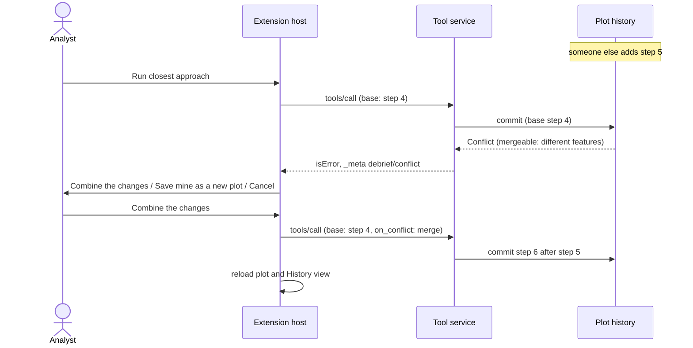

# Conflicts

What happens when a plot changes on disk while an analyst has it open.

## Requirements cited

| SRD | Requirement |
| --- | --- |
| SUB-28 | Debrief detects the change and never silently overwrites it. |
| SUB-29 | Offer to save as a new plot; offer to merge non-overlapping changes by replaying deltas; never merge overlapping changes automatically; never lock files. |
| SUB-14, SUB-35 | Refuse newer-schema files; warn before writing a newer-schema file into a shared catalogue. |
| NFR-11 | Saves are atomic; a failed save leaves the original intact and says so. |
| SUB-19 | The plot's whole history is in its plot file, protected by checksums. |

## Model

Plots are never locked (SUB-29). Instead every change says which version of the plot it was made against (its *base*), and is refused if the plot has moved on.

1. **Noticed while open.** Debrief checks each second whether the open plot's file has changed on disk: another window, another analyst on a shared folder, an agent. The plot file holds the plot's whole history, so Debrief compares the history's current step, how many steps it holds, and the checksum of the content the current step recorded. If the plot has moved on, the map, outline and History view show the latest, and a notification says *"Serial 1 was changed elsewhere. Debrief is showing the latest."* (SUB-28). Nothing the analyst had done is lost: their changes were already saved as steps. If only the plot's time window changed (its island), Debrief shows the new window and says so, without reading the plot again.
2. **Met by a tool run.** If the plot changed between the analyst opening it and running a tool, the tool's result is not saved. Debrief asks, in a dialog:
   - where the two changes touch **different features**: **Combine the changes** (the tool's result is applied on top of the other change) or **Save mine as a new plot**;
   - where they touch **the same features** (including a named set that refers to a feature the other change deleted): only **Save mine as a new plot**. Overlapping changes are never combined automatically.
   - **Cancel** saves nothing and shows the latest; the analyst can run the tool again.
3. **Saved as a new plot.** The new plot, *Serial 1 (your changes)*, has the history the analyst was working from (every step up to it, unchanged, checksums and all), the same sources and files, and then their change. The original keeps the other change. Debrief offers to open it.
4. **Met by undo.** Undo is refused if the plot changed since it was shown; Debrief shows the latest and says nothing was undone.
5. **Newer schema.** A plot written by a newer Debrief is refused, with the version it needs, and never partly loaded (SUB-14). Before saving a change, an undo or an import would write a newer schema into a catalogue other analysts share, Debrief says so and asks: **Save anyway** updates the catalogue's declared version; closing the dialog saves nothing (SUB-35). Until schema 1.0 a catalogue must match exactly to open at all (SUB-13), so the question first appears after 1.0.

6. **Changed outside Debrief.** A plot whose history fails its checksums (a step altered, removed or moved by hand) is shown as its file holds it, but Debrief changes nothing in it and says so: *"This plot's history has been changed outside Debrief: step 2 of its history is not as Debrief recorded it. Debrief shows the plot as its file holds it, but will not change it. Ask whoever sent it for a fresh copy."* A plot whose content no longer matches its intact history (edited in another program, say) is rebuilt from its history, the file as found is kept beside it, and Debrief says so. A change to the time window alone is never treated as either.

Each save rewrites the whole plot file, content and history together, through a new file that replaces the old one only once it is complete, and takes a lock for the milliseconds it lasts, so two processes saving at once can't interleave; a reader never waits (NFR-11). If a process dies part-way, the plot file is the one from before that save, whole; opening the plot says a save was interrupted.

## Reference implementation

- **Detecting and merging:** `History.commit` and `_check_merge` in `debrief_stac.history`; `Catalogue.save_as_new` (`History.fork_into`).
- **Checksums:** `debrief_schemas.chain` (the hash chain, the content hash, the step rules); the `DAMAGED` and `MISMATCH` messages in `debrief_stac.history`.
- **The service:** `base` and `on_conflict` on `tools/call`; error -32001 on `debrief/undo`, `redo` and `goto`.
- **The extension:** `watch`, `askAboutConflict` and `runTool` in `vscode/src/extension.ts`; `historyOnDisk` and `changedSince` in `vscode/src/catalogue.ts`.
