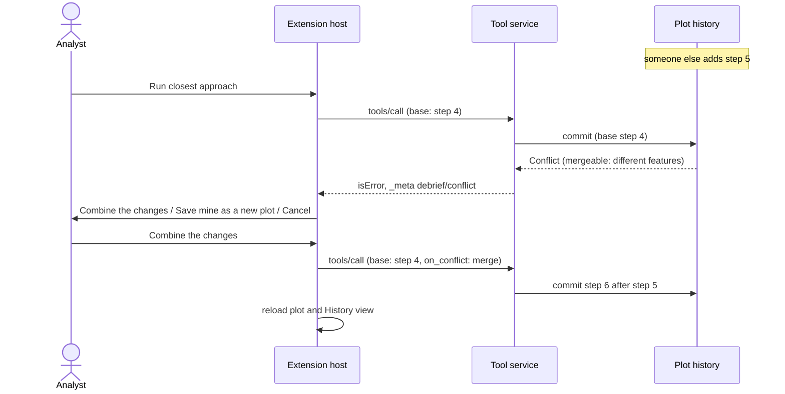

# Conflicts

What happens when a plot changes on disk while an analyst has it open.

## Requirements cited

| SRD | Requirement |
| --- | --- |
| SUB-28 | Debrief detects the change and never silently overwrites it. |
| SUB-29 | Offer to save as a new plot; offer to merge non-overlapping changes by replaying deltas; never merge overlapping changes automatically; never lock files. |
| SUB-14, SUB-35 | Refuse newer-schema files; warn before writing a newer-schema file into a shared catalogue. |
| NFR-11 | Saves are atomic; a failed save leaves the original intact and says so. |

## Model

Plots are never locked (SUB-29). Instead every change says which version of the plot it was made against (its *base*), and is refused if the plot has moved on.

1. **Noticed while open.** Debrief checks each second whether the open plot's history has changed on disk: another window, another analyst on a shared folder, an agent. If it has, the map, outline and History view show the latest, and a notification says *"Serial 1 was changed elsewhere. Debrief is showing the latest."* (SUB-28). Nothing the analyst had done is lost: their changes were already saved as steps.
2. **Met by a tool run.** If the plot changed between the analyst opening it and running a tool, the tool's result is not saved. Debrief asks, in a dialog:
   - where the two changes touch **different features**: **Combine the changes** (the tool's result is applied on top of the other change) or **Save mine as a new plot**;
   - where they touch **the same features** (including a named set that refers to a feature the other change deleted): only **Save mine as a new plot**. Overlapping changes are never combined automatically.
   - **Cancel** saves nothing and shows the latest; the analyst can run the tool again.
3. **Saved as a new plot.** The new plot, *Serial 1 (your changes)*, has the history the analyst was working from, the same sources and files, and then their change. The original keeps the other change. Debrief offers to open it.
4. **Met by undo.** Undo is refused if the plot changed since it was shown; Debrief shows the latest and says nothing was undone.
5. **Newer schema.** A plot written by a newer Debrief is refused, with the version it needs, and never partly loaded (SUB-14). The warning before writing a newer schema into a shared catalogue (SUB-35) is described with it.

Each save is atomic and takes a lock for the milliseconds it lasts, so two processes saving at once can't interleave; a reader never waits (NFR-11).

## Reference implementation

- **Detecting and merging:** `History.commit` and `_check_merge` in `debrief_stac.history`; `Catalogue.save_as_new`.
- **The service:** `base` and `on_conflict` on `tools/call`; error -32001 on `debrief/undo`, `redo` and `goto`.
- **The extension:** `watch`, `askAboutConflict` and `runTool` in `vscode/src/extension.ts`.
