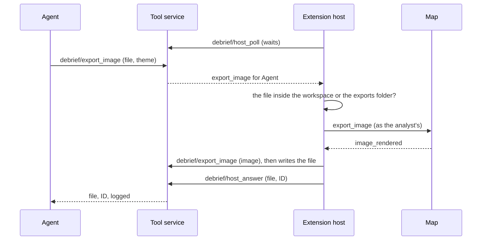

# Exported images

How an analyst exports the map as an image for a report or a slide, and how anyone holding that image, in a Word report or a PowerPoint deck months later, finds the plot it came from, as it was then.

## Requirements cited

| SRD | Requirement |
| --- | --- |
| SUB-25 | Images exported from Debrief carry an embedded GUID in their metadata linking back to their source. |
| EXT-05 | Report images: out, with embedded GUID metadata. |
| OUT-04 | Traceable figures in Word and PowerPoint: any exported image traces back to its source plot by GUID. |
| OUT-01 | Report figures produced without leaving Debrief. |
| SUB-19, SUB-21 | Every change is a recorded step; earlier states are reached by replay. |
| SUB-22 | View state in the island is neither undoable nor recorded. |
| SUB-30 | One map component in every host. |
| NFR-13 | Everything works from the keyboard, and by touch. |

## Model

1. **What is exported is what the analyst sees** (decision, product owner, 16 Oct 2026): the map drawn as it is drawn on screen, never redrawn another way. Tracks and their parts in the time window, context tracks, labels, symbols and arrows at their intervals, annotations and their labels, the narrative box beside its track, current time's markers, the Tote's lines, the north arrow and the scale bar, land and the graticule. Labels are where the map placed them, kept clear of one another, because the image is written from the map as laid out. Not in it: the map's controls and key, its notes, the drawing toolbar, handles, fixes ringed to check, and the selection's outline and the dimming of everything else, which are for working, not for a report.
2. **Three sizes, two colours.** *As on screen* (the map's own size, twice over for sharpness), *Slide, 1600 × 900* (16:9, laid out at 1200 × 675 and scaled by 4/3 so its text reads at a slide's size) and *A4 landscape* (1754 × 1240, A4 at 150 dots an inch, laid out at 877 × 620 and doubled). For a size other than the screen's the map is laid out at that size for a moment, the same area fitted, so labels are placed and thinned for it (the narrative box on the side its marker has room at that size), then put back exactly as it was. A picture of the map as it was covers it meanwhile, so the analyst sees no jump and no flash of colour; anything sent to the map meanwhile (a selection made, say) is shown once it is put back, never undone by it. *As on screen* colours, or *Light, for print*: VS Code's Light Modern, whatever the editor's theme; data colours are the same in both.
3. **PNG or SVG; no JPEG** (decision, product owner, 16 Oct 2026). An SVG keeps every line and label as a vector, its text as text, with its letter-spacing and tabular figures; each image clips to an id of its own, so two pasted into one document do not share one. A PNG is that SVG drawn onto a canvas. The map draws no reference tiles; were one ever shown it would be left out, and said (expert panel, 16 Oct 2026).
4. **Each image carries an ID** (decision, product owner, 16 Oct 2026) naming the plot, the exact revision exported (the plot's content hash, so the step on screen) and the export itself, so a figure traces to exactly what was on screen even after the plot is changed:

    | | Written | Where |
    | --- | --- | --- |
    | In full | `DBF1-PTETVDX3-KG8RB9E5X7Y58R98-M6SC7N75-Z` | The image's metadata: a PNG's iTXt chunk `debrief:figure` and its XMP (`dc:identifier`), before the image data; an SVG's `metadata` element, as XMP |
    | Short | `DBF-PTET-KG8R-B9EM-69` | The footer, and what an analyst types |

    In Crockford's base 32: digits and capital letters without I, L, O or U, so it reads aloud and types without confusion. In full: `DBF1`; the plot key, 8 symbols, the first 40 bits of the SHA-256 of the catalogue's own id and the item's id (as collation names items, never a title or a folder's name, so it means the same on every analyst's machine); the revision, 16 symbols, the first 80 bits of the plot's content hash; the export, 8 random symbols, so two exports of one view are two images; and a check symbol, Luhn mod 32 over the rest. The short form, `DBF-PPPP-RRRR-RRRE-EC`, keeps 4 symbols of the plot key, 7 of the revision and 2 of the export, with a check symbol of its own: enough to find the plot and the step among a catalogue's plots, and to tell one export of a revision from another (one in 1,024 shares the export's two symbols with another of the same revision; then both are listed to choose from). Any one symbol mistyped is caught, never looked up. Typed, case, spaces and dashes do not matter, and O is read as 0, I and L as 1. Nothing else goes into the image: not the plot's title, its catalogue's name nor who exported it. Python and TypeScript hold the format to `schemas/vectors/figure-ids.json`.
5. **The footer** (decision, product owner, 16 Oct 2026): the short form, 1.4% of the image's width high (22 pixels on a slide, 25 on A4; never under 14; product owner, 16 Oct 2026, down from 2% so it does not dominate a slide), so it still reads when Word shows the image at half a page's width, in the theme's quieter text colour and haloed in the background's, so it reads on any theme and over any track. It goes in the corner, of the four, where it covers least of the plot (the fewest points of its tracks, annotations and labels), beside, never over, the scale bar or the north arrow; bottom left where nothing is in the way. On by default, and on again for every export: turned off for one export with **Image ID in a corner**, it is not remembered off (expert panel, 16 Oct 2026); the size and colours are remembered. It is the main trace once an office program drops an image's metadata (see *Office programs* below).
6. **Each export is logged in the plot's island** (decision, product owner, 16 Oct 2026): its ID, the revision, when, who, the area exported (its viewport), current time and the time window, the format, size and colours, the file's name (not its folder) and whether it had the footer (`PlotView.exports`). With it, the Tote's tracks shown (`tote`). View state: never a step, so an export changes neither the plot's revision nor any product that drew from it, and undo never takes one back. The newest 500 are kept, the oldest dropped first; an image whose entry is gone still traces by its ID, only its view and time are not restored (decision, product owner, 16 Oct 2026). Who exported and the file's name stay in it. An entry's time must be within its window, whoever sends it.
7. **The analyst's own export log** (decision, product owner, 16 Oct 2026): where the plot's log cannot be written (its catalogue is read-only), the export goes into `exports.json` beside the analyst's Debrief configuration, naming the catalogue and the plot; **Find source of image…** reads it as it reads the plots', so every export stays traceable. The newest 2,000 are kept. The analyst is told which log has it.
8. **Find source of image.** Pick an image (Debrief reads its metadata: a PNG, an SVG, or each picture in a Word, PowerPoint or LibreOffice file) or type the ID from its footer. Debrief finds the plot in the analyst's catalogues, at the step whose revision the ID names, and opens it **read-only** as it was then: rebuilt by replay from its history and checked against the step that recorded it, as undo is, so it is exactly what was on screen. The view and the time come from the export log where it has the image; the map says *The plot at step 3 of 7, as when image DBF-PTET-KG8R-B9EM-69 was exported. Read-only.* with **Go to latest**. Nothing can be changed there: every change is refused, and said, until the analyst goes to the latest. The History shows the step as *shown read-only*. The Tote is worked out on the plot as it was then, with the tracks it showed when the image was exported, so the view traced matches the figure, its lines included (decision, product owner, 16 Oct 2026).
9. **Several match.** A footer's short form, or an ID typed from an old image, can name more than one export of a revision; each is listed with when it was exported and the area it showed, for the analyst to choose. Debrief never picks one, first or last (expert panel, 16 Oct 2026). Each picture in a Word or PowerPoint file is read on its own, so a report with several figures traces each; a picture that cannot be read (encrypted, damaged, compressed in a way Debrief cannot read) is skipped and said why, and the others are still read.
10. **Copies.** A plot moved to another catalogue, or sent to a colleague, has another plot key but the same revisions: where no plot of the image's key has its revision, any plot that does is found, and said to be *a copy, with the same content then*. Several found are listed to choose from.
11. **A plot whose history is damaged** (shown as its file holds it, never changed) is still exported, its ID naming its content's hash, and traced (expert panel, 16 Oct 2026).
12. **An earlier revision exports as itself**: exported while shown read-only, an image's ID names that revision, so its short form is the same.

### What is a step, and what isn't

| | Where | Undoable | In the history |
| --- | --- | --- | --- |
| Exporting an image | The plot's island (`exports`: the export log), or the analyst's own export log | No | No |
| Showing an earlier revision | Nowhere: the plot file is not changed | | |
| The image's ID | The image (metadata, footer) and the export log | | |

### In VS Code

- **Debrief: Export image…** (the camera on the map's title bar, the Outline's menu, the Command Palette) asks three things, each from the keyboard: the size (a list), what it shows (**Image ID in a corner** and **Light colours, for print**, ticked or not), and where to save it, as PNG or SVG by the name given (the plot's title and the image's short ID). The size and colours are remembered for next time; the footer is on each time. A notification names the file and its ID, with **Copy ID** and **Show in folder**.
- **Debrief: Find source of image…** (Catalogues' title bar menu, the Command Palette): **Choose an image file…** or **Type the ID from the image's corner…**, the ID checked as it is typed. The plot opens read-only, at the view and time exported; **Go to latest** is on the map, its title bar and the History's.
- Agents and keyboard macros pass the choices and the file: `debrief.exportImage` with `{format, preset, theme, footer, file, overwrite}`, `debrief.findImageSource` with `{file}` or `{id}`, and `choose` (counting from 0) where several match; without it the analyst is asked. A file given this way is written only inside the workspace's folders or the folder set in **Debrief: Export folder** (`debrief.exportFolder`), resolved through any link, and over a file there only with `overwrite` and the analyst's yes to *Replace* (expert panel, 16 Oct 2026). The tool service writes no image file: the extension does.
- While an earlier revision is shown read-only, the extension refuses every tool service request aimed at that plot that is not on an allow-list of methods that leave a plot alone (`schemas/vectors/service-methods.json`, held to Python's list), and opens it without finishing an interrupted change, which would write to it.

### In the playground

The **Export image** panel: **Format**, **Size**, **Colours** and **Image ID in a corner** (ticked again after each export), then **Export image…**, which hands the file to the browser to save. There is no save dialog to rename it in, so the panel says plainly that the file's name has the plot's title in it (decision, product owner, 16 Oct 2026). Below it, **Find source of image**: choose a file, or type the ID from its corner and press **Find** (or `Enter`). The plot is opened as it was, read-only, with **Go to latest** on the map; any plot found is also listed with **Open as exported**, with when it was exported and the area it showed; where several match, none is opened until the reader chooses.

### For agents

`debrief/export_image` with `{store, item, file, preset?, theme?, footer?, overwrite?, agent}` exports the plot as the analyst would (decision, product owner, 16 Oct 2026): the tool service asks the map open in VS Code to draw it, through the same path as **Export image…**, and the extension writes the file, within the folders above, asking the analyst before replacing one. Refused, and said, if no map is open (no VS Code polling the service) or the map shows another plot. Drawing lays the analyst's map out at the image's size for a moment, under a picture of it. An earlier revision shown read-only exports as itself. `debrief/find_image_source` reads a file or a typed ID, listing every export it names, and `skipped` for pictures it could not read; `debrief/open_revision` gives the plot as it was at a revision; `debrief/figure_id` gives a fresh ID. A host gives `debrief/export_image` the image it drew (`image`): the ID is put into its metadata, the export logged, and the image given back to write.

Only `debrief/export_image` may send a request up to 48 MB (an image); every other method keeps the 10 MB limit.

### Keyboard and touch

| Where | Key or gesture | Does |
| --- | --- | --- |
| VS Code | **Export image…**: `↑` `↓` `Enter` on the size, `Space` to tick, `Enter`; the save dialog | Exports the map |
| VS Code | **Find source of image…**: `↑` `↓` `Enter`; the open dialog, or type the ID and `Enter` | Opens the plot as it was, read-only |
| The map, an earlier revision | `Tab` to **Go to latest**, `Enter`; tap | The plot as it is now |
| The playground's Export image panel | `Tab` through its lists, the tick box and **Export image…**; `Enter` in the ID box finds it | As VS Code |

There is no map gesture: exporting and tracing are commands and buttons, so they are the same from the keyboard, a mouse and a touch screen. The panel never scrolls sideways, down to 210 pixels and in a wider font.

An agent's export goes the same way, asked of the extension by the service:



```mermaid
sequenceDiagram
    actor Analyst
    participant Host as Extension host
    participant Map
    participant Service as Tool service
    participant Plot as Serial 1 (plot file)
    Analyst->>Host: Export image… (slide, footer, PNG)
    Host->>Service: debrief/figure_id
    Service-->>Host: DBF1-… and DBF-PTET-KG8R-B9EM-69 (revision now)
    Host->>Map: export_image (slide, footer text)
    Map-->>Host: image_rendered (PNG, viewport)
    Host->>Service: debrief/export_image (image, file name, view, time, Tote)
    Service->>Plot: island: export log entry (no step)
    Service-->>Host: the image with its ID, logged
    Host->>Host: writes the file
    Note over Analyst: the figure goes into a report; the plot changes
    Analyst->>Host: Find source of image… (the PNG, or DBF-PTET-KG8R-B9EM-69)
    Host->>Service: debrief/find_image_source
    Service-->>Host: Serial 1, step 3 (now step 7), export log entry
    Host->>Service: debrief/open_revision
    Service-->>Host: the plot replayed to step 3, checked
    Host->>Map: show_plot (revision_shown), viewport and time exported
    Analyst->>Map: Go to latest
```

## Office programs (informative)

Tried on 16 Oct 2026, with a PNG exported from the sample. python-docx, python-pptx and LibreOffice were the only office programs tried: Word and PowerPoint themselves were not available, so nothing here says what they do.

| Into | Then | The ID in the picture's metadata |
| --- | --- | --- |
| A `.docx` by python-docx | | Kept: the picture is stored byte for byte |
| A `.pptx` by python-pptx | | Kept: stored byte for byte |
| The `.docx` and `.pptx` | Saved again by LibreOffice 7 as `.docx`, `.pptx` and `.odt` | Kept |
| The `.docx` | Saved as PDF by LibreOffice | Gone: the picture is re-encoded |

Word compresses a document's pictures to 220 pixels an inch on save by default, and its *Compress pictures* and saving as PDF re-encode a picture: any of them may drop the metadata. So the footer is the main trace, typed into **Find source of image…**; the metadata is a convenience where it survives. **Find source of image…** reads a Word, PowerPoint or LibreOffice file picture by picture, so a whole report can be checked at once.

## Performance

Measured in the playground's test on 16 Oct 2026 (headless Chromium, the sample's serial 1), from **Export image…** to the file handed to the browser, Python under Pyodide minting, stamping and logging: a slide's PNG in 670 to 720 ms, A4 landscape in light colours in about 670 ms, a PNG as on screen in about 620 ms, an SVG as on screen in about 340 ms (after the expert panel's review, which added the picture laid over the map while it is resized: 90 to 270 ms more than before). The map is laid out at the image's size and put back within a few frames; the analyst sees *Preparing the image…* over a picture of the map. Finding a plot by an image reads the item ids of each catalogue and only the plots whose key matches. Each item lists the revisions its plot has had (`debrief:revisions`, written with each step), so a copy, found by its revision alone, or an ID that matches nothing, reads only the items, never a plot without the revision; an item from before items kept the list is read whole.

## Reference implementation

- **The ID, stamping, reading and finding:** `python/debrief-stac/src/debrief_stac/figures.py` (`new_figure_id`, `parse_figure_id`, `stamp_png`, `stamp_svg`, `figure_ids_in`, `figure_for`, `prepare_export`, `log_export`, `find_sources`); `Catalogue.record_export` and `Catalogue.revision_shown`, `History.revisions` and `History.replay_checked`; the analyst's own export log in `python/debrief-config/src/debrief_config/exports.py`. Tested in `python/debrief-stac/tests/test_figures.py` and `test_figures_review.py`, held to `schemas/vectors/figure-ids.json`; TypeScript reads the same format in `ts/kernel/src/figureid.ts`, tested in `ts/kernel/test/figureid.test.ts`.
- **The service:** `python/debrief-tools/src/debrief_tools/figures.py` (with `Bridge`, `debrief/host_poll` and `debrief/host_answer` for an agent's export); tested in `python/debrief-tools/tests/test_figures_service.py`.
- **Drawing the image:** `vscode/webview/exportimage.ts` (`composeSvg`, `rasterise`) and `exportImage` in `vscode/webview/map.ts`; sizes, the footer's corner and size, the SVG's frame and text in `vscode/webview/exportlogic.ts`, tested in `vscode/test/unit/export.test.ts`.
- **VS Code:** `debrief.exportImage`, `debrief.findImageSource` and `debrief.openLatestRevision` in `vscode/src/extension.ts`, `renderImage` in `vscode/src/panels/map.ts`, the wording, what is remembered and where an agent may write in `vscode/src/figures.ts`; read-only changes refused in `ToolService.request` by `guardRequest`. Played in `vscode/test/integration/suite.ts` (`exportedImages`).
- **The playground:** the Export image panel in `vscode/play/host.ts`, `figure_id`, `export_image`, `find_image_source` and `open_revision` in `vscode/play/play.py`; played in `vscode/test/play/export.mjs`.
- **Schema:** 0.0.22: `figures.yaml` (`FigureId`, `ShortFigureId`, `ImageExport`, `ImageRequest`, `RenderedImage`, `RevisionShown`, `FigureSource`, `LoggedExport`, `ExportLog`), `PlotView.exports`, `debrief:revisions` on an item; messages `export_image`, `image_rendered`, `latest_asked`, and `revision_shown` on `show_plot`.

*Not yet:* a map drawn for an agent with no map open, or in the playground; exporting several views at once (the storyboard, CAP-13, will); a choice of corner for the footer; reading an image's ID out of a PDF a report was saved as (its picture re-encoded: the footer is the trace).
