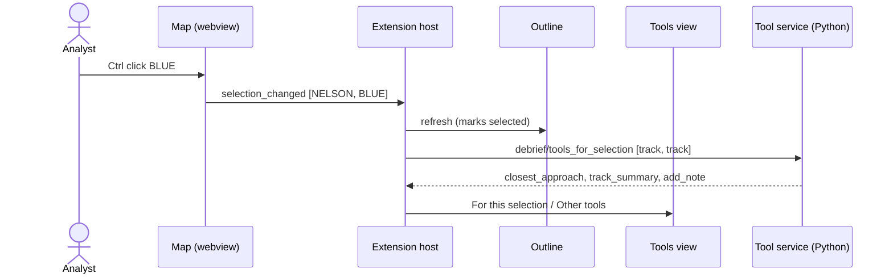

# Selection and tool offering

How an analyst selects features, in the map, outline or catalogue, and how Debrief offers the tools that apply to that selection.

*The model, its sequence diagram and its reference implementation are written in Phase 1. Version 0 gathers the requirements it must satisfy.*

## Requirements cited

| SRD | Requirement |
| --- | --- |
| SUB-26, SUB-27 | Selection is shared state that views, extensions and tools can all read and set. |
| TL-06 | Each tool declares the feature types it applies to. |
| TL-08 | The tools offered are those that apply to every selected item. |
| TL-09 | A tool declaring an unknown type is not offered, and Debrief says why. |
| TL-11 | Named sets are reusable as a selection. |
| NFR-13 | Selection is possible by keyboard. |

## Model

**One selection, everywhere.** The analyst selects features in the map or the outline, and every view shows the same selection (SUB-26).

| Gesture | Map | Outline |
| --- | --- | --- |
| Select one feature | Click it | Click it |
| Add or remove one | Ctrl or Shift click (Cmd on macOS) | Ctrl click |
| Select a range | — | Shift click |
| Clear | Click empty sea, or **Clear selection** in the outline's title bar | **Clear selection** |

- **Showing selection.** The map draws selected features thicker, with a halo in the theme's focus colour, and dims the rest. The outline marks them *selected*. The tools view counts them.
- **Offering tools.** Whenever the selection changes, the tools view asks the tool service which tools apply to every selected item, within each tool's count limits (TL-08). The rule lives in Python, so agents get the same answer (TL-14).
- **Explaining tools not on offer.** Tools that don't apply are listed under **Other tools**, each saying what it needs ("select 2 tracks"), rather than being hidden (CON-10).
- **Unknown data types.** Tools that name a data type Debrief doesn't know appear under **Not available**, with the reason (TL-09).
- **Time-only annotations.** These have no position, so they appear only in the outline (CAP-04).

## Reference implementation

- **Selection state:** `vscode/src/session.ts`.
- **Map gestures:** `vscode/webview/map.ts`.
- **Outline:** `vscode/src/views/outline.ts`.
- **Tools view:** `vscode/src/views/tools.ts`.
- **The offering rule:** `debrief_tools.registry.applies`.

*Not yet:* keyboard selection in the map (NFR-13, Phase 3), named sets as selections (TL-11), and selection shared with other extensions and tools (SUB-27, Phase 2).
