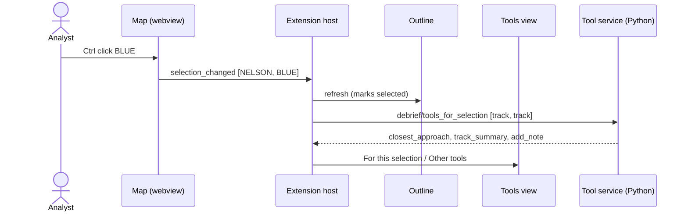

# Selection and tool offering

How an analyst selects features, in the map, outline or catalogue, and how Debrief offers the tools that apply to that selection.

*The model, its sequence diagram and its reference implementation are written in Phase 1. Version 0 gathers the requirements it must satisfy.*

## Requirements cited

| SRD | Requirement |
| --- | --- |
| SUB-26, SUB-27 | Selection is shared state that views, extensions and tools can all read and set. |
| TL-06 | Each tool declares the feature types it applies to. |
| TL-08 | The tools offered are those that apply to every selected item. |
| TL-09 | A tool declaring an unknown type is not offered, and Debrief says why. |
| TL-11 | Named sets are reusable as a selection. |
| NFR-13 | Selection is possible by keyboard. |

## Model

**One selection, everywhere.** The analyst selects features in the map or the outline, and every view shows the same selection (SUB-26).

| Gesture | Map | Outline |
| --- | --- | --- |
| Select one feature | Click it | Click it |
| Add or remove one | Ctrl click (Cmd on macOS) | Ctrl click (Cmd on macOS) |
| Select a range | — | Shift click |
| Select all | — | **Select all** on the Outline's toolbar, or `Ctrl+A` in the tree: every row listed |
| Select a row's children | — | **Select children** on the Outline's toolbar |
| Clear | Escape, or click empty sea | **Clear selection** on the Outline's toolbar |
| Zoom to the selection | **Selected** button, top left | — |

Ctrl or Cmd adds in both places, as everywhere in VS Code. Shift selects a range in the outline, and does nothing on the map, which has no order to make a range of.

- **Showing selection.**
  - **On the map.** Each selected feature gets a dotted outline in the theme's text colour. That colour is never a force colour, so selecting tracks never makes them look blue or red. Everything else is dimmed.
  - **In the outline.** Selected features are marked *selected*. The last one selected elsewhere is revealed and highlighted.
  - **In the tools view.** The selection is counted.
- **The Outline's toolbar** (product owner, 28 Oct 2026). Compact icon buttons at the top of the Outline act on its selection; each has a tooltip saying what it will do, or why it cannot. In VS Code they are in the Outline view's title bar; in the playground, a row above the tree.

    | Button | Icon (VS Code codicon) | What it does |
    | --- | --- | --- |
    | **Hidden on map** | `eye` when everything selected is shown; `eye-closed` when all of it is hidden; `color-mode` when some of each (the playground's is a half-closed eye) | All shown: hides them all. All hidden: shows them all. Mixed: shows them all, the usual convention for a mixed toggle (`aria-pressed="mixed"`). One step, named with a count (*3 tracks and 12 cuts hidden on the map*), through the same hide and show operations as the Tools' **Hide cuts** and **Show cuts**. Tracks, TMA solutions, sensors, cuts, annotations and sensor observations can be hidden; a leg or a position cannot, and is left out, the tooltip saying so. Narrative entries are not in the Outline: they are read in the Timeline. |
    | **Colour** | `symbol-color` | The selected that have a colour (tracks and solutions, sensors, cuts, annotations; not chart furniture) take one colour: the palette, or a custom `#rrggbb`. One step. Disabled, saying why, when nothing selected has a colour. In VS Code a QuickPick; in the playground a small popover of swatches (arrow keys among them) and a custom colour. |
    | **Select all** | `check-all` | Every row listed: the rows of the branches open, as `Ctrl+A` in the tree. A sensor's cuts are not selected unless it is open. |
    | **Select children** | `type-hierarchy-sub` | The selection replaced by the direct children of what is selected: a track's sensors, a sensor's cuts (all of them, though VS Code pages a sensor of more than 500), a solution's legs, a leg's positions. Their branches open, the first child brought into sight. Disabled when the selection has none. |
    | **Clear selection** | `clear-all` | Nothing selected. |

    VS Code's title bar shows one of three hide commands (`debrief.selectionHide`, `debrief.selectionShow`, `debrief.selectionShowAll`) by the context key `debrief.selectionVisibility` (`visible`, `hidden`, `mixed` or `none`); `debrief.selectionColourable`, `debrief.selectionHasChildren` and `debrief.selectionNotEmpty` enable the others. Its tooltips are the commands' titles, which cannot change, so the reasons are said when a command is run instead. The native tree cannot be told to select many rows, so rows selected by the toolbar are marked *selected* in their description, as before, and the first is revealed.

    In the playground the toolbar is `role="toolbar"`, one tab stop with a roving `tabindex`: `←` and `→` move along it (wrapping), `Home` and `End` to its ends, `Enter` or `Space` presses. A button that cannot act stays reachable (`aria-disabled`), its reason its description. Icons are drawn in the text colour, so they follow light, dark and high-contrast themes; under forced colours they take the system's colours, a pressed toggle the system's Highlight.

- **The selection's count, said.** The Outline no longer has a hint line under its heading ("1 feature selected · Ctrl-click to add, Shift-click for a range", product owner, 28 Oct 2026): the gestures are taught by the walkthroughs (*Open and explore a serial*, *Select tracks in the Outline*). A screen reader still hears the count when it changes (*3 tracks and 12 cuts selected*), from a polite live region.
- **Offering tools.** Whenever the selection changes, the tools view asks the tool service which tools apply to every selected item, within each tool's count limits (TL-08). The rule lives in Python, so agents get the same answer (TL-14).
- **Explaining tools not on offer.** Tools that don't apply are listed under **Other tools**, each saying what it needs ("select 2 tracks"), rather than being hidden (CON-10).
- **Unknown data types.** Tools that name a data type Debrief doesn't know appear under **Not available**, with the reason (TL-09).
- **Time-only annotations.** These have no position, so they appear only in the outline (CAP-04).

## Reference implementation

- **Selection state:** `vscode/src/session.ts`.
- **Map gestures:** `vscode/webview/map.ts`.
- **Outline:** `vscode/src/views/outline.ts`.
- **The Outline's toolbar:** what each button does and says, `vscode/webview/outlinetoolbar.ts`; the playground's, `vscode/play/outlinebar.ts`; VS Code's title bar, `package.json` and `debrief.selection*` in `vscode/src/extension.ts`.
- **Tools view:** `vscode/src/views/tools.ts`.
- **The offering rule:** `debrief_tools.registry.applies`.

*Not yet:* keyboard selection in the map (NFR-13, Phase 3), named sets as selections (TL-11), and selection shared with other extensions and tools (SUB-27, Phase 2).
