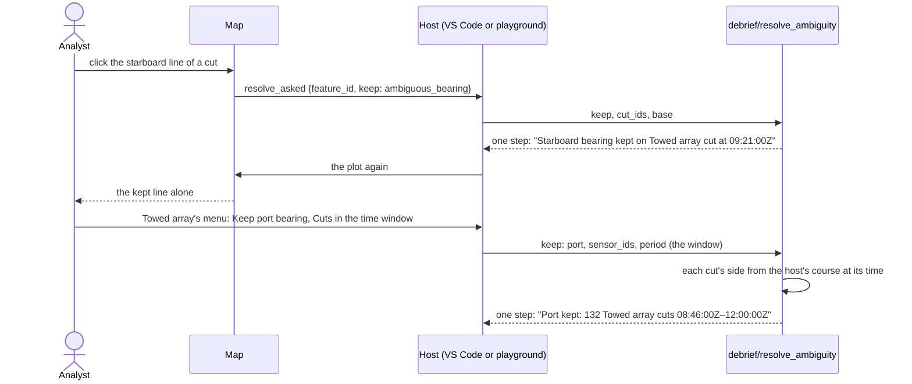

# Sensors and bearings

How bearings from a platform's sensors come into a plot, how the map draws them, and how an analyst resolves a towed array's ambiguous bearings to one side. The ground TMA (CAP-21) will stand on.

## Requirements cited

| SRD | Requirement |
| --- | --- |
| CAP-22 | Import bearings and ambiguous (towed-array) bearings; the analyst resolves each ambiguous bearing to one side. Bearings are drawn as lines (product owner, 24 Oct 2026). Frequency is not imported. |
| CAP-21 | A TMA solution is rooted in a selected period of bearing data, its positions at the sensor's observation times in that period, with live bearing residuals while it is dragged. |
| CAP-28, CAP-29 | Sensor data is shown only within the plot's time window, which is the volume strategy for weeks of bearings. |
| CAP-33 | Later: a tool that proposes the side of ambiguous bearings from ownship's manoeuvres, for the analyst to confirm. Recorded, not built. |
| SUB-22, SUB-24 | Presentation is content: colour and hiding are steps. Every change is one recorded, undoable step with its parameters. |
| EXT-01, EXT-14 | REP files and legacy plot files are read as legacy Debrief read them, and what is not imported is listed. |
| NFR-04, NFR-06 | The drag budget (100 ms), and observation-heavy plots. |
| NFR-13 | Everything works from the keyboard, and by touch. |

## Model

1. **A sensor belongs to its track.** A sensor is a feature of its own (`kind: sensor`): its name, the track that carries it (`host_track_id`, its *host*), its colour, whether it is hidden, and how legacy Debrief drew it (`legacy_symbology`). Each of its observations is a **cut**, a feature too (`kind: sensor_cut`): its sensor, its time, its bearing, and where the file gives them, its ambiguous bearing, which of the two was kept (`resolved`), its range, the position it was taken from (`origin`), a label, a comment, a colour of its own, and whether it is hidden. Neither has a geometry: a cut is drawn from its host's position at its time, wherever the host is moved, split or merged. A cut is its own feature, as a narrative entry is, so keeping a side of ten cuts is a step that stores ten small features, not a sensor of thousands. Schema 0.0.23.
2. **Four ways in.** As legacy Debrief read them, with its tests ported:
    - **REP and DSF files.** `;SENSOR:` (a bearing, a range), `;SENSOR2:` (a bearing, its ambiguous twin, a frequency, a range) and `;SENSOR3:` (a bearing, its accuracy, a frequency and its accuracy, a range) lines. A **.dsf** file is a REP file of sensor lines alone, read as legacy Debrief's *ImportReplay* read it: into a plot already open (**Read sensor data into this plot (DSF, REP)…**, the Outline's menu; *Sensor data into the open plot* under **Import…** in the playground), since it has no track of its own. A REP file imported as a plot brings its sensor lines in with its tracks.
    - **Legacy plots (.dpf).** Each track's sensors and their contacts: name, colour, visibility, every cut's time, bearing, ambiguous bearing (and whether legacy kept one side), range, label, comment, colour, visibility and line style. No longer listed as not imported.
    - **Rider's narrative (Word).** A Rider entry's bearing (`273`), with its ambiguous twin (`92/112`), becomes a cut of the sensor *Rider bearings* on the entry's platform's track, as legacy Debrief made it a sensor cut; the entry stays in the narrative, its bearing in its text. An arc (`096-112`) and *No B* are not cuts, and the record says so.
    - **Agents.** `debrief/import_sensor` (below).
3. **Which track.** A sensor line names its track. It is carried by the plot's track of that name, ignoring case, or else the first one whose name starts with the same six letters (legacy `BabelFish`). Where none matches, the analyst is asked which track carries it, or **Do not read these** (legacy Debrief asked, *Sensor track not found*); an agent says it in `hosts`. A sensor named *UNKNOWN* takes the file's name. A sensor of the same name already on the same track takes the new cuts (legacy `TrackWrapper.add`), so reading two files of one array makes one sensor. A file read into the plot before (by its content, under any name) is said first, and read again only if the analyst says so.
4. **Read as legacy Debrief read them**, quirks kept: a token starting with *N* (`NULL`, `NaN`) is no value, so a line whose bearing is `NULL` gives no cut and is counted in the notes; a `;SENSOR:` range of 0 is no range; a `;SENSOR2:` or `;SENSOR3:` line must have a label; a `;SENSOR3:` line has no ambiguous bearing, and from a sensor named *UNKNOWN* that gives a frequency, a bearing of 0 is none. A bearing outside 0 to 360° is read modulo 360 (`-153.5` is `206.5`). Ranges are yards. A sensor's colour is its symbology's second letter, legacy's colour code. Times are UTC, to the millisecond.
5. **What is not imported, said in the step's record.** Frequencies (every cut that gives one, and a .dpf sensor's base frequency): acoustic analysis stays in the acoustic replay application (CAP-22, EXT-03). `;SENSOR3:`'s bearing accuracy, read and thrown away by legacy Debrief too (below). Line styles: cuts are drawn solid, or dashed for a towed array's starboard bearing. A .dpf sensor's array offset, or an array centre from measured data: its cuts are drawn from the track's position. Cuts outside their host's fixes are kept but not drawn, as legacy Debrief drew none.
6. **A legacy plot's ambiguous bearings, read right.** Older legacy Debrief wrote `AmbiguousBearing="0.000"` with `HasAmbiguousBearing="false"` on cuts that were never ambiguous: a placeholder, read as no ambiguous bearing and counted in the notes (of the 20,665 cuts in legacy Debrief's sample plots, 16,945 are such). A non-zero twin with `HasAmbiguousBearing="false"` is a cut legacy resolved: it comes in resolved, keeping the bearing legacy kept, and **Make ambiguous again** brings the other back (318 cuts in the samples; 922 still ambiguous, 2,480 with no twin).

### On the map

7. **Lines from the host, in the time window.** Every cut in the time window is drawn: from its host's position at its time, along the geodesic between fixes, exactly as the square at current time is placed (`pointAt`), or from its own position where the file gave one; along the geodesic at its bearing, to its range, or else past the edge of the view (twice the view's larger side, at most five degrees of arc, legacy Debrief's length). None is drawn outside its host's span. Each is in its sensor's colour, or its own. A cut outside the window is not drawn at all: the window is the volume strategy (CAP-29). A hidden sensor, a hidden host, or a hidden cut is not drawn.
8. **Two bearings until one is kept.** An ambiguous cut is two lines, both in its sensor's colour: the one to port of the host's course solid, the one to starboard darker and dashed, so the sides are told apart without colour (legacy Debrief drew starboard darker). Which side a bearing is on is legacy `relBearing`'s: the bearing less the host's course there, within ±180°, port when below zero. A resolved cut is its kept line alone, solid.
9. **The current cut.** For each sensor, the cut current time is at (the last at or before it, in the window) is drawn wider, haloed in the map's colour, with a dot where it is drawn from. The key says what each kind of line is, once the plot has cuts.
10. **Pointing at a cut** says its sensor and time, its bearings and the side each is on, which was kept, its range, label and comment, and, for an ambiguous one, *Click this line to keep it; right-click for more*.
11. **Selected cuts** are haloed as a selected track is, and with a selection elsewhere the rest are dimmed. `Ctrl`-click a cut's line to select it (or add it to the selection); selecting its sensor or its host selects all its cuts' lines.
12. **Exported images** draw the cuts as the map shows them, the current ones wider (SUB-25).

### Resolving ambiguity

13. **One cut.** Click one of an ambiguous cut's two lines on the map: that bearing is kept, one step, named *Port bearing kept on Towed array cut at 09:21:00Z*. Right-click it, or press and hold it on a touch screen, for its menu: **Keep 045.0° (port)**, **Keep 135.0° (starboard)**, **Make ambiguous again** once resolved, **Keep a side for more cuts…** and **Select this cut**. In the playground the menu is a short dialog of the same choices. From the keyboard, **Cut at current time…** on a sensor's menu in the Outline opens the menu of the cut the map emphasises, its bearings and sides said, so every cut can be read and kept without a pointer by moving current time to it.
14. **A period.** **Ambiguous bearings: keep port or starboard…** on a sensor's menu in the Outline (or the Command Palette): **Keep port bearing**, **Keep starboard bearing** or **Make ambiguous again**, then which cuts: **The cut at the current time**, **Cuts in the time window**, **Selected cuts** or **All cuts**, each saying how many cuts it holds and how many have two bearings. In the playground, **Port…**, **Starboard…** and **Both again…** under *Sensor*, below the Outline, and the same on a sensor's row's menu. Port and starboard are offered for every cut, as legacy Debrief offered them: for each cut, the bearing on that side of the host's course *at that cut's time* is kept, so cuts either side of a turn come out right.
15. **One step, with what was asked.** Every resolution is one recorded step, however many cuts: *Port kept: 132 Towed array cuts 08:46:00Z–12:00:00Z*; *Ambiguous again: 3 Towed array cuts 09:00:00Z–09:02:00Z* (a name too long for the History leaves out its period, said in its next note). Its record holds what was asked: the side, the sensors and the period, or how many cuts were named. Cuts with no ambiguous bearing, cuts already so, and cuts where the side cannot be told (outside the host's span, or where it never moved) are left as they are, and the step's notes say how many. A resolution that would change nothing changes nothing, and says why.
16. **Undo, and back to ambiguous.** Undo takes a resolution back like any step. **Make ambiguous again** is its own step, for a cut or a period, when the analyst changes their mind after other work.
17. **What a cut keeps.** A resolved cut records *which bearing* was kept (`bearing` or `ambiguous_bearing`), not the side. A side depends on the host's course at the cut's time; moving the host later does not swap a resolved cut's bearing.

### In the Outline and the Timeline

18. **The Outline.** Each sensor is a row under its host track, with how many cuts it has, and how many are ambiguous and resolved: *Towed array: 132 cuts · 40 ambiguous · 92 resolved*. Its menu: keeping a side (above), **Change colour…**, **Hide on map** and **Show on map**, each one step (*Colour of Bow sonar set to green*). Cuts are not rows: a sensor may have thousands.
19. **Not in the Timeline (decision, 24 Oct 2026).** The Timeline lists narrative entries, notes and periods to read in time order. Cuts would bury them: the sample's serial has 393 cuts against 46 narrative entries, a towed array gives one every 30 to 60 seconds, and a legacy DSF file gives every cut a label. The current cut is emphasised on the map instead, and the narrative already says when a contact was gained or lost. Revisit if analysts ask to read cuts in a list; the Tote is the likelier place, as a bearing beside the computed one when TMA comes.

### Tracks edited

20. **Splitting and merging.** Splitting a track gives its sensors' later cuts to the new second track, as a sensor of the same name, and the step's note says so (*Towed array: its 10 cuts from the split on are a sensor of BLUE ONE (2)'s*). Merging tracks moves their sensors to the merged track. Moving, rotating, shearing or stretching a track moves the origin of every cut it carries, as the cuts are drawn from it.

### Agents

21. `debrief/sensors` (reading): the plot's sensors, each with its host, colour, whether it is hidden, how many cuts, ambiguous and resolved, and its first and last cut's time; with `cuts: true`, each cut in `period` (at most 20,000 in all) with its time, bearings, which was kept, the side its first bearing is on, its range, label, comment and where it is drawn from: what a TMA solution will be rooted in.
22. `debrief/resolve_ambiguity` (changing): `keep` (`port`, `starboard`, `bearing`, `ambiguous_bearing`, or `ambiguous` for both again) and either `cut_ids`, or `sensor_ids` and perhaps a `period`. One step.
23. `debrief/preview_sensor` says what a file's sensor lines hold, and which track would carry each, changing nothing; `debrief/import_sensor` reads them in, one step, with `hosts` naming the track for a track name the plot has not, and `again` to read a file read before. Both are in `schemas/vectors/service-methods.json`, so an earlier revision shown read-only refuses the changing ones.

## Bearing error: drawn as lines (decision, 24 Oct 2026)

The SRD asked for a bearing error, where a file supplies one, drawn as a wedge. Of the formats legacy Debrief read:

- `;SENSOR:` and `;SENSOR2:` carry no bearing error.
- `;SENSOR3:` carries a *bearing accuracy* in degrees (and a frequency accuracy). Legacy `ImportSensor3` read both and threw them away, unused. Legacy Debrief's sample files give `NULL` for it, and no format or code says what it means: a standard deviation, a half-width, a 95% bound.
- A .dpf plot's sensor contacts carry none.

So bearings are drawn as lines only, no wedges, and `;SENSOR3:`'s accuracy is listed as not imported (product owner, 24 Oct 2026). A wedge needs an error field agreed with the acoustic replay application's owners, its meaning included; the model can hold an optional error on a cut later without changing anything here.

## Keyboard and touch

Everything on the map has a way without a pointer ([keyboard equivalents](keyboard-equivalents.md)): a sensor's menu in the Outline (`Shift+F10` or the menu key; press and hold on a touch screen) keeps a side for the cut at current time, the window, the selected cuts or all, and **Cut at current time…** says the current cut's bearings and sides and opens its menu (a screen reader reads both, where the map's lines are a picture); **Ambiguous bearings: keep port or starboard…** is in the Command Palette; in the playground, *Sensor*'s buttons under the Outline. A cut's line is pressed and held on a touch screen for its menu, as it is right-clicked.

## Performance budget

Painting is on one canvas, as the map's symbols and arrows are: a sensor of thousands of cuts is one image to pan, not thousands of elements. Each cut's lines are worked out once, along the geodesic, and kept while the host and the cut are unchanged; a line is cut into only as many pieces as keep it within a quarter of a pixel of the geodesic on screen. The current cuts are on a canvas of their own over the rest, so moving current time repaints one line per sensor.

Measured in headless Chromium with software rendering (the playground's map page; medians, with the 95th percentile where it matters):

| Plot | First draw (once) | Window moved, pan, zoom | Current time moved |
| --- | --- | --- | --- |
| Legacy `ALPHA.rep` (200,000 fixes) and `ALPHA_CUTS.dsf` (611 cuts) | 46 ms | 0.7 ms (1.5 ms) | 0.1 ms |
| The sample's serial 1 (393 cuts, 132 ambiguous) | | 0.9 ms | 0.2 ms |
| 10,611 cuts in the window, half ambiguous | 330 ms | 13 ms (22 ms) | 0.1 ms |
| 50,611 cuts in the window | 1.4 s | 81 ms (134 ms) | 0.1 ms |

Before the lines were cut to fit and the current cuts given their own canvas, 10,611 cuts took 119 ms (194 ms) for every step of current time.

**The budget:** moving current time (playing, dragging the slider, and a TMA drag, which moves no cut) under 1 ms for any number of cuts; moving the window, panning or zooming within a frame (16 ms) for up to 10,000 cuts in the window and within NFR-04's 100 ms for up to 50,000; the first draw within half a second for each 10,000 cuts. Past 50,000 cuts in the window, narrow the window: that is what it is for (CAP-29). The playground's test holds the sample to it on every run.

In Python, a step's cost on a large plot is the plot's, not the sensor's: reading `ALPHA_CUTS.dsf` into `ALPHA.rep`'s plot takes 6 s, of which 4 s is writing any step to a plot of 200,000 fixes (changing a sensor's colour there takes 4 s too). Resolving cuts finds the host's course from its fixes once a step.

## Not yet

- **Bearing-error wedges**, until a field is agreed (above).
- **The automatic ambiguity resolver** (CAP-33): proposing each cut's side from ownship's manoeuvres (a true bearing steady across a turn is on the side whose relative bearing changed by the turn), for the analyst to confirm or change as one step. Recorded, not built.
- **Array offsets.** A towed array's cuts are drawn from the track's position, not from the array behind it.
- **Frequency**, by decision (CAP-22).
- **TMA** (CAP-21): a solution rooted in the cuts of the time window, its positions at their times, and residuals against them.

## Reference implementation

- **Model:** `SensorFeature`, `SensorCutFeature`, `AmbiguityResolution` in `schemas/linkml/features.yaml`; the rules in `debrief_schemas.documents` (a cut's sensor in the plot, a sensor's host track, bearings from 0 to under 360°, a resolution only of an ambiguous cut); the geometry in `debrief_kernel.sensors` and `vscode/webview/sensors.ts`, held to `schemas/vectors/sensor-cuts.json` (legacy `relBearing`'s own test cases, the default length, cuts across a turn, a stationary host, the antimeridian, high latitude).
- **Python:** `debrief_io.rep` (`parse_sensor`), `debrief_io.sensor_import`, `debrief_io.dpf` and `debrief_io.dpf_import`, `debrief_io.narrative` (Rider bearings); `debrief_stac.sensors` and `Catalogue.add_sensors`, `Catalogue.resolve_ambiguity`; `debrief/sensors`, `debrief/resolve_ambiguity`, `debrief/preview_sensor` and `debrief/import_sensor` in `debrief_tools.service`; the sample's sensors in `debrief_sample.synth` (`TowedArrayModel`).
- **Hosts:** `vscode/webview/sensormap.ts` (the canvas, hit testing), `vscode/webview/map.ts`; the commands `debrief.resolveAmbiguity`, `debrief.cutMenu` and `debrief.importSensor` in `vscode/src/extension.ts`, `vscode/src/sensorimport.ts`, the Outline in `vscode/src/views/outline.ts`; the playground's in `vscode/play/host.ts`.
- **Tests:** `python/debrief-kernel/tests/test_sensors.py`, `python/debrief-io/tests/test_rep_sensors.py`, `python/debrief-io/tests/test_dpf_sensors.py`, `python/debrief-stac/tests/test_sensors.py`, `python/debrief-tools/tests/test_sensors_service.py`, `vscode/test/unit/sensors.test.ts`, `vscode/test/play/sensors.mjs`, and a step of `vscode/test/integration/suite.ts`.
