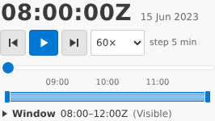
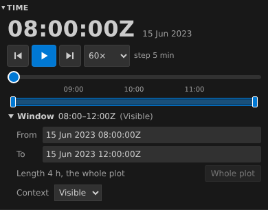
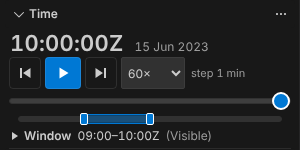

# Time controller

How an analyst sets the plot's time window and current time, plays through them, and what is saved where.

## Requirements cited

| SRD | Requirement |
| --- | --- |
| CAP-28 | One time window for the whole plot, independent of its overall time range, saved in the plot file as view state. A tool's time outside it is shown, never saved, until the analyst keeps or reverts it. |
| CAP-29 | Tracks for a whole deployment at once, at least 3:1 against the map outside the window by default; sensor data only within the window. |
| SUB-22 | View state in the island is neither undoable nor recorded; two analysts changing it at once are told, not overwritten. |
| SUB-26, SUB-27 | Current time (an instant and a range) is shared state that views, extensions and tools read and set. |
| SUB-28 | A change made elsewhere is never silently overwritten. |
| NFR-13 | Everything works from the keyboard, in any theme. |

## Model

1. **One controller, every host.** VS Code shows it as the **Time** view at the top of the Debrief sidebar, above the catalogues, outline, tools and history. The playground shows the same component in its **Time** panel. The map only draws: it has no control of its own.

    It is laid out as **big time and scrubber** (product owner, 28 Oct 2026, superseding the compact layout of 12 Oct, whose window slider sat on top and whose current time was small text in a corner). From the top:

    - **current time, large** (`10:31:30Z`, in tabular figures so it does not jitter while playing), with its date small beside it (`15 Jun 2023`): the largest text in the panel, readable at a glance. It scales down a little in a narrow column (from 32 to 22 pixels), never below the rest;
    - **one row of transport**: step back, play or pause, step forward (icon buttons with names and hover titles, at least 32 pixels square, 44 by touch, the dock's touch rule), the speed (`60×`) and the step (`step 5 min`);
    - **the scrubber**: a full-width slider over the time window, with a prominent thumb and tick labels on whole intervals of UTC (`09:00`, `10:00`; seconds or days where the window needs them), as many as leave each label room;
    - **the overview strip**: a thin strip for the plot's whole period, the window a shaded band on it, a mark at current time;
    - the note, when a tool shows a window other than the saved one (item 9);
    - **the window's details**, folded under a disclosure that says the window and how context tracks are drawn: **▸ Window 08:00–12:00Z (Visible)**.

    

    The details are **folded at first**, since some analysts never manage the window, and stay as the analyst left them: in the browser's storage in the playground (`debrief.play.timeWindowOpen`), and as the view's own state in VS Code. They hold the window's start and end, to type (**From** and **To**: any form the tool forms read, such as `09:30Z`, `15 Jun 2023 09:30:00Z` or `150930Z JUN 23`, or a time of day without its Z), its length, **Whole plot** (the window the plot's whole period; off when it already is), and in the playground how context tracks are drawn (item 5).

    

    At 1366 × 768 the panel is about 266 pixels wide, in the docked layout's left column; it works from the narrow side column's 210 pixels to a 390-pixel phone without scrolling sideways. Docked, Time's group is 204 pixels tall (it was 172), enough for the panel with its details folded, so nothing scrolls inside it at 1024, 1280, 1366 or 1920 pixels; the Outline below gives up a row. In VS Code the view is as tall as VS Code first makes it, about 123 pixels at 1440 × 900 with the other Debrief views open; there the panel draws closer (its tick labels left out, current time at 22 pixels), so all of it shows without scrolling. Only the note, when a tool shows another window, takes it past that height, and the view then scrolls until it is dragged taller; given about 190 pixels it is laid out in full, note and all. Debrief cannot set the view's height: VS Code ignored the view's `initialSize` in the integration test.
2. **The time window** is the band on the overview strip, with an edge at each end. Drag the band to move the window, keeping its length; drag an edge to move that end. The window is never shorter than one second: the edges stop a second apart and never cross. A plot saved with a window of no length opens showing its first second, and that is saved only if the analyst moves it. Or type its ends in its details, or choose **Whole plot**.
3. **Current time** is never outside the window. When the window moves past current time, current time moves with it. Set it by:

    - **the scrubber**, over the window, for fine control while working a period;
    - **the step buttons**, which step back and forward by about a hundredth of the window (1 s up to 1 day; the step shows beside the speed);
    - **a click in the overview strip**: inside the band, current time moves there; **outside it, the window moves to take the time in**, its length kept, centred on the time and kept within the plot's period, and is saved as if let go. The analyst asked to see that time, so the window goes to it; keeping the window and putting current time at its nearer end would leave the time they clicked out of sight (product owner, 28 Oct 2026);
    - **typing it**: click current time (or `Enter` on it), type a time in any form the tool forms read, or a time of day without its Z, and `Enter`; `Escape` leaves it as it was. Outside the window, the window moves as for a click; outside the plot, it says so and changes nothing.
4. **Play** (**▶**, or Space) moves current time forward at the chosen speed and stops at the end of the window. Playing from the end starts again at the window's start. The speeds are multiples of real time:

    | Speed | Plays | For |
    | --- | --- | --- |
    | 1× | real time | a close-quarters encounter, second by second |
    | 10× | ten minutes a minute | an approach |
    | 60× (the default) | a minute a second | a four-hour serial in four minutes |
    | 600× | ten minutes a second | a serial in under half a minute |
    | 3600× | an hour a second | a week's deployment in under three minutes |

    Current time moves ten times a second while playing: smooth to follow, without flooding the views. A window shorter than one of those moves (the speed times a tenth of a second: 6 s at 60×) cannot be played: **Play** is off and says *Window too short to play at 60×: widen it or slow down*, on hover and to screen readers. It stays focusable, so the reason can be read.

5. **What the map shows.** Within the window, tracks are drawn in full: solid lines 2.5 px wide, direction ticks, a hollow dot at the first fix in the window and a filled, labelled dot at the last. Outside it, each whole track stays in view as a **context track**, so a deployment of weeks still reads as one picture (CAP-29): a solid line 1.5 px wide, with no ticks, dots or labels, in the track's hue made quieter (moved toward the theme's text colour). Annotations with a time or a period are drawn only while it falls in the window; annotations without one always are. Sensor data will be drawn only within the window (CAP-29); bearings are not drawn yet.

    **Context tracks** are set for the plot and saved in its island like the window. In VS Code they are in the Time view's **...** menu, on its title bar: **Context tracks: Visible**, **Faint** and **Hidden**, the plot's choice checked (the commands `debrief.contextTracks.visible`, `.faint` and `.hidden`, which run `debrief.setContextTracks`). When the analyst's setting draws faint as visible, the view's title says so. The playground has no title menu: its **Context** list is in the window's details. In both, the details' summary says the plot's choice: *(Visible)*, *(Faint)* or *(Hidden)*.

    | Setting | Draws them |
    | --- | --- |
    | Visible (the default) | At least 3:1 against the map's background on any theme, as drawn. Debrief works this out from the theme's editor background: opacity 0.6, and each colour's lightness moved away from the background only as far as it needs. |
    | Faint | Fainter (opacity 0.35), for a busy plot. No 3:1 promise. |
    | Hidden | Not at all: only the window shows. |

    An analyst who needs the contrast everywhere turns on the setting **Debrief › Map: Minimum Context Contrast** (`debrief.map.minimumContextContrast`): faint is then drawn visible on every plot they open, without changing the plot; hidden is still hidden. High-contrast themes draw context tracks in the track's own colour, opaque, 1 px wide. Selecting a feature dims the others, context tracks included, but never below opacity 0.3, and never on a high-contrast theme.
6. **Moving shows; letting go saves.** The map follows the window as it moves. The window is saved in the plot when the analyst lets go: the pointer is released, or the key is released. Holding an arrow key down saves once. Saving on every movement would rewrite the plot file many times a second and, on a shared folder, look to a colleague like a flood of changes.
7. **What is saved where.**

    | | Where | Undoable | In the history |
    | --- | --- | --- | --- |
    | Time window, context tracks | The plot file, in its island | No | No |
    | Current time | Shared state, not saved | No | No |
    | Colour, hiding, data | The plot, through its history | Yes | Yes |

    The window travels with the plot: a colleague given the plot file opens it on the same window. `Ctrl+Z` never changes the window, and moving the window never conflicts with a change to the plot's content.
8. **Shared state follows the window.** The range of current time in shared state is the window as shown, so tools and other extensions see it, and it follows a drag at once.
9. **A tool's time outside the saved window.** Closest approach, say, moves current time to the moment it finds. If that is outside the saved window, Debrief shows it without saving anything:

    - the window shown widens by the least amount that takes the time in, but never to more than twice the saved window's length. Beyond that, the window moves instead: the saved length, centred on the time, kept within the plot's period;
    - the part of the overview strip that differs from the saved window is hatched, and a note says *Showing beyond saved window* (or *Showing a different period from the saved window*, when it moved), with **Keep** and **Revert** at its right. The note is one line: in a narrow view its text is cut short, and shows whole on hover. It stays until the analyst chooses, and screen readers hear all of it (a polite live region);
    - the tool's message adds *(outside your saved window)*. The history records the tool's run and its result, such as the closest approach's time, never a window.

    **Keep** saves the window shown, as letting go does, conflict checks included (SUB-28). **Revert** shows the saved window again, with current time moved to its nearest edge. Dragging an edge or the band, moving either from the keyboard, typing an end, **Whole plot**, or a click outside the window saves the window as left, so it counts as Keep. Moving current time, stepping and playing inside the window shown neither save it nor clear the note. If the plot is closed or VS Code reloads, the window shown is lost and the saved one returns.

    A tool whose purpose is to set the window (none ships yet) can ask for its range to be saved (`save_window` on its `state_change`). Debrief saves it, through the same path, only when the analyst ran that tool by hand from its form on the plot still open; a run by an agent, a command, a chain or a replay is shown as above, never saved.
10. **A colleague's window.** If someone else changes the plot's window, Debrief notices (it watches the plot file as well as its history), shows the new window without reading the plot's content again, and says so. If the analyst lets go of a window after a colleague changed it, theirs is kept: Debrief shows it and says *Someone else changed the time window, so yours was not saved*. Nothing is merged or overwritten silently (SUB-28).

### Keyboard

| Focus | Key | Does |
| --- | --- | --- |
| Current time (the large time) | Enter, Space | Type a time; then Enter goes there, Escape leaves it |
| Step back, Play, Step forward | Enter, Space | Step, play or pause |
| Speed | ↑ ↓ | Choose a speed |
| The scrubber | ← → ↑ ↓ | One step (a hundredth of the window) |
| The scrubber | Page Up, Page Down | Ten steps |
| The scrubber | Home, End | The window's start and end |
| The band | ← → ↑ ↓ | Moves the window by a step (a hundredth of the plot's period), keeping its length; saved when the key is released |
| The band | Shift with ← → ↑ ↓ | Resizes it: moves its end by a step |
| The band | Page Up, Page Down (with Shift, resizing) | Ten steps |
| The band | Home, End | The window to the plot's start or end; with Shift, its end to a second after its start or to the plot's end |
| An edge of the band | ← → ↑ ↓ | Moves that end by a step; saved when the key is released |
| An edge of the band | Page Up, Page Down | Ten steps |
| Window start | Home, End | To the plot's start; to a second before the window's end |
| Window end | Home, End | To a second after the window's start; to the plot's end |
| Any slider | Space | Play or pause |
| Window (the disclosure) | Enter, Space | Fold or unfold the window's details |
| From, To | Enter, or leaving the box | Set that end of the window; Escape puts back what was there |
| Whole plot | Enter, Space | The window the plot's whole period |
| Keep, Revert | Enter, Space | Save the window shown; show the saved window again |
| Context tracks (the playground's list, in the details) | ↑ ↓ | Visible, faint or hidden. In VS Code, the view's **...** menu, or the commands in the Command Palette |

`Tab` reaches each in that order: current time, the transport, the scrubber, the band and its edges, the note's buttons when it shows, the disclosure, then the details when open. Every slider has a name and says its time to screen readers (`aria-valuetext`: the scrubber its time, the band *15 Jun 2023 08:00:00Z to 15 Jun 2023 12:00:00Z, whole plot*); the disclosure says whether it is open (`aria-expanded`). Playing updates no live region: the only ones are the note, and a typed time's problem, said once. Colours come from the theme only; under forced colours (Windows High Contrast) the band, its edges, the thumb and **Play** take the system's colours, so none of them vanishes.

```mermaid
sequenceDiagram
    actor Analyst
    participant Controller as Time controller
    participant Host as Extension host
    participant Map
    participant Service as Tool service
    participant Plot as Plot file
    Analyst->>Controller: drag the band or an edge
    loop as it moves
        Controller->>Host: time_changed (current time; range = window)
        Host->>Map: set_time: draw the window
    end
    Analyst->>Controller: let go
    Controller->>Host: window_changed (the window)
    Host->>Service: debrief/set_view (view, hash last read)
    alt changed elsewhere since it was read
        Service-->>Host: CONFLICT
        Host->>Service: debrief/open: read the view again
        Host->>Controller: show_time (their window)
        Host->>Analyst: yours was not saved; showing theirs
    else
        Service->>Plot: rewrite the island only, under the history's lock
        Service-->>Host: new view hash
    end
```

## Reference implementation

- **The component:** `vscode/webview/timecontrol.ts` and `timecontrol.css`; its rules, free of the page, in `vscode/webview/timelogic.ts` (window limits, steps, speeds, `Player`, `WindowGesture`, `windowForTime`, `placeToolTime`, `SavedWindow`; for the panel's parts, `fractionOf` and `timeAt` map the scrubber and the strip, `windowToInclude` moves the window to a time outside it, `bandKey` reads the band's keys, `ticksFor` places the scrubber's labels, `describeWindow` writes the summary and `readTypedTime` reads a typed time), tested in `vscode/test/unit/timecontrol.test.ts` and `timewindow.test.ts`. The host keeps the details' state (`TimeControlOptions.windowOpen`).
- **Context tracks:** `vscode/webview/contrast.ts` (`contextStyle`: colour, opacity and width per theme), tested against every palette colour on Dark+ and Light+ in `vscode/test/unit/contrast.test.ts`; drawn by `applyContext` in `vscode/webview/map.ts`.
- **VS Code:** the Time view, `vscode/src/panels/timeview.ts` and `vscode/webview/time.ts` (the details' state in the webview's state, `getState` and `setState`; the closer layout for a short view in `vscode/webview/time.css`); saving and noticing the island in `vscode/src/extension.ts` (`saveWindow`, `saveContext`, `saveView`, `applyToolState`, `refreshView`, `watch`); the window in shared state in `vscode/src/session.ts` (`windowChanged`, `onView`); what the map draws in `vscode/webview/map.ts` (`drawWindow`). The commands `debrief.setTimeWindow` and `debrief.setContextTracks` set them for agents and keyboard macros; the Time view's title menu runs `debrief.contextTracks.visible`, `.faint` and `.hidden`, checked through the context key `debrief.contextTracks`.
- **The playground:** `vscode/play/host.ts` (`saveView`, `showToolTime`; the details' state under `debrief.play.timeWindowOpen`), Time's height in `vscode/play/dock.ts` (`TIME_HEIGHT`), and `set_view` in `vscode/play/play.py`. It has no settings: the minimum-contrast setting is always off there.
- **Messages:** `show_time` (with `saved_window`, `context_tracks`, `minimum_context_contrast`), `window_changed`, `context_changed` and `set_context` (`WebviewMessage`). VS Code's Time view no longer sends `context_changed`, since the choice moved to its title menu; the kind stays in the schema.
- **The service:** `debrief/set_view` and `debrief/open`; `Catalogue.write_view`. The island's `context_tracks` and a result's `save_window` are in the schema (0.0.10).
- **The tests:** the integration test's time window and context steps, and the Time view at its first size; the playground test's `playTheTimeController` and its closest approach steps; `vscode/test/play/timepanel.mjs` (current time the largest text and following play; the scrubber; the band dragged, resized and clicked inside and outside; the details folded at first and remembered; typing a time and the window's ends; every part from the keyboard; no sideways scroll at 390 pixels, in the narrow side column and docked); and `vscodeTimeView`, which loads VS Code's Time view page given 190 pixels and at its first height, and checks that everything shows without scrolling (with the note and without, given 190 pixels), that the details' state comes back with the page, and high contrast and forced colours.

In VS Code, at the view's first height:



*Not yet:* drawing sensor data (bearings arrive with Phase 4's D stream, and will be limited to the window); the window following current time while playing; a choice of step.
