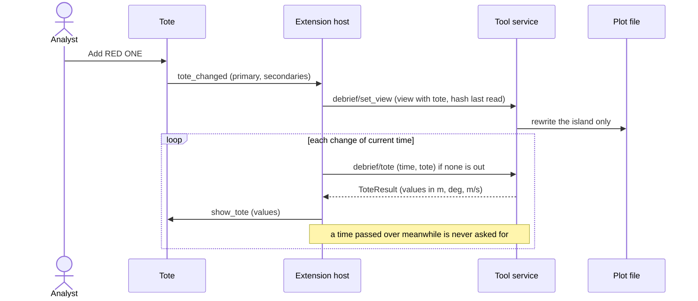

# Tote

How an analyst compares one primary track with several secondaries at current time: the Tote, what it measures, how tracks are chosen, and what is saved where.

## Requirements cited

| SRD | Requirement |
| --- | --- |
| CAP-06 | The Tote shows relative geometry between one primary and several secondaries, updated with current time. |
| CAP-07 | The Tote is a view onto a measure group: a named, reusable set of measures for a mode of analysis, extending a shared core, defined by a study's lead analyst and kept in the study catalogue. |
| NFR-04 | Tote values update within 100 ms of a change to current time. Per-call requests meet it (Phase 0 spike); the dense-sampling fallback stays a contingency. |
| PRN-03 | Measures are worked out in Python. Views only format them. |
| SUB-03 | Range and bearing are geodesic on WGS84. |
| SUB-04 | Values are written with the analyst's units and decimals, by the formatting service. |
| SUB-22 | View state in the island is neither undoable nor recorded; two analysts changing it at once are told, not overwritten. |
| NFR-13 | Everything works from the keyboard, and by touch. |

## Model

1. **One component, every host.** VS Code shows the Tote as a view in the Debrief sidebar, below **Time**, folded until it is first used: the commands that choose its tracks open it. The playground shows the same component under the time controller, in a panel that folds away. The map draws a thin, muted, dashed line from the primary's square to each secondary's at current time (see 9).
2. **One primary, several secondaries.** The primary is the track the others are measured from: usually ownship. Choose it from **Primary** at the top of the Tote. Add secondaries from **Add** below the table, in the order they should be listed. A track is never both: choosing a secondary as the primary takes it out of the secondaries. Each secondary has **×** at the end of its name, in the table's last column, to remove it; `Delete` or `Backspace` on a secondary does the same.

    From the outline, a track's menu (right-click; press and hold on a touch screen; `Shift+F10` or the menu key from the keyboard) has **Set as Tote primary**, **Add to Tote** and **Remove from Tote**. In VS Code these act on every selected track, so several can be added at once.
3. **The core measures.** The Tote is a view onto a measure group (CAP-07). The only group so far is **core**, the measures legacy Debrief's Tote showed, its optional angle on the bow and bearing rate included (decision, product owner, 14 Oct 2026), in this order:

    | Measure | Heading | Of | Worked out as |
    | --- | --- | --- | --- |
    | Range | Range | primary to secondary | Geodesic distance on WGS84 |
    | Bearing | Brg | primary to secondary | True bearing along the geodesic, three figures: `304.0°T`; a dash where the two are in one place |
    | Relative bearing | Rel | primary to secondary | The bearing less the primary's course: red to port, green to starboard, `R045.0°`, `G120.0°`; dead ahead `000.0°`, dead astern `180.0°`; a dash where the primary has no course, or the two are in one place |
    | Angle on the bow | AOB | primary to secondary | The bearing from the secondary to the primary less the secondary's course: the secondary's aspect as the primary sees it, written as relative bearing is, `R030.0°` (the primary on its port bow, so its port side is seen), `G135.0°`; `000.0°` bows on, `180.0°` stern on; a dash where the secondary has no course |
    | Bearing rate | Brg rate | primary to secondary | How fast the true bearing from the primary changes, from both tracks' courses and speeds at that instant (each moved a second either way along its course, on the geodesic): positive drawing right (clockwise), negative drawing left, in degrees per minute (the angular-rate kind, `0.5°/min`, to the analyst's angle decimals); a dash without both courses and speeds |
    | Course | Crse | each track | Recorded course at the fixes either side, interpolated the shorter way round through 360°; a track with no recorded courses, the geodesic's direction there |
    | Speed | Spd | each track | Recorded speed, interpolated; else the leg's length over its duration |
    | Depth | Depth | each track | Recorded depth, interpolated; a dash where none is recorded |

    Units and decimals are the analyst's display settings (SUB-04): ranges in their length unit, speeds in theirs, angles to their decimals. Depths are in metres, or feet where lengths are in feet or yards, to one decimal: there is no depth setting yet. Relative bearing uses the primary's course as its head, as legacy Debrief did; a heading separate from course would change it only for a platform crabbing across a current.

4. **What each line shows.** The primary's own measures (course, speed, depth) are under **Primary**, each with its label: *Crse 214.5°T Spd 9.9 kn Depth 0.0 m*. The table below has one row of headings and a line for each secondary. In a narrow view, such as VS Code's sidebar at its usual width or a demo's side column, each secondary takes three short lines: its name, with **×** at the end; its range, bearing and relative bearing under their headings; then its angle on the bow, bearing rate and own measures, each labelled as the primary's are: *AOB G135.0° Brg rate -0.8°/min Crse 230.0°T Spd 6.0 kn Depth 20.0 m*. Where the view is wide enough (about 600 px), one line a secondary, every measure under its heading. A long name is cut short, in full on hover; nothing scrolls sideways down to about 200 px. Every value has its measure's full name on hover and for screen readers, and the swatch beside a name is the track's colour on the map.
5. **Where tracks are at current time.** Exactly where the map draws each track's square at current time: along the geodesic between the fixes either side, in proportion to time. The Tote and the map are held to the same shared test vectors (`schemas/vectors/track-positions.json`), so the range read off the Tote is the range between the two squares.
6. **No data at current time.** A track that has not started, or has ended, says so in place of its values: *Starts 08:28:48Z* or *Ended 10:35:17Z*. Without the primary at current time, only each secondary's own measures show. A track chosen that the plot no longer has (merged or deleted since) says *No longer in the plot*; remove it, or undo the change that removed it.
7. **Values follow current time.** Dragging current time, stepping it, playing or a tool moving it all update the Tote. It asks Python once for each time: one request at a time, and when the answer comes, one more for the latest time if current time has moved on. Times passed over meanwhile are never asked for, so playing never builds a queue, and the Tote is never more than one answer behind (decision 11 Oct, from the Phase 0 spike). Only a Tote that is showing asks.
8. **What is saved where.**

    | | Where | Undoable | In the history |
    | --- | --- | --- | --- |
    | The primary, the secondaries, the measure group, the map's lines on or off | The plot file, in its island | No | No |
    | Current time | Shared state, not saved | No | No |
    | Measure groups of a study (part B) | The study catalogue | | |

    Choosing tracks is how the plot is being looked at, not a change to it, so it is view state, like the time window: it travels with the plot, so a colleague given the plot file sees the same Tote, but `Ctrl+Z` never changes it and choosing never conflicts with a change to the plot's content. Legacy Debrief kept its Tote's tracks in the GUI part of a `.dpf` file, beside the plot's data, for the same reason. Each choice is saved at once, through the same path as the window. A colleague's choice made meanwhile is shown, never overwritten: *Someone else changed this plot's view, so your choice of Tote tracks was not saved* (SUB-28).

9. **The Tote on the map.** A thin dashed line in a muted theme colour (the theme's description colour, never a fixed one) runs from the primary's square to each secondary's at current time, along the geodesic, so the range read off the Tote is the line's length. It moves with current time, and a secondary with no data then has none. **Lines on the map**, a box under **Add**, turns them off and on for the plot: island state like the choice of tracks, never a step (decision, product owner, 14 Oct 2026). The lines are never in the way: they take no clicks.

### Keyboard and touch

| Where | Key or gesture | Does |
| --- | --- | --- |
| **Primary**, **Add** | `↑` `↓` (or `Alt+↓` to open the list) | Choose the primary; add a secondary |
| A secondary in the table | `Tab` | Reaches it, then its **×** |
| A secondary | `Delete`, `Backspace` | Removes it from the Tote; the keyboard moves to the next |
| **×** | `Enter`, `Space` | Removes that secondary |
| A track in the outline | `Shift+F10`, menu key | Its menu: **Set as Tote primary**, **Add to Tote** or **Remove from Tote**; `↑` `↓` move, `Enter` chooses, `Escape` closes |
| A track in the outline (touch) | Press and hold | The same menu |
| **Lines on the map** | `Space` | Turns the map's lines from the primary off, and on |
| The playground's **Tote** heading | `Enter`, `Space` | Folds the panel away, and back |

Values arriving many times a second while playing never move the keyboard: the secondary or button that had it keeps it.

## Latency (NFR-04)

Measured on the development container on 14 Oct 2026, serial 1 of the sample exercise, BLUE ONE against every other track, with all eight core measures (bearing rate is the dearest: each track is moved a second either way and the bearing measured again):

| Host | Measured from | p50 | p95 | max |
| --- | --- | --- | --- | --- |
| Tool service, in process (pytest, 9 secondaries, 400 slider positions) | request to reply | 7.8 ms | 10.4 ms | 16 ms |
| Python alone, the same | call to return | 4.4 ms | 6.2 ms | 8.5 ms |
| VS Code, real service (integration test, 3 secondaries, 300 times at 60 a second) | asking to showing | 5.2 ms | 10.4 ms | 33 ms |
| Playground, Pyodide in Chromium (playground test, 4 secondaries, playing) | asking to showing | 6.4 to 7.2 ms | 15 to 20 ms (three runs) | 30 to 71 ms |
| Pyodide in Node (`spikes/pyodide/run.sh`, 2 secondaries) | Python alone, mean | 2.2 ms | | |

Every measurement is well inside 100 ms, so the Tote stays on the architecture the Phase 0 spike chose: one request per time. The dense-sampling fallback is not built. Each check reports its numbers and asserts generously (three times the budget at p95), so a slow CI machine does not fail it: `python/debrief-tools/tests/test_tote_latency.py`, the integration test's Tote steps and `vscode/test/play/tote.mjs`.

## Measure groups: what part B adds

The schema and the service are ready for groups beyond core:

- `MeasureDefinition` (id, title, heading label, subject *relative* or *own*, quantity kind, how it is shown) and `MeasureGroup` (id, title, `extends`, measure ids in order) are LinkML types; `ToteView.measure_group` names the group a plot's Tote shows; `ToteResult` carries the group and its definitions with the values, so a view shows any group without knowing it in advance.
- `debrief/measure_groups` lists the groups and measures available; `debrief/tote` takes the group in its `tote` parameter. A group a plot names that its study does not have is shown as core, with a note saying so.

Part B needs: a study catalogue item holding the study's groups, written by its lead analyst and read by every plot in the study (CAP-07); measures beyond core declared by Python tool libraries, as tools are, and evaluated by `debrief_stac.tote`; a choice of group in the Tote; and rules for a group whose measure a library no longer provides.

## Reference implementation

- **Measures:** `python/debrief-kernel/src/debrief_kernel/measures.py` (`TrackMotion`, `measure`, `CORE_GROUP`), positions from `geodesy.TrackPath`, tested in `tests/test_measures.py` (geodesic range and bearing, relative bearing across 360°, angle on the bow, bearing rate against crossing speed over range, far north, the antimeridian, missing data, interpolation). Formatting: `format_relative_bearing` and `format_depth` in `debrief_kernel.formatting` and `formatRelativeBearing`, `formatDepth` in `ts/kernel`, held to `schemas/vectors/formatting.json`.
- **Over a plot:** `python/debrief-stac/src/debrief_stac/tote.py` (`tote`, `tote_tracks`, `measure_groups`): tracks prepared once and kept while the plot file is unchanged, or only its island; tested in `tests/test_tote.py`.
- **The service:** `debrief/tote` and `debrief/measure_groups`; the choice through `debrief/set_view`.
- **The component:** `vscode/webview/totecontrol.ts` and `tote.css`; its rules, free of the page, in `vscode/webview/totelogic.ts` (`withPrimary`, `withSecondaries`, `withoutSecondary`, `withMapLines`, `toteMapLines`, `formatMeasure`, `toteLines`, `ToteRequests`), tested in `vscode/test/unit/tote.test.ts`, with the map's `positionAt` (`vscode/webview/geodesic.ts`) held to the shared position vectors.
- **The map:** `drawToteLines` in `vscode/webview/map.ts`, from the island on `show_plot` and from `set_tote` when the choice changes.
- **VS Code:** the Tote view, `vscode/src/panels/toteview.ts` and `vscode/webview/tote.ts`; saving the choice in `vscode/src/extension.ts` (`saveTote`, through `saveView`). Commands `debrief.tote.setPrimary`, `debrief.tote.add`, `debrief.tote.remove` (the outline's menu) and `debrief.setTote` (agents and keyboard macros).
- **The playground:** `vscode/play/host.ts` (`refreshTote`, `chooseTote`, `trackMenu`) and `tote` in `vscode/play/play.py`.
- **Schema:** `schemas/linkml/measures.yaml` (0.0.18); `PlotView.tote` (with `map_lines`); messages `show_tote`, `tote_changed` and `set_tote`.

*Not yet:* study measure groups and measures beyond core (part B); a heading separate from course for relative bearing; a depth unit setting.
