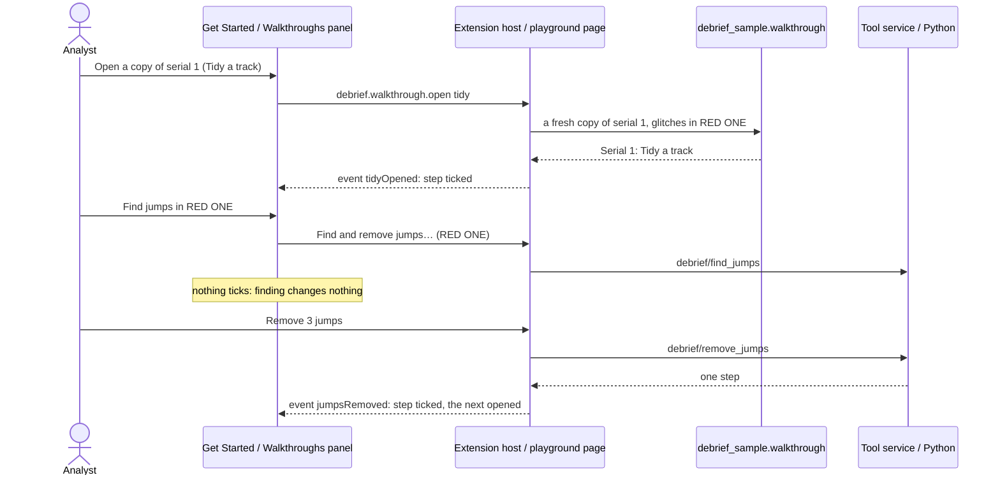

# Walkthroughs

How a newcomer learns Debrief on the sample exercise: five short walkthroughs, each step ticked off when the analyst actually does it, the same in VS Code and in the browser.

## Requirements cited

| SRD | Requirement |
| --- | --- |
| CAP-25 | Guided first-use walkthroughs for common tasks, using the demonstration sample data. |
| NFR-09 | An analyst with domain knowledge but no Debrief training imports a sample serial, composes a storyboard and exports it within an hour. |
| OUT-05 | A new analyst productive quickly: first useful output within an hour of first use. |
| DEP-06, DEP-07 | A public web demo with fixed sample data; files the analyst chooses are read in the browser only. |
| DEP-08 | The hybrid sample data the walkthroughs use. |
| NFR-13 | Everything works from the keyboard. |

## Model

1. **Five walkthroughs** (decision, product owner, 17 Oct 2026; the fifth, *Bearings and TMA*, product owner, 25 Oct 2026, before the VSIX release), each about 10 minutes, each a handful of steps:

    | Walkthrough | Steps |
    | --- | --- |
    | Open and explore a serial | Open a copy of serial 1; move current time; select tracks in the Outline; compare tracks in the Tote; read the narrative in the Timeline |
    | Import and collate | Open a copy; import BLUE ONE's navigation log (a REP file); see where each source has data (Catalogue, Coverage); take the new data; choose a source for a period |
    | Tidy a track | Open a copy with GPS glitches; remove the jumps; smooth the track; mark and label a fix; shear a leg, as in TMA |
    | Annotate and export a figure | Open a copy; draw an annotation; label the times on tracks; export a traceable image; find the image's source |
    | Bearings and TMA | Open a copy and its bearings (the towed array selected in the Outline, its bearings in Bearings); keep a side of an ambiguous bearing; make a first guess; put its start at RED ONE's range; shear the first leg to fit; leave out a wild bearing; split at the turn and fit the second leg (about 12 minutes) |

2. **Each works on a fresh copy, never the sample** (decision, product owner, 17 Oct 2026). The first step of each makes a copy of the sample's serial 1, titled after the walkthrough (*Serial 1: Tidy a track*), whose first step holds the sample's whole history and one more record saying it is a copy; its sources, payloads and supporting files come with it. *Tidy a track*'s copy has three GPS glitches in RED ONE, put in as a step of its own so they are never mistaken for real data; *Import and collate*'s comes with BLUE ONE's navigation log as a REP file to import; *Bearings and TMA*'s has one wild bearing, the towed array's cut at 11:12Z turned 40° off (its bearing one way and its ambiguous bearing the other, so the pair still mirror each other about the array's heading), as a step of its own, since the sample's bearings have none. `debrief_sample.walkthrough` makes them, the same for both hosts. **Starting a walkthrough again** makes a fresh copy, deletes the old one and unticks the walkthrough's steps, so ticks belong to a copy; pressing the button again while a copy is being made makes none (panel review, 17 Oct 2026).
3. **A step ticks when it is done, never when its button is pressed.** Each step names an event; the host sends it when the change it asks for succeeds, however it was made (a form, the map, the keyboard, an agent): a jump removal saved, an area added, an image exported. Looking is not doing: finding jumps, previewing smoothing or moving a track ticks nothing. A few steps are about seeing: moving current time or selecting two tracks by hand (not a plot opening, a tool or a command, which is how Debrief selects what it has just added), a Tote with a primary and a secondary, an entry chosen in the Timeline, and Coverage on screen once the log is imported.
    **Only on the walkthrough's own copy, in the walkthrough shown** (panel review, 17 Oct 2026). The same change made to any other plot ticks nothing, as does the analyst's own file imported (only the walkthrough's log counts) or a stretch made where the step asks for a shear.
4. **Each step's button only takes the analyst there**: it opens the copy, or brings the panel or the command that does the step to hand (in VS Code a command, which asks what it needs; in the playground the panel, opened and scrolled to, or the button clicked). The analyst does the step. With another plot open, the button opens the walkthrough's copy first, and says so; before there is a copy, it refuses and says to open one. A button never acts on the analyst's own plot.
5. **One source of words.** `vscode/walkthroughs/tours.json` holds every step's title, what to do, where and the keyboard, with what differs between hosts beside it. VS Code's `contributes.walkthroughs` is written from it (`npm run walkthroughs`; the unit tests fail if `package.json` differs), and the playground's panel reads it, so the two cannot drift. Each step's picture is an SVG drawn from serial 1 by `python -m debrief_sample media`, in theme colours, the same file in both hosts.
6. **The keyboard, in every step.** Each says how to do it from the keyboard, as the [keyboard equivalents](keyboard-equivalents.md) give it.
7. **The next walkthrough is offered when one ends** (decision, product owner, 23 Oct 2026), in `tours.json`'s order, never left to be found in the list: *Open and explore a serial*, *Import and collate*, *Tidy a track*, *Annotate and export a figure*, *Bearings and TMA*. After the last, all walkthroughs are done. Both hosts take the order and the words (**Next walkthrough: *title***, **All walkthroughs done**) from `contribute.mjs`, so they cannot drift.

### In VS Code

The walkthroughs are on VS Code's **Get Started** page, under Debrief: **Debrief: Walkthroughs: learn Debrief on the sample exercise** from the Command Palette, the Catalogues view's menu, or **Start a walkthrough** while no catalogue is added. Each step's button is a command; every step after the first runs through `debrief.walkthrough.do` (the walkthrough, then the command and its arguments), which opens the copy first. A step ticks when its context key, `debrief.walkthrough.<event>`, is set (`completionEvents: ["onContext:…"]`), VS Code's documented way. The Get Started page counts a context key only if it changes after the page's service has started, which may be long after. So the extension also marks the step with VS Code's own `welcome.markStepComplete` (and `welcome.markStepIncomplete` when a walkthrough starts again). These commands are not part of VS Code's API: a failure is written to Debrief's log, and the integration test checks that VS Code still has them.

**On the first activation after install**, Debrief opens *Open and explore a serial* on the Get Started page (`workbench.action.openWalkthrough` with `debrief.debrief#explore`), once only: a flag in the extension's global state (`debrief.walkthrough.openedOnInstall`) is set first, so later starts, and a page that failed to open, never open it again (decision, product owner, 22 Oct 2026). The Get Started page is VS Code's own and takes VS Code's theme; the guidance accent below is the playground's.

**Each walkthrough's last step ends with a link to the next**, alone on its line so the Get Started page draws it as a button: **Next walkthrough: Import and collate** runs `workbench.action.openWalkthrough` with `debrief.debrief#collate`, and so on. *Bearings and TMA*'s last step says instead that, once it is done, all walkthroughs are done (decision, product owner, 23 Oct 2026).

**Open a copy of serial 1** (`debrief.walkthrough.open` with the walkthrough's id) builds the sample with the analyst's Python (`python -m debrief_sample walkthrough`) into the extension's own storage, one folder for each walkthrough, and adds it as a catalogue of its own, *Walkthrough: Tidy a track*. Pressed again, it asks: **Start again with a fresh copy** (the old copy and its catalogue go; the sample never changes) or **Carry on with my copy**. Agents pass `{fresh}`. **Import the navigation log** (`debrief.walkthrough.importLog`) imports the log waiting beside *Walkthrough: Import and collate*'s catalogue, as **Import plot file…** imports any REP file.

### In the playground and the web demo

A **Walkthroughs** panel, **open on first load wherever it appears**: the web demo, the playground and the blog's demos that include it (decision, product owner, 22 Oct 2026, superseding 17 Oct's folded outside the web demo), since it is where a newcomer gains an overall understanding. **900 pixels wide and more the panels are docked** ([browser layout](browser-layout.md); decision, product owner, 23 Oct 2026, superseding 22 Oct's column of its own from 1200 pixels): the walkthroughs are a group of their own on the right, alone (second round, 23 Oct 2026), so a step's words are never hidden behind another tab and stay in sight while the analyst does it in the panels on the left, under the map and on the map; the step's own button brings the panel it names into view, wherever the analyst has put it. The panel scrolls on its own. A reader who brings another tab to the front, or moves the panel, finds the layout as they left it next time, in the playground and the web demo; a blog's demo starts as it was made every time. **Narrower**, on a phone and in the blog's demos, it is the side column's first panel, above the time controller, folding by its heading as every panel there does; a reader who folds it finds it folded next time, except in a blog's demo. At 1366 pixels the right-hand group is about 290 pixels wide and the map 791. It holds a list to choose the walkthrough, its steps (each a button that opens it, its number or a tick, *done* said to screen readers), the step to do next open, and a line saying what was done and what comes next. **The guidance accent** sets the panel apart from the panels around it, in the theme's link colour (`--vscode-textLink-foreground`, the focus colour `--vscode-focusBorder` where a theme has none; the playground's theme maps both): a 3 pixel edge on the panel, its heading bar tinted with the accent (14% over the panel's background), each step's number in the accent and the next step's number a disc of it. Docked, its tab is its heading, and carries the tint and a 3 pixel edge of the accent; folded, in the side column, its heading does. Text keeps WCAG AA contrast (4.5:1) on the light and dark themes, tested; data colours are untouched (see the style guide's [Theme](../style-guide/theme.md)). The copy is made in the browser from the sample as the site shipped it, kept apart from the reader's own changes, so a walkthrough always starts clean. The chosen walkthrough is remembered in the browser; ticks are not, since the copies go when the page closes (product owner, 17 Oct 2026).

**When a walkthrough's steps are all done** (decision, product owner, 23 Oct 2026), the panel says so below the steps and offers **Next walkthrough: *title***, a button in the guidance accent (the next step's disc's colours: the accent behind, the panel's background as its text, at 4.5:1 or more). The keyboard moves to it, and the status line says it is there; but when the last step was done on the map or in a form beside it (a frame has the keyboard), as *Bearings and TMA*'s leg is dragged, the keyboard stays there and the status line, a live region, says the walkthrough is done and what comes next (product owner, 25 Oct 2026). Pressing it shows the next walkthrough as choosing it from the list does, the keyboard on its first step's button, which opens that walkthrough's own copy. **Before then, a quieter link, Skip to next walkthrough: *title***, is always below the steps, in the accent and underlined: a step ticks only when it is done, so there is no "done or skipped" to wait for, and a reader stuck on a step, or who knows it already, can still move on without hunting in the list. The list stays, to choose any walkthrough. After the last walkthrough: **All walkthroughs done**, and a link, **Start again: Open and explore a serial**, the keyboard on it.

The **web demo** at `/demo/` is the playground's page full screen, every panel and the walkthroughs, opening the fixed sample serials. A file the analyst chooses opens there too, read in the browser only (decision, product owner, 17 Oct 2026, amending DEP-07). No request carries it, nothing is sent at all (nor as the tab closes), and no WebSocket opens. Nothing derived from it is stored either: in the web demo the Timeline keeps only the kinds of entry shown and its view's own settings, never sources, types or highlighted phrases. It is gone when the tab closes.

**Content-Security-Policy.** The web demo and the playground's pages (the page, each frame, the geodesic demo) carry a strict policy in a meta element (`vscode/play/csp.mjs`): only the site itself, and jsDelivr for Pyodide; no forms, plugins or other origins; `base-uri 'self'` for the demo's `<base>`. A meta element's policy does not reach the Python worker, and GitHub Pages cannot send one as a header. **Pyodide's files come from jsDelivr with no integrity check, a risk the product owner accepts** (17 Oct 2026).

### Keyboard and touch

| Where | Key or gesture | Does |
| --- | --- | --- |
| Get Started (VS Code) | `Tab` to a step, `Enter` opens it; `Tab` to its button, `Enter` | VS Code's own page |
| The playground's panel | `Tab` to the list, `↓` chooses a walkthrough; `Tab` to a step, `Enter` or `Space` opens it; `Tab` to its button, `Enter` | Every part a button or a list; a tap does the same |
| The playground's panel, docked | `Tab` to its tab, `Enter`; `Shift+F10` on it moves it to another group | [Browser layout](browser-layout.md) |

The panel never scrolls sideways, nor the page, at 210, 280 or 390 pixels, in the side column of a 650 to 899 pixel window, or docked at 900 to 1440 pixels, in a wider font too.

### Bearings and TMA (product owner, 25 Oct 2026)

The fifth walkthrough, added before the VSIX release: sensors, ambiguity and TMA had none, beyond *Tidy a track*'s shear. It works on BLUE ONE's towed array on RED ONE, and makes its solution live, so the sample keeps no solution of its own and its feature counts are unchanged.

**It fits properly** (product owner, 25 Oct 2026): the walkthrough ends with a solution near the bearings' own accuracy, as legacy Debrief's TMA tutorial teaches (pages 48 to 58), not at about 6° RMS as it first did. Legacy's way, one leg at a time: pin the leg's start on its first bearing; shear its end until the errors stand on the zero line and the Error pane passes; zoom in to fine-tune; bearings never give range, so move the start along its bearing and shear again; then the next leg. The walkthrough gives the range (RED ONE was 3.27 nmi from the towed array at 09:46Z), where an analyst would try ranges, so it takes seven steps and about 12 minutes rather than a search.

**Serial 1, not serial 2.** Every serial has both sonars. In serial 2 RED ONE is 1.4 to 3 nmi from BLUE ONE throughout; in serial 1 the towed array holds RED ONE at 3 to 4.5 nmi from 09:46Z, and RED ONE turns between 10:30Z and 10:40Z, from 250° at 4 kn to 200° at 5 kn, a manoeuvre to split at. So the walkthrough copies serial 1, as the others do.

| Step | What it asks | Its button (VS Code; the playground) | Ticks when |
| --- | --- | --- | --- |
| Open a copy of serial 1 and its bearings | Read the towed array's two lines a cut, mirrored about the array's heading | The copy opened, then the towed array selected in the Outline and **Bearings** showing it, in the panel below the editor in VS Code (`debrief.chooseInOutline`; `outline:`) | the copy opens (`tmaOpened`) |
| Keep a side of an ambiguous bearing | **Keep starboard** in the Tools for 236.3° (starboard), the side the Bow sonar's 235.3° at 09:46:00Z agrees with (its cuts read by opening *Bow sonar* in the Outline); the period's other ambiguous cuts are measured by the nearer side (≈), an assumption the step says | The Outline opens the towed array and selects its cut at 09:46Z, current time there | a side is kept, not both made ambiguous again (`sideKept`) |
| Make a first guess | Debrief's defaults (4.94 nmi, across the bearing, 8 kn) | The Outline selects the cuts 09:46Z to 12:00Z (102) and runs **TMA solution from 102 cuts…**, the form in Bearings | a solution is made (`solutionMade`) |
| Put the start at RED ONE's range | Move the whole solution 1.67 nmi at 056.3°, along the first bearing towards BLUE ONE, to 3.27 nmi (or drag its Move handle, the first error kept on zero) | The solution selected and **Move track…** (**Move…**) asked of it | the whole solution is moved (`solutionMoved`) |
| Shear the first leg to fit | Box the errors to 10:32Z in the Error pane, then shear about the start: about 246° at 3.8 kn | The solution selected and **Shear track…** (**Shear…**) asked of it | the whole solution is sheared (`solutionSheared`); another track's shear is *Tidy a track*'s |
| Leave out a wild bearing | **Leave out of Contact 1 solution** in the Tools (or `Space` in the plot) for the cut at 11:12Z, some 40° left of its neighbours | The Outline selects the cut at 11:12Z, the solution still shown in Bearings | a cut is left out, not counted again nor already left out (`cutLeftOut`) |
| Split at the turn and fit the second leg | **Split before 10:38:00Z** in the Tools (or `S` in the plot); **This leg**; pin the second leg's start on its first bearing, about 0.17 nmi at 155°; shear its end, about 200° at 5.2 kn | The Outline opens the solution to its leg and selects its position at 10:38Z, moving current time there, so This leg is the second | one of its legs is dragged, once it is split (a drag with a period: **This leg**, *This leg* in the forms, or the time window); the split alone is not the step (`legDragged`) |

On the sample, as `python/debrief-sample/tests/test_walkthrough.py` holds them (`walkthrough.play_tma`, which makes the first guess as its form sends it) and the playground's test reaches them through the forms, to a tenth of a degree:

| After | RMS | The cue (3.0° cut-off) |
| --- | --- | --- |
| The first guess | 55.9° | ✗ 95 of 102 beyond, the largest 136.6° |
| The start at RED ONE's range | 62.7°: up, as the course and speed are still the guess's | ✗ 99 of 102 beyond |
| The first leg sheared (246° at 3.8 kn) | 38.8° over all; 1.7° over the first leg's 40 cuts, 2 of them beyond | ✗ 64 of 102 beyond, the errors running away after 10:32Z to −77° by 12:00Z |
| The wild bearing left out | 38.3° | ✗ 63 of 101 beyond |
| The second leg pinned (0.17 nmi at 155°) and sheared (200° at 5.2 kn) | 1.8° | ✗ 9 of 101 beyond, the largest 4.8° |

**Why the cue never passes.** The sample's sonar noise is 1.5° (1.8° RMS against RED ONE's true track over these cuts, with the turn), so with 101 cuts some fall beyond 3° whatever the fit: RED ONE's true track itself leaves 8 of 101 beyond, the largest 4.4°. The last step says so: aim for an RMS under about 2° and only a handful beyond. The default cut-off and the sample's noise are unchanged (product owner, 25 Oct 2026). For the same reason the cue stays ✗ while only the first leg is fitted: it counts every cut of the solution, the second leg's too.

**What the buttons choose, in the Outline** (product owner, 27 Oct 2026; Bearings had the cut list before). `debrief.chooseInOutline` takes the sensor or the solution and what to choose under it (`cut_time`, `period` and `make`, or `fix_time`; `outlineChoice`): the cut at or nearest a time, the cuts of a period (with `make`, **TMA solution from cuts…** run for them, the first guess's form in Bearings), or the solution's position at a time; it moves current time to a cut or a position, opens the rows above it, selects it, gives it the keyboard, and in the one column of a phone brings it into sight centred in the page, so a section's heading never covers it. Bearings follows the selection and rings it. The playground's action is `outline:<sensor or solution>?cut=…`, `?period=…/…&make` or `?fix=…`, the same choice. `debrief.showBearings` stays for agents, with a `TmaFocus` sent once with the view (`FocusOnce`). **The solution's id** is not known until it is made: a step names it `$solution`, and each host puts in the copy's latest TMA solution when the button is pressed, or says *Make the solution first* while there is none. In VS Code a step's button that opens a form (Move…, Shear…) also brings Bearings back into sight in the panel if it was closed.

**The keyboard.** The cut's buttons (Keep, Leave out, Split) come before the list in the tab order, so from the list it is `Shift+Tab` back to them (the steps say so; the playground's test presses it); in the plot `Space` or `Delete` leaves a cut out, `S` splits, `1` and `2` keep a side. The forms **Move…** and **Shear…** offer *This leg* under *What changes* once a solution is split, the leg current time is in, so the second leg is fitted by typing as the first was ([track operations](track-operations.md)).

**Candidly.** The sample's bearings have no wild one, so the copy has one put in, as *Tidy a track*'s glitches are, and History says so. The map draws every cut of the serial's window and the narrative's labels, so at 09:46Z the map's nearest bearing label (*Regained RED ONE, bearing 231.8°T*, at 09:42:30Z) is not the Bow sonar's cut then; the step gives the number and where to read it (the Bow sonar opened in the Outline). Moving the start to the right range makes the RMS worse before the shear makes it better, which the step says. The range is given, not found: finding it would be a search of trial ranges, longer than a walkthrough.

## The onboarding trial

NFR-09's trial, with analysts, is the product owner's to run. It is formative. `docs/notes/onboarding-trial.md` gives:
- the pass rule to pre-register: at least 80% complete without help above the first rung, the median silent run within 40 minutes, and no one over 60;
- the participants (a pilot first) and the fixed set-up (a catalogue already added);
- the neutral observer and the help ladder;
- the four tasks (import a REP file and a legacy .dpf plot; tidy; annotate; export a traceable figure), worded so they do not mirror the walkthroughs;
- what to time, the success criteria and their tolerances, the observation sheet, and how results are recorded.

The trial is pending. The playground's test does the same tasks as a speed run, in the playground only, counting each action (32) and failing above 36, to show they can be done.

## Reference implementation

`vscode/walkthroughs/tours.json` (the words) and `contribute.mjs` (how VS Code shows them); `vscode/src/walkthroughs.ts` (VS Code's events and copies); `vscode/play/tours.ts` (the playground's panel and its events); `python/debrief-sample/src/debrief_sample/walkthrough.py` (the copies) and `media.py` (the pictures); `vscode/play/demo.mjs` (the web demo's page). Tests: `vscode/test/unit/walkthroughs.test.ts` (each walkthrough's last step on the Get Started page linking to the next by id), `vscode/test/integration/walkthroughs.ts` (the first walkthrough opened on the first activation and not on the next; every walkthrough in VS Code, each event on its real action, Bearings and TMA's buttons' choices reaching the view, Bearings in the panel below the editor and brought back into sight there by a step's button, and the RMS each step reaches), `vscode/test/unit/tma.test.ts` (`focusChoice`, `FocusOnce`, `legExtent`), `vscode/test/play/onboarding.mjs` (open on first load in the playground, the web demo and the first hour post's demo; the guidance accent and its contrast in light and dark; the next walkthrough offered at each one's end, the keyboard on it, and all done after the last; each walkthrough start to finish in the playground, the speed run, the web demo), `python/debrief-sample/tests/test_walkthrough.py`.
