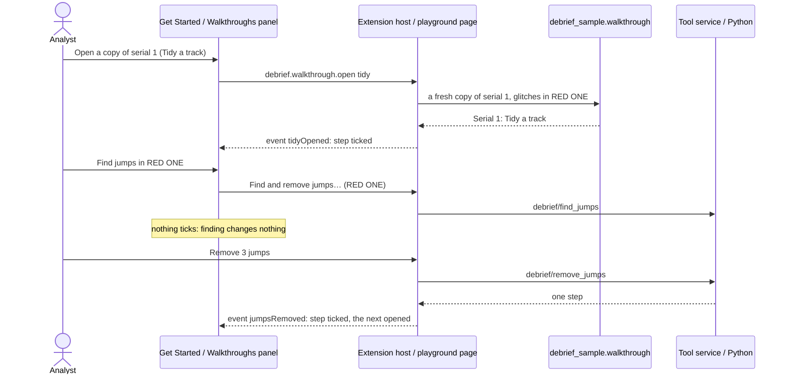

# Walkthroughs

How a newcomer learns Debrief on the sample exercise: four short walkthroughs, each step ticked off when the analyst actually does it, the same in VS Code and in the browser.

## Requirements cited

| SRD | Requirement |
| --- | --- |
| CAP-25 | Guided first-use walkthroughs for common tasks, using the demonstration sample data. |
| NFR-09 | An analyst with domain knowledge but no Debrief training imports a sample serial, composes a storyboard and exports it within an hour. |
| OUT-05 | A new analyst productive quickly: first useful output within an hour of first use. |
| DEP-06, DEP-07 | A public web demo with fixed sample data; files the analyst chooses are read in the browser only. |
| DEP-08 | The hybrid sample data the walkthroughs use. |
| NFR-13 | Everything works from the keyboard. |

## Model

1. **Four walkthroughs** (decision, product owner, 17 Oct 2026), each about 10 minutes, each a handful of steps:

    | Walkthrough | Steps |
    | --- | --- |
    | Open and explore a serial | Open a copy of serial 1; move current time; select tracks in the Outline; compare tracks in the Tote; read the narrative in the Timeline |
    | Import and collate | Open a copy; import BLUE ONE's navigation log (a REP file); see where each source has data (Catalogue, Coverage); take the new data; choose a source for a period |
    | Tidy a track | Open a copy with GPS glitches; remove the jumps; smooth the track; mark and label a fix; shear a leg, as in TMA |
    | Annotate and export a figure | Open a copy; draw an annotation; label the times on tracks; export a traceable image; find the image's source |

2. **Each works on a fresh copy, never the sample** (decision, product owner, 17 Oct 2026). The first step of each makes a copy of the sample's serial 1, titled after the walkthrough (*Serial 1: Tidy a track*), whose first step holds the sample's whole history and one more record saying it is a copy; its sources, payloads and supporting files come with it. *Tidy a track*'s copy has three GPS glitches in RED ONE, put in as a step of its own so they are never mistaken for real data; *Import and collate*'s comes with BLUE ONE's navigation log as a REP file to import. `debrief_sample.walkthrough` makes them, the same for both hosts.
3. **A step ticks when it is done, never when its button is pressed.** Each step names an event; the host sends it when the change it asks for succeeds, however it was made (a form, the map, the keyboard, an agent): a jump removal saved, an area added, an image exported. Looking is not doing: finding jumps, previewing smoothing or moving a track ticks nothing. A few steps are about seeing: moving current time or selecting by hand (not a plot opening or a tool), a Tote with a primary and a secondary, an entry chosen in the Timeline, and Coverage on screen showing the plot's.
4. **Each step's button only takes the analyst there**: it opens the copy, or brings the panel or the command that does the step to hand (in VS Code a command, which asks what it needs; in the playground the panel, opened and scrolled to, or the button clicked). The analyst does the step.
5. **One source of words.** `vscode/walkthroughs/tours.json` holds every step's title, what to do, where and the keyboard, with what differs between hosts beside it. VS Code's `contributes.walkthroughs` is written from it (`npm run walkthroughs`; the unit tests fail if `package.json` differs), and the playground's panel reads it, so the two cannot drift. Each step's picture is an SVG drawn from serial 1 by `python -m debrief_sample media`, in theme colours, the same file in both hosts.
6. **The keyboard, in every step.** Each says how to do it from the keyboard, as the [keyboard equivalents](keyboard-equivalents.md) give it.

### In VS Code

The walkthroughs are on VS Code's **Get Started** page, under Debrief: **Debrief: Walkthroughs: learn Debrief on the sample exercise** from the Command Palette, the Catalogues view's menu, or **Start a walkthrough** while no catalogue is added. Each step's button is a command; a step ticks when its context key, `debrief.walkthrough.<event>`, is set (`completionEvents: ["onContext:…"]`).

**Open a copy of serial 1** (`debrief.walkthrough.open` with the walkthrough's id) builds the sample with the analyst's Python (`python -m debrief_sample walkthrough`) into the extension's own storage, one folder for each walkthrough, and adds it as a catalogue of its own, *Walkthrough: Tidy a track*. Pressed again, it asks: **Start again with a fresh copy** (the old copy and its catalogue go; the sample never changes) or **Carry on with my copy**. Agents pass `{fresh}`. **Import the navigation log** (`debrief.walkthrough.importLog`) imports the log waiting beside *Walkthrough: Import and collate*'s catalogue, as **Import plot file…** imports any REP file.

### In the playground and the web demo

A **Walkthroughs** panel, first in the side column above the time controller, folding like every panel: a list to choose the walkthrough, its steps (each a button that opens it, its number or a tick, *done* said to screen readers), the step to do next open, and a line saying what was done and what comes next. The copy is made in the browser from the sample as the site shipped it, kept apart from the reader's own changes, so a walkthrough always starts clean. The chosen walkthrough is remembered in the browser; ticks are not, since the copies go when the page closes.

The **web demo** at `/demo/` is the playground's page full screen, every panel and the walkthroughs, opening the fixed sample serials. A file the analyst chooses opens there too, read in the browser only (decision, product owner, 17 Oct 2026, amending DEP-07): no request carries it, and nothing of it is stored, so it is gone when the tab closes.

### Keyboard and touch

| Where | Key or gesture | Does |
| --- | --- | --- |
| Get Started (VS Code) | `Tab` to a step, `Enter` opens it; `Tab` to its button, `Enter` | VS Code's own page |
| The playground's panel | `Tab` to the list, `↓` chooses a walkthrough; `Tab` to a step, `Enter` or `Space` opens it; `Tab` to its button, `Enter` | Every part a button or a list; a tap does the same |

The panel never scrolls sideways at 210, 280 or 390 pixels, in a wider font too.

## The onboarding trial

NFR-09's trial, with analysts, is the product owner's to run: `docs/notes/onboarding-trial.md` gives the participants, the script, the four tasks (import, tidy, annotate, export a traceable figure), what to time, the success criteria (a provisional 40 minutes), the observation sheet and how results are recorded. It is pending. The playground's test does the same tasks as a speed run, counting each action, to show they can be done.

## Reference implementation

`vscode/walkthroughs/tours.json` (the words) and `contribute.mjs` (how VS Code shows them); `vscode/src/walkthroughs.ts` (VS Code's events and copies); `vscode/play/tours.ts` (the playground's panel and its events); `python/debrief-sample/src/debrief_sample/walkthrough.py` (the copies) and `media.py` (the pictures); `vscode/play/demo.mjs` (the web demo's page). Tests: `vscode/test/unit/walkthroughs.test.ts`, `vscode/test/integration/walkthroughs.ts` (every walkthrough in VS Code, each event on its real action), `vscode/test/play/onboarding.mjs` (each walkthrough start to finish in the playground, the speed run, the web demo), `python/debrief-sample/tests/test_walkthrough.py`.
