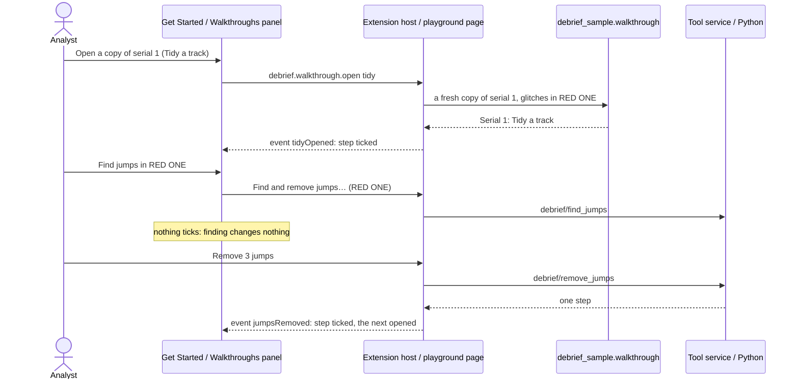

# Walkthroughs

How a newcomer learns Debrief on the sample exercise: five short walkthroughs, each step ticked off when the analyst actually does it, the same in VS Code and in the browser.

## Requirements cited

| SRD | Requirement |
| --- | --- |
| CAP-25 | Guided first-use walkthroughs for common tasks, using the demonstration sample data. |
| NFR-09 | An analyst with domain knowledge but no Debrief training imports a sample serial, composes a storyboard and exports it within an hour. |
| OUT-05 | A new analyst productive quickly: first useful output within an hour of first use. |
| DEP-06, DEP-07 | A public web demo with fixed sample data; files the analyst chooses are read in the browser only. |
| DEP-08 | The hybrid sample data the walkthroughs use. |
| NFR-13 | Everything works from the keyboard. |

## Model

1. **Five walkthroughs** (decision, product owner, 17 Oct 2026; the fifth, *Bearings and TMA*, product owner, 25 Oct 2026, before the VSIX release), each about 10 minutes, each a handful of steps:

    | Walkthrough | Steps |
    | --- | --- |
    | Open and explore a serial | Open a copy of serial 1; move current time; select tracks in the Outline; compare tracks in the Tote; read the narrative in the Timeline |
    | Import and collate | Open a copy; import BLUE ONE's navigation log (a REP file); see where each source has data (Catalogue, Coverage); take the new data; choose a source for a period |
    | Tidy a track | Open a copy with GPS glitches; remove the jumps; smooth the track; mark and label a fix; shear a leg, as in TMA |
    | Annotate and export a figure | Open a copy; draw an annotation; label the times on tracks; export a traceable image; find the image's source |
    | Bearings and TMA | Open a copy and its bearings (the towed array's cuts in Bearings); keep a side of an ambiguous bearing; make a first guess; drag the solution to fit; leave out a wild bearing; split into legs and drag one |

2. **Each works on a fresh copy, never the sample** (decision, product owner, 17 Oct 2026). The first step of each makes a copy of the sample's serial 1, titled after the walkthrough (*Serial 1: Tidy a track*), whose first step holds the sample's whole history and one more record saying it is a copy; its sources, payloads and supporting files come with it. *Tidy a track*'s copy has three GPS glitches in RED ONE, put in as a step of its own so they are never mistaken for real data; *Import and collate*'s comes with BLUE ONE's navigation log as a REP file to import; *Bearings and TMA*'s has one wild bearing, the towed array's cut at 11:12Z turned 40° off, as a step of its own, since the sample's bearings have none. `debrief_sample.walkthrough` makes them, the same for both hosts. **Starting a walkthrough again** makes a fresh copy, deletes the old one and unticks the walkthrough's steps, so ticks belong to a copy; pressing the button again while a copy is being made makes none (panel review, 17 Oct 2026).
3. **A step ticks when it is done, never when its button is pressed.** Each step names an event; the host sends it when the change it asks for succeeds, however it was made (a form, the map, the keyboard, an agent): a jump removal saved, an area added, an image exported. Looking is not doing: finding jumps, previewing smoothing or moving a track ticks nothing. A few steps are about seeing: moving current time or selecting two tracks by hand (not a plot opening, a tool or a command, which is how Debrief selects what it has just added), a Tote with a primary and a secondary, an entry chosen in the Timeline, and Coverage on screen once the log is imported.
    **Only on the walkthrough's own copy, in the walkthrough shown** (panel review, 17 Oct 2026). The same change made to any other plot ticks nothing, as does the analyst's own file imported (only the walkthrough's log counts) or a stretch made where the step asks for a shear.
4. **Each step's button only takes the analyst there**: it opens the copy, or brings the panel or the command that does the step to hand (in VS Code a command, which asks what it needs; in the playground the panel, opened and scrolled to, or the button clicked). The analyst does the step. With another plot open, the button opens the walkthrough's copy first, and says so; before there is a copy, it refuses and says to open one. A button never acts on the analyst's own plot.
5. **One source of words.** `vscode/walkthroughs/tours.json` holds every step's title, what to do, where and the keyboard, with what differs between hosts beside it. VS Code's `contributes.walkthroughs` is written from it (`npm run walkthroughs`; the unit tests fail if `package.json` differs), and the playground's panel reads it, so the two cannot drift. Each step's picture is an SVG drawn from serial 1 by `python -m debrief_sample media`, in theme colours, the same file in both hosts.
6. **The keyboard, in every step.** Each says how to do it from the keyboard, as the [keyboard equivalents](keyboard-equivalents.md) give it.
7. **The next walkthrough is offered when one ends** (decision, product owner, 23 Oct 2026), in `tours.json`'s order, never left to be found in the list: *Open and explore a serial*, *Import and collate*, *Tidy a track*, *Annotate and export a figure*, *Bearings and TMA*. After the last, all walkthroughs are done. Both hosts take the order and the words (**Next walkthrough: *title***, **All walkthroughs done**) from `contribute.mjs`, so they cannot drift.

### In VS Code

The walkthroughs are on VS Code's **Get Started** page, under Debrief: **Debrief: Walkthroughs: learn Debrief on the sample exercise** from the Command Palette, the Catalogues view's menu, or **Start a walkthrough** while no catalogue is added. Each step's button is a command; every step after the first runs through `debrief.walkthrough.do` (the walkthrough, then the command and its arguments), which opens the copy first. A step ticks when its context key, `debrief.walkthrough.<event>`, is set (`completionEvents: ["onContext:…"]`), VS Code's documented way. The Get Started page counts a context key only if it changes after the page's service has started, which may be long after. So the extension also marks the step with VS Code's own `welcome.markStepComplete` (and `welcome.markStepIncomplete` when a walkthrough starts again). These commands are not part of VS Code's API: a failure is written to Debrief's log, and the integration test checks that VS Code still has them.

**On the first activation after install**, Debrief opens *Open and explore a serial* on the Get Started page (`workbench.action.openWalkthrough` with `debrief.debrief#explore`), once only: a flag in the extension's global state (`debrief.walkthrough.openedOnInstall`) is set first, so later starts, and a page that failed to open, never open it again (decision, product owner, 22 Oct 2026). The Get Started page is VS Code's own and takes VS Code's theme; the guidance accent below is the playground's.

**Each walkthrough's last step ends with a link to the next**, alone on its line so the Get Started page draws it as a button: **Next walkthrough: Import and collate** runs `workbench.action.openWalkthrough` with `debrief.debrief#collate`, and so on. *Bearings and TMA*'s last step says instead that, once it is done, all walkthroughs are done (decision, product owner, 23 Oct 2026).

**Open a copy of serial 1** (`debrief.walkthrough.open` with the walkthrough's id) builds the sample with the analyst's Python (`python -m debrief_sample walkthrough`) into the extension's own storage, one folder for each walkthrough, and adds it as a catalogue of its own, *Walkthrough: Tidy a track*. Pressed again, it asks: **Start again with a fresh copy** (the old copy and its catalogue go; the sample never changes) or **Carry on with my copy**. Agents pass `{fresh}`. **Import the navigation log** (`debrief.walkthrough.importLog`) imports the log waiting beside *Walkthrough: Import and collate*'s catalogue, as **Import plot file…** imports any REP file.

### In the playground and the web demo

A **Walkthroughs** panel, **open on first load wherever it appears**: the web demo, the playground and the blog's demos that include it (decision, product owner, 22 Oct 2026, superseding 17 Oct's folded outside the web demo), since it is where a newcomer gains an overall understanding. **900 pixels wide and more the panels are docked** ([browser layout](browser-layout.md); decision, product owner, 23 Oct 2026, superseding 22 Oct's column of its own from 1200 pixels): the walkthroughs are a group of their own on the right, alone (second round, 23 Oct 2026), so a step's words are never hidden behind another tab and stay in sight while the analyst does it in the panels on the left, under the map and on the map; the step's own button brings the panel it names into view, wherever the analyst has put it. The panel scrolls on its own. A reader who brings another tab to the front, or moves the panel, finds the layout as they left it next time, in the playground and the web demo; a blog's demo starts as it was made every time. **Narrower**, on a phone and in the blog's demos, it is the side column's first panel, above the time controller, folding by its heading as every panel there does; a reader who folds it finds it folded next time, except in a blog's demo. At 1366 pixels the right-hand group is about 290 pixels wide and the map 791. It holds a list to choose the walkthrough, its steps (each a button that opens it, its number or a tick, *done* said to screen readers), the step to do next open, and a line saying what was done and what comes next. **The guidance accent** sets the panel apart from the panels around it, in the theme's link colour (`--vscode-textLink-foreground`, the focus colour `--vscode-focusBorder` where a theme has none; the playground's theme maps both): a 3 pixel edge on the panel, its heading bar tinted with the accent (14% over the panel's background), each step's number in the accent and the next step's number a disc of it. Docked, its tab is its heading, and carries the tint and a 3 pixel edge of the accent; folded, in the side column, its heading does. Text keeps WCAG AA contrast (4.5:1) on the light and dark themes, tested; data colours are untouched (see the style guide's [Theme](../style-guide/theme.md)). The copy is made in the browser from the sample as the site shipped it, kept apart from the reader's own changes, so a walkthrough always starts clean. The chosen walkthrough is remembered in the browser; ticks are not, since the copies go when the page closes (product owner, 17 Oct 2026).

**When a walkthrough's steps are all done** (decision, product owner, 23 Oct 2026), the panel says so below the steps and offers **Next walkthrough: *title***, a button in the guidance accent (the next step's disc's colours: the accent behind, the panel's background as its text, at 4.5:1 or more). The keyboard moves to it, and the status line says it is there; but when the last step was done on the map or in a form beside it (a frame has the keyboard), as *Bearings and TMA*'s leg is dragged, the keyboard stays there and the status line, a live region, says the walkthrough is done and what comes next (product owner, 25 Oct 2026). Pressing it shows the next walkthrough as choosing it from the list does, the keyboard on its first step's button, which opens that walkthrough's own copy. **Before then, a quieter link, Skip to next walkthrough: *title***, is always below the steps, in the accent and underlined: a step ticks only when it is done, so there is no "done or skipped" to wait for, and a reader stuck on a step, or who knows it already, can still move on without hunting in the list. The list stays, to choose any walkthrough. After the last walkthrough: **All walkthroughs done**, and a link, **Start again: Open and explore a serial**, the keyboard on it.

The **web demo** at `/demo/` is the playground's page full screen, every panel and the walkthroughs, opening the fixed sample serials. A file the analyst chooses opens there too, read in the browser only (decision, product owner, 17 Oct 2026, amending DEP-07). No request carries it, nothing is sent at all (nor as the tab closes), and no WebSocket opens. Nothing derived from it is stored either: in the web demo the Timeline keeps only the kinds of entry shown and its view's own settings, never sources, types or highlighted phrases. It is gone when the tab closes.

**Content-Security-Policy.** The web demo and the playground's pages (the page, each frame, the geodesic demo) carry a strict policy in a meta element (`vscode/play/csp.mjs`): only the site itself, and jsDelivr for Pyodide; no forms, plugins or other origins; `base-uri 'self'` for the demo's `<base>`. A meta element's policy does not reach the Python worker, and GitHub Pages cannot send one as a header. **Pyodide's files come from jsDelivr with no integrity check, a risk the product owner accepts** (17 Oct 2026).

### Keyboard and touch

| Where | Key or gesture | Does |
| --- | --- | --- |
| Get Started (VS Code) | `Tab` to a step, `Enter` opens it; `Tab` to its button, `Enter` | VS Code's own page |
| The playground's panel | `Tab` to the list, `↓` chooses a walkthrough; `Tab` to a step, `Enter` or `Space` opens it; `Tab` to its button, `Enter` | Every part a button or a list; a tap does the same |
| The playground's panel, docked | `Tab` to its tab, `Enter`; `Shift+F10` on it moves it to another group | [Browser layout](browser-layout.md) |

The panel never scrolls sideways, nor the page, at 210, 280 or 390 pixels, in the side column of a 650 to 899 pixel window, or docked at 900 to 1440 pixels, in a wider font too.

### Bearings and TMA (product owner, 25 Oct 2026)

The fifth walkthrough, added before the VSIX release: sensors, ambiguity and TMA had none, beyond *Tidy a track*'s shear. It works on BLUE ONE's towed array on RED ONE, and makes its solution live, so the sample keeps no solution of its own and its feature counts are unchanged.

**Serial 1, not serial 2.** Every serial has both sonars. In serial 2 RED ONE is 1.4 to 3 nmi from BLUE ONE throughout, so Debrief's first guess, 4.94 nmi out, is far off and no single drag brings it near (best about 23° RMS); in serial 1 the towed array holds RED ONE at 3 to 4.5 nmi from 09:46Z, and RED ONE turns at 10:31Z, a manoeuvre to split at. So the walkthrough copies serial 1, as the others do.

| Step | What it asks | Its button (VS Code; the playground) | Ticks when |
| --- | --- | --- | --- |
| Open a copy of serial 1 and its bearings | Read the towed array's two lines a cut | The copy opened, then **Bearings** listing the towed array (`debrief.showBearings`; `bearings:`) | the copy opens (`tmaOpened`) |
| Keep a side of an ambiguous bearing | Keep 236.3° (starboard), the side the Bow sonar's 235° agrees with | Bearings chooses the cut at 09:46Z and moves current time there | a side is kept, not both made ambiguous again (`sideKept`) |
| Make a first guess | Debrief's defaults | Bearings chooses the period 09:46Z to 12:00Z (102 cuts) and opens **Make solution…** | a solution is made (`solutionMade`) |
| Drag the solution to fit | Shear it about its start, about 215° at 3 kn | The solution selected and **Shear track…** (**Shear…**) asked of it | the solution moved, rotated, sheared or stretched (`solutionDragged`); another track's shear is *Tidy a track*'s |
| Leave out a wild bearing | `Space` on the cut at 11:12Z | Bearings chooses the counted cut with the largest residual | a cut is left out, not counted again (`cutLeftOut`) |
| Split into legs and drag one | **Split into legs at 10:38:00Z**, then drag the first leg (**This leg**), about 285° at 4 kn | Bearings chooses the cut at 10:38Z | one of its legs is dragged, once it is split (a drag with a period: **This leg**, or the time window); the split alone is not the step (`legDragged`) |

On the sample, as `python/debrief-sample/tests/test_walkthrough.py` holds them (`walkthrough.play_tma`): the first guess's RMS is 55°; the shear takes it to 13.8°, the residuals climbing to +29° at 10:32Z and falling after; the wild bearing, about −37°, is the largest residual, and leaving it out takes the RMS to 13.3°; split at 10:38Z, the first leg's shear takes its residuals from 19° to 4.7°, the second leg not moving, and the RMS to 6.1°. The test fails if the sample stops giving what the steps' words promise.

**What the buttons choose in Bearings.** `debrief.showBearings` takes a second argument, a `TmaFocus` (`cut_time`, `period` and `make`, or `largest`), sent once with the view (`TmaView.focus`): the view chooses the cut, the period or the largest residual, moves current time to a cut, and gives the list (or the first guess's form) the keyboard. The playground's action is `bearings:<sensor or solution>?cut=…`, `?period=…/…&make` or `?largest`, the same focus. **The solution's id** is not known until it is made: a step names it `$solution`, and each host puts in the copy's latest TMA solution when the button is pressed, or says *Make the solution first* while there is none.

**Candidly.** The sample's bearings have no wild one (the towed array's errors are 2°), so the copy has one put in, as *Tidy a track*'s glitches are, and History says so. The map draws every cut of the serial's window, so at 09:46Z the Bow sonar's line is easier read in its number, which the step gives, than picked out among them. The first guess starts 4.94 nmi out where RED ONE was 3.3, so shears alone fit to about 5° rather than the bearings' 2°: moving the solution's start nearer does the rest.

## The onboarding trial

NFR-09's trial, with analysts, is the product owner's to run. It is formative. `docs/notes/onboarding-trial.md` gives:
- the pass rule to pre-register: at least 80% complete without help above the first rung, the median silent run within 40 minutes, and no one over 60;
- the participants (a pilot first) and the fixed set-up (a catalogue already added);
- the neutral observer and the help ladder;
- the four tasks (import a REP file and a legacy .dpf plot; tidy; annotate; export a traceable figure), worded so they do not mirror the walkthroughs;
- what to time, the success criteria and their tolerances, the observation sheet, and how results are recorded.

The trial is pending. The playground's test does the same tasks as a speed run, in the playground only, counting each action (32) and failing above 36, to show they can be done.

## Reference implementation

`vscode/walkthroughs/tours.json` (the words) and `contribute.mjs` (how VS Code shows them); `vscode/src/walkthroughs.ts` (VS Code's events and copies); `vscode/play/tours.ts` (the playground's panel and its events); `python/debrief-sample/src/debrief_sample/walkthrough.py` (the copies) and `media.py` (the pictures); `vscode/play/demo.mjs` (the web demo's page). Tests: `vscode/test/unit/walkthroughs.test.ts` (each walkthrough's last step on the Get Started page linking to the next by id), `vscode/test/integration/walkthroughs.ts` (the first walkthrough opened on the first activation and not on the next; every walkthrough in VS Code, each event on its real action, Bearings and TMA's buttons' choices reaching the view), `vscode/test/play/onboarding.mjs` (open on first load in the playground, the web demo and the first hour post's demo; the guidance accent and its contrast in light and dark; the next walkthrough offered at each one's end, the keyboard on it, and all done after the last; each walkthrough start to finish in the playground, the speed run, the web demo), `python/debrief-sample/tests/test_walkthrough.py`.
