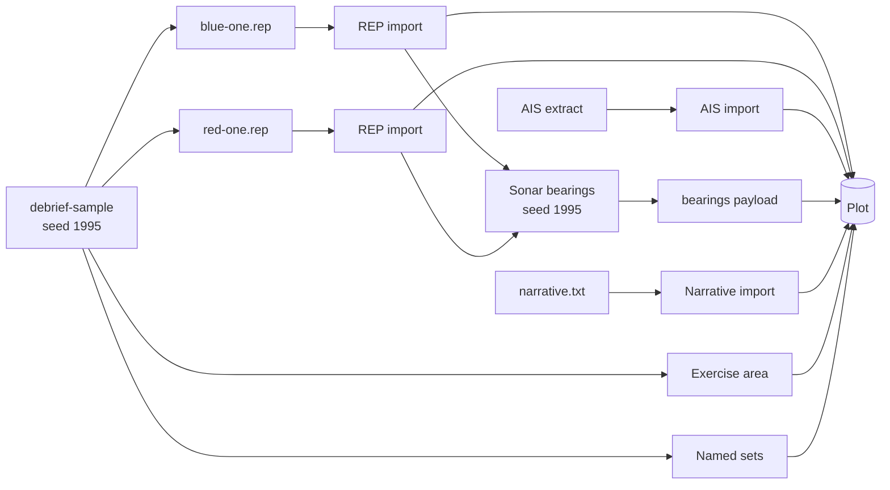

# Sample data

The sample data is a small exercise for demonstrations, walkthroughs and blog posts (DEP-08). It replaces the 1995 single-serial sample. Real, open AIS traffic gives the background picture; on top of it sits an invented exercise: a blue ownship, a red submarine, the ownship's sonar bearings and a scripted narrative, over three serials.

Everything except the AIS is fiction. Use only this data in blog posts and interactive examples (DEV-05, DEV-06).

## Building it

```bash
uv run python -m debrief_sample build sample
```

This creates a catalogue in the folder `sample`, with one plot per serial. The same seed, built with the same versions of Debrief's libraries, always gives the same files, byte for byte; `--seed` gives a different exercise over the same AIS traffic.

## What is in it

The exercise lies in open water east of the entrance to Chesapeake Bay, on 15 Jun 2023. The area was chosen because open AIS covers it, not for any naval use. It is on the continental shelf, mostly 10 to 35 m deep, so RED ONE's depths are notional.

| Serial | Time | Story |
| --- | --- | --- |
| 1 | 08:00Z to 12:00Z | BLUE ONE gains RED ONE, classifies it and follows it south-west, losing and regaining it. |
| 2 | 12:00Z to 17:00Z | RED ONE heads west for the shipping lane; BLUE ONE zigzags astern of it to resolve range. |
| 3 | 17:00Z to 23:00Z | BLUE ONE sprints and drifts; RED ONE evades, and is not regained after the first sprint. |

Each plot holds:

- **Background traffic.** 8 to 10 AIS tracks: merchant ships under way and at anchor, a tug, yachts and pleasure craft. Each is named by its type and a number, such as "Cargo 03", never by its real name.
- **BLUE ONE and RED ONE.** One fix a minute. RED ONE's tracks carry depth. Both were written as REP files and imported, so they are sources like any analyst's.
- **Sonar bearings.** BLUE ONE's bow sonar on RED ONE every 30 seconds, with a 1.5° error. The sonar can hold RED ONE only within 4.5 nmi, outside its baffles astern and while not sprinting, and within those limits contact comes and goes, so each serial has gaps. Between 177 and 349 bearings per serial, held as one set of sensor observations (CON-02).
- **Narrative.** About 35 entries per serial, in Zulu time, from BLUE ONE, RED ONE and exercise control (EXCON): intentions, alterations of course, first contact and its classification, contacts lost and regained, bearing reports with their drift, and closest approaches. Each entry has a kind (Course, Sonar, CPA, Log, Intention, Weather). The log is kept as a supporting file, and each entry is also a narrative entry in the plot, BLUE ONE's and RED ONE's belonging to their tracks, read in the Timeline (CAP-20).
- **The exercise area**, as a shape, and two named sets: *Exercise* and *Background traffic*.

## Its history, as a worked example

Every plot records how it was made (SUB-18). Its history names each source with its content hash (SUB-11), and each tool with its version (SUB-24). The steps that use randomness record their seed and how each random generator is derived from it (SUB-20), and the synthesis records a digest of the serial's script, so a replay can tell whether it runs the same script.



To see the history of a serial, open its `plot.geojson` and read `provenance`. Each source sits in the plot's `sources` folder, read-only; checking the sources reports nothing when none has changed.

## The AIS data

The background traffic comes from the US national AIS archive, published by NOAA's Office for Coastal Management on MarineCadastre.gov from the US Coast Guard's receiver network. It is a US Government work, in the public domain in the United States. One day was reduced to a small area, the serial windows and 16 vessels, thinned to one fix a minute, with military, law-enforcement, pilot and search-and-rescue vessels left out. Every identifier was removed. The reduction and the licence are described beside the extract, in `python/debrief-sample/data/README.md`.

## For walkthroughs

Debrief's walkthroughs (CAP-25) never change the sample: each works on a copy of serial 1, titled after it, made by `debrief_sample.walkthrough`. VS Code builds a fresh sample for each walkthrough into a catalogue of its own, `python -m debrief_sample walkthrough FOLDER TOUR`; the playground copies the sample as the site shipped it. *Tidy a track*'s copy has three GPS glitches in RED ONE, as a step of their own; *Import and collate*'s comes with BLUE ONE's navigation log, a REP file of fiction like the rest. The walkthroughs' pictures are drawn from serial 1 by `python -m debrief_sample media vscode/media/walkthroughs`. See [Walkthroughs](interaction-models/walkthroughs.md).

## Not yet in it

- **Ambiguous bearings** from a towed array (CAP-22): the sonar is a bow sonar, so its bearings are not ambiguous.
- **A narrative as an analyst would import it**, from Word or PDF (CAP-19): the log is plain text, and it is a supporting file rather than a source, because the builder wrote it.
- **Labels on fixes**: REP labels are not yet imported.
