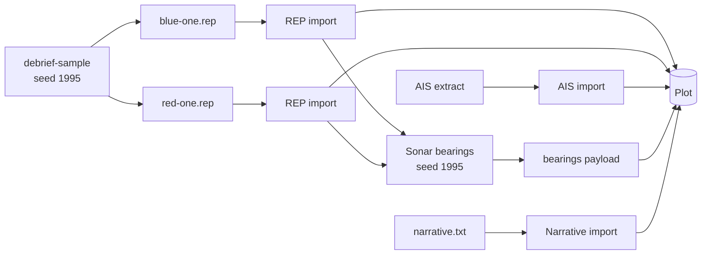

# Sample data

The sample data is a small exercise for demonstrations, walkthroughs and blog posts (DEP-08). It replaces the 1995 single-serial sample. Real, open AIS traffic gives the background picture; on top of it sits an invented exercise: a blue ownship, a red submarine, the ownship's sonar bearings and a scripted narrative, over three serials.

Everything except the AIS is fiction. Use only this data in blog posts and interactive examples (DEV-05, DEV-06).

## Building it

```bash
uv run python -m debrief_sample build sample
```

This creates a catalogue in the folder `sample`, with one plot per serial. The same seed always gives the same files, byte for byte; `--seed` gives a different exercise over the same AIS traffic.

## What is in it

The exercise lies in open water east of the entrance to Chesapeake Bay, on 15 Jun 2023.

| Serial | Time | Story |
| --- | --- | --- |
| 1 | 08:00Z to 12:00Z | BLUE ONE searches, gains RED ONE and holds it as it heads south-west. |
| 2 | 12:00Z to 17:00Z | RED ONE heads west for the shipping lane; BLUE ONE changes legs to resolve range. |
| 3 | 17:00Z to 23:00Z | BLUE ONE sprints and drifts, losing contact while sprinting; RED ONE evades. |

Each plot holds:

- **Background traffic.** 8 to 10 AIS tracks: merchant ships under way and at anchor, a tug, yachts and pleasure craft. Each is named by its type and a number, such as "Cargo 03", never by its real name.
- **BLUE ONE and RED ONE.** One fix a minute. RED ONE's tracks carry depth. Both were written as REP files and imported, so they are sources like any analyst's.
- **Sonar bearings.** BLUE ONE's bow sonar on RED ONE every 30 seconds, while within 8 nmi and not sprinting, with a 1.5° error. Several hundred per serial, held as one set of sensor observations (CON-02).
- **Narrative.** About 30 entries per serial, in Zulu time, from BLUE ONE, RED ONE and exercise control (EXCON): intentions, alterations of course, contacts gained and lost, bearing reports and closest approaches. The log is kept as a supporting file, and each entry is also a note at its time.
- **The exercise area**, as a shape, and two named sets: *Exercise* and *Background traffic*.

## Its history, as a worked example

Every plot records how it was made (SUB-18). Its history names each source with its content hash (SUB-11), and each tool with its version (SUB-24). The steps that use randomness record their seed (SUB-20).



To see the history of a serial, open its `plot.geojson` and read `provenance`. Each source sits in the plot's `sources` folder, read-only; checking the sources reports nothing when none has changed.

## The AIS data

The background traffic comes from the US national AIS archive, published by NOAA's Office for Coastal Management on MarineCadastre.gov from the US Coast Guard's receiver network. It is a US Government work, in the public domain in the United States. One day was reduced to a small area, the serial windows and 16 vessels, thinned to one fix a minute, with military, law-enforcement, pilot and search-and-rescue vessels left out. Every identifier was removed. The reduction and the licence are described beside the extract, in `python/debrief-sample/data/README.md`.

## Not yet in it

- **Ambiguous bearings** from a towed array (CAP-22): the sonar is a bow sonar, so its bearings are not ambiguous.
- **A narrative as an analyst would import it**, from Word or PDF (CAP-19): the log is plain text, and it is a supporting file rather than a source, because the builder wrote it.
- **Labels on fixes**: REP labels are not yet imported.
